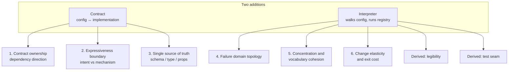
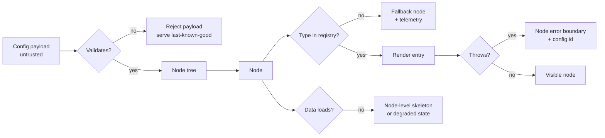
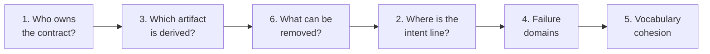

# Architectural Concerns of a Config-Driven Frontend

**Research note**
Status: analysis complete, no implementation started
Scope: the structural tensions the pattern creates, independent of team or tooling
Last updated: 2026-11-01

Companion docs:

- [config-driven-frontend-architecture.md](config-driven-frontend-architecture.md) — what the pattern is, case studies, operational failure modes.
- [react-typescript-patterns.md](react-typescript-patterns.md) — how it is implemented in React and TypeScript.
- [state-management.md](state-management.md) — where runtime state lives, and how RTK Query fits.

This note covers a different layer: the decisions that constrain every later feature
and cannot be fixed inside a feature PR.

---

## 1. The framing

Config-driven architecture adds exactly two things to a codebase:

1. a **contract** between configuration and implementation;
2. an **interpreter** that walks the configuration and runs the implementation.

Everything structural follows from those two additions. That is useful, because it
turns an open-ended risk list into six decisions you can actually take and record.

A concern belongs on this list when it meets all three tests:

- resolving it constrains many features, not one;
- getting it wrong cannot be repaired locally;
- it reappears, in a new shape, in every subsequent feature.

Governance and funding matter, but they are consequences. If the contract has no
owner, no amount of process fixes the coupling.

---

## 2. Concern 1 — Contract ownership and dependency direction

**The question:** does the client conform to the config, or does the config conform
to the client?

A contract has a direction. Pick one:

| Model | Who owns the schema | Who conforms | Cost |
|---|---|---|---|
| **Server-owned** | Backend publishes schema and version | Every client must handle unknown input | Compatibility logic lives in the client cache |
| **Client-owned** | Client publishes a typed union | Backend may only emit that union | Server cannot innovate without a client release |

Both work. Having both at once does not. Mixed ownership produces a contract that
changes from two ends, and compatibility stops being specifiable: the server adds a
field the client rejects, the client requires a field the server has not shipped.

Server-owned is the mobile case. Client-owned is the single-web-client case. The
distinction is not stylistic: it decides whether versioning is solvable.

**The decision to record:** who may add a primitive, who may remove one, and which
side carries the compatibility burden.

**Wrong answer looks like:** a client-side registry that quietly accepts new types
*and* a server that sends them without a version, so neither side knows what "old
client" means.

**Signal it is going wrong:** the first time you cannot answer "will this config work
on the version our users have?" without reading code.

---

## 3. Concern 2 — Expressiveness boundary

**The question:** which kind of knowledge is being serialised — intent or mechanism?

Config should carry intent. It should not carry mechanics.

| Intent (config's job) | Mechanism (code's job) |
|---|---|
| "Promo block above the fold" | "flex row, gap 16, order 2" |
| "This field is required" | "validate on blur with this regex" |
| "Show this section to editors" | "compare this rule string against the user object" |
| "Content is a card with an image" | "apply these CSS classes and this DOM order" |

The boundary is crossed gradually, one convenient escape hatch at a time. Each
crossing is individually reasonable. Together they turn the contract into a worse
programming language without a type checker, an editor, a debugger or a review
culture.

**The test:** can a config author express something the product designers never
intended? If yes, the boundary is too wide.

Second test: does config need to know how a primitive is implemented in order to use
it? If yes, the primitive is leaking mechanism upward.

**Resolution:** keep the config vocabulary at the level of user-visible meaning.
Everything below that line stays in the registry entry, where it is typed, tested and
reviewed.

---

## 4. Concern 3 — Single source of truth

**The question:** which artifact is derived from which?

Config-driven systems carry three descriptions of the same thing:

1. the runtime schema that validates the payload;
2. the TypeScript type the code is written against;
3. the component's props.

Hand-maintaining all three guarantees drift. Drift is silent, because the compiler
never sees the config payload: the type says `title`, the server sends `heading`, and
nothing complains until a blank region appears in production.

This is architectural, not a testing gap. Once three copies exist, no test suite
closes the hole; tests can only catch the drifts you anticipated. Only derivation
does:

- schema → type (`z.infer`, `FromSchema`),
- type → schema (generated at build),
- component props → schema (introspection, rarely worth it).

**The decision to record:** the single direction of derivation, and the build step
that enforces it.

**Signal it is going wrong:** a pull request that changes two of the three artifacts
and not the third.

---

## 5. Concern 4 — Failure domain topology

**The question:** where along the path does a fault stop propagating?

Not error handling. Structure. The pattern turns a config file into executable input,
so a defect can originate at any hop:

If the answer to "where does it stop?" is "the page", the architecture has exactly
one failure domain, and every new primitive increases the blast radius. A node-level
boundary plus a fallback for unknown types turns a total outage into a degraded
region.

The deeper architectural point: **degradation has to be authored.** A system designed
only for success has no defined behaviour when part of the config is unavailable.
Retrofitting failure domains after launch means revisiting every primitive.

**The decision to record:** the failure domains (node, section, page, session) and
what a degraded domain looks like to the user.

**Signal it is going wrong:** a stale tab renders a blank screen instead of the last
known good layout.

---

## 6. Concern 5 — Complexity concentration and vocabulary cohesion

**The question:** is the interpreter small, and is its vocabulary orthogonal?

The abstraction does not remove complexity. It relocates it into one component: the
interpreter. That concentration is the deal you are making, and it is acceptable only
if two conditions hold.

**Condition one — small interface.** The interpreter takes config and services, and
returns UI. If its interface grows a parameter per feature, the concentration became a
bottleneck instead of a service.

**Condition two — orthogonal vocabulary.** The registry is the system's vocabulary.
Non-orthogonal primitives multiply behaviour nobody wrote: a node type that can be a
container and a form control and a data source produces n × m interactions, and every
combination needs its own test.

Both conditions have one measurable proxy:

> Does adding a primitive touch only the registry?

If adding a primitive also requires editing the renderer, the dispatcher and two other
primitives, the vocabulary is leaking into the mechanism, and the cost per feature now
grows with the number of features instead of staying flat.

**The decision to record:** what qualifies as a primitive, and what the minimum
addition touches.

---

## 7. Concern 6 — Change elasticity and exit cost

**The question:** which changes is this optimised for, and can it be removed?

Every architecture trades one kind of change against another. This one makes
**arrangement** cheap and **semantics** expensive.

| Change | Cost |
|---|---|
| Reorder, add, remove sections | Free, config only |
| New field, new block from existing primitives | Free, config only |
| New primitive | One registry entry, plus contract revision |
| Change what a primitive means | Contract change, breaks stored config |
| Change the schema shape | Breaking, migration required |
| Change to a bespoke interaction | Escape hatch, or engine change |

Arrangement is what you need early. Semantics is what you need later. That is the
real bet, and it should be stated before adoption rather than discovered during the
third refactor.

The second half is exit cost. An architecture with no removal seam is a one-way door:
every screen depends on the contract, so leaving it means rewriting the screens, not
the engine.

**The decision to record:** the surface that stays swappable, and what config could be
deleted without touching the rest. One narrow surface plus a working escape hatch
keeps the door open at almost no cost.

**Signal it is going wrong:** the first feature that cannot use config *and* cannot
use the escape hatch. That is the moment the architecture became mandatory without
becoming sufficient.

---

## 8. Two derived concerns

Both come from the interpreter, and both are structural rather than tooling.

### 8.1 Legibility

In a generic renderer, cause and symptom are far apart. A stack trace ends in the
renderer, not in the thing that caused the fault.

Provenance is therefore part of the design: which config, which version, which node.
If those three identifiers are not available at the failure point, debugging degrades
into reproducing the payload by hand. Adding them later means touching every error
path; adding them at the start costs a field.

### 8.2 Test seam

The architecture must expose a unit that can be tested without mounting a page:
a registry entry, a contract parser, a node in isolation.

If the only seam is end-to-end, the design is untestable by construction, because the
number of meaningful combinations grows with the vocabulary. The seam is a structural
property: it comes from keeping the renderer separate from the primitives and from
parsing props inside the entry that owns them.

---

## 9. How the concerns interact

They are not independent. The two cheap ones are constrained by the two expensive
ones.

- Ownership (1) and derivation (3) set the contract. A change to either is felt in
  every stored config.
- Expressiveness (2) decides how large the contract grows. Every widening makes
  ownership harder and drift more likely.
- Concentration (5) decides how expensive semantics become over time, which is the
  cost side of elasticity (6).
- Failure domains (4) are cheap early and expensive later, because retrofitting a
  degraded state revisits every primitive.

Order of decisions, from hardest to reverse:

Concerns 1, 3 and 6 are one-way doors. Once screens depend on a contract, changing
its owner, its derivation or its removal story is a migration, not a refactor.

Concern 2 is cheap early and expensive late: widening is easy, narrowing breaks
stored config.

---

## 10. What this list is not

- Not the operational failure modes. Those are in
  [config-driven-frontend-architecture.md](config-driven-frontend-architecture.md) §8: the
  god protocol, debugging collapse, security, accessibility, testing combinatorics.
- Not the state design. That is in [state-management.md](state-management.md): which
  layer owns config, server data, form values and per-node UI state.
- Not a quality-attribute analysis. A formal exercise (scenarios, tactics, tradeoff
  points, sensitivity points) would produce different artifacts and would require the
  product's quality goals as input.

---

## 11. Open questions for this repository

1. Is the contract server-owned or client-owned? One of them, in writing.
2. Which single artifact derives the others, and what build step enforces it?
3. What is the intent line for this engine: which words may appear in config, and
   which are forbidden?
4. What are the failure domains, and what does a degraded node look like?
5. What is the minimum diff for a new primitive?
6. If the experiment fails, which parts can be deleted without rewriting screens?

---

## 12. Sources

These six concerns are a structural reading of the case studies and documentation
already cited in the companion docs, in particular:

- Airbnb Ghost: shared schema across clients, section/screen split.
- Lyft: declarative primitives plus semantic components as the escape hatch.
- Shopify Remote DOM: host-owned components, remote tree, sandbox boundary.
- Storyblok and Builder.io: block registries and editor-driven `inputs`.
- Refine: resource config with replaceable providers.
- RTK Query: cache-key semantics and the absence of a normalized cache.
- React documentation on context, and its warning that context has no selector.

### Caveats

- The ranking reflects structural leverage, not measured defect data. Treat it as an
  argument to test, not a finding.
- "One-way door" is a judgement about cost of reversal, not an absolute.
