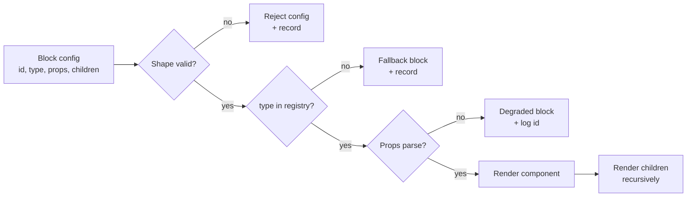
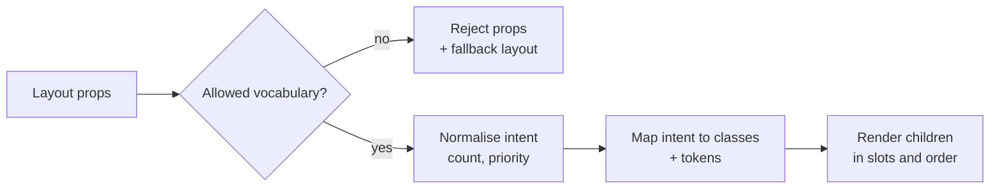
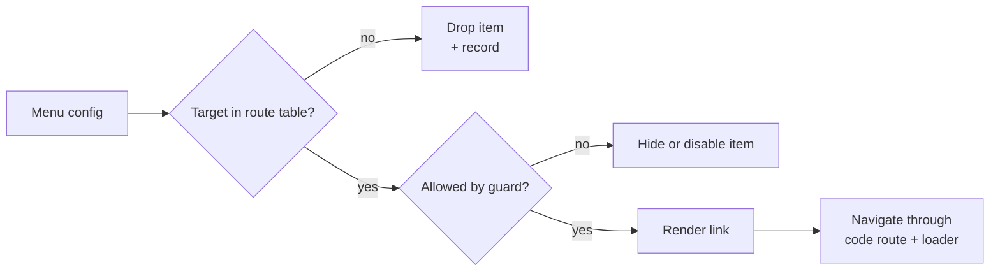
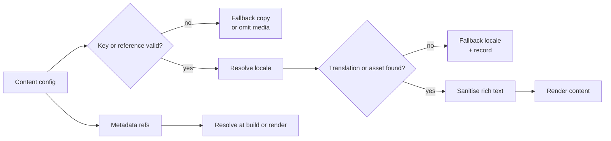
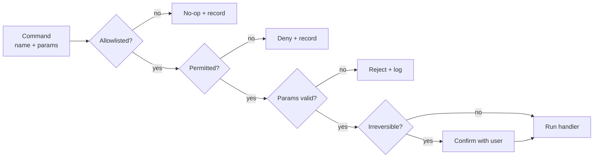
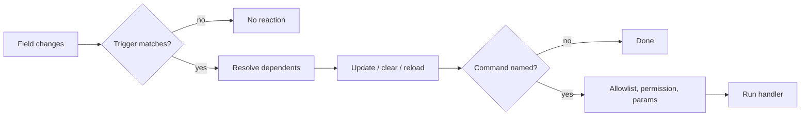
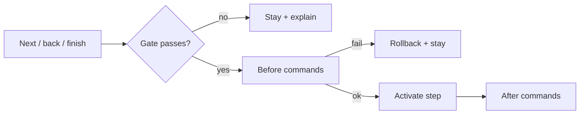
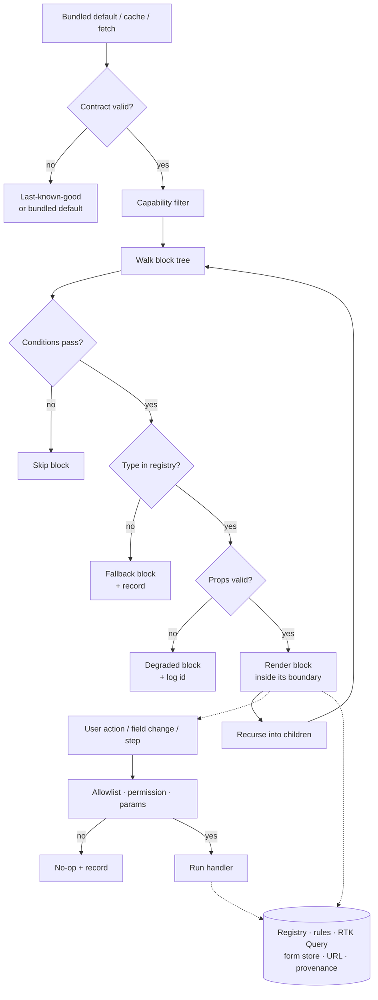
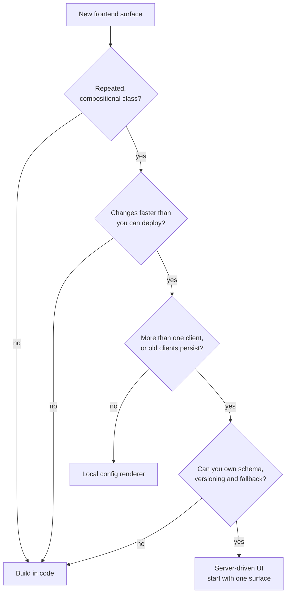

# Config-Driven Frontend Architecture

**Research report**
Status: research synthesis complete; project decision pending
Scope: frontend architecture, with emphasis on config-driven and server-driven UI
Last updated: 2026-11-03

**How to use this report.** This is a tradeoff guide, not a required feature list or
implementation blueprint. Choose one concern, author, and delivery mode before using
the implementation guidance. The repository's config-driven-architecture README still
has no chosen goal, constraints, or domain, so this report does not recommend adopting
the pattern for a specific product surface yet.

---

## 1. Overview

**Target.** Config-driven architecture moves structure or behaviour out of hand-written code and into data that a generic engine interprets. In the frontend that data can describe a form, a page, a navigation shell, a design system, a rollout rule or an entire screen. The most discussed form is **server-driven UI (SDUI)**: the backend sends layout, data and actions; the client renders them from a registry of components.

**Benefits.** It buys speed and reach:

- change the product without shipping a client build;
- keep web, iOS and Android in parity;
- support many tenants, markets or plans from one codebase;
- run experiments and roll back server-side;
- let non-engineers author parts of the product.

**Challenges.** You stop building screens and start building a platform: schema, registry, renderer, expression language, validation, versioning, capability negotiation, fallbacks, tooling, observability, security and governance. Thoughtworks moved SDUI back to the **Trial** ring in April 2026: the investment is justified for large-scale applications, but only with a strong business case and disciplined engineering, applied to highly dynamic areas rather than as a blanket replacement. They also warn about the "god-protocol" failure mode and recall "horrendous, overly configurable messes" from earlier experiments.

**Costs.** The abstraction relocates complexity rather than removing it. Delivery shifts from screens to the platform; generic primitives flatten bespoke UX; cause and symptom separate, so debugging and testing get harder; compatibility becomes permanent work; and the system drifts toward a worse programming language with no IDE, debugger or tests.

**Verdict.** Strong fit for repeated, high-churn, multi-client, compositional surfaces. Poor fit for unique, highly interactive, design-differentiated UI, or for a single web client that can already deploy several times a day.

---

## 2. Config-driven in the frontend

In the frontend, config is any data that decides what renders or how it behaves. The
architecture label matters far less than the question it hides: **which part of the
frontend am I handing to data?**

That question has a finite, nameable set of answers. The concerns below are the ones
that recur. Everything else is a bundle of them.

### 2.1 Structure and content

| Concern | Config decides | Code decides |
|---|---|---|
| **Composition** (page structure) | What appears on the page, in what order, and what sits inside what | The insides of each block; which children it accepts |
| **Layout intent** (arrangement) | How a group of blocks is arranged: row or column, how many, which comes first | CSS values and breakpoints |
| **Navigation** (menu) | The menu labels, grouping and destinations | Route matching, guards, code splitting |
| **Content** | Which text, images and media appear | Markup, sanitising, rendering |
| **Localisation** (language) | Which language and regional format (dates, numbers) | Translations, plural rules, formatters |
| **SEO and metadata** | The page title, description and link preview | Rendering strategy and SSR |

Config chooses order and nesting; each block declares what it accepts. Config points
at content by key; the translation layer resolves it.

### 2.2 Data, behaviour and rules

| Concern | Config decides | Code decides |
|---|---|---|
| **Data binding** (which record) | Which record a block shows, e.g. campaign `q3-launch` | How the request is built and sent |
| **Freshness** (data age) | How long a record may stay cached before it refreshes | Cache implementation |
| **User actions** (clicks and submits) | Which named command a click, submit or menu choice runs, with what parameters | The command handler, its side effects and permission check |
| **Field reactions** (knock-on behaviour) | What reacts when a field changes: which fields update, clear or reload, and which named command fires | Dependency graph, evaluation order, cycle detection, command handlers |
| **Conditions** (visibility) | When a block or field is shown or enabled; whether a field must be filled in | Rule evaluation; no expression strings |
| **Step reactions** (step lifecycle) | What reacts when a step is entered, left or completed: which step comes next, what branches, what must be true to continue, and which named command fires | Transition machine, ordering, guard and validation execution, state persistence |
| **Validation** (accepted values) | Which values are accepted, including rules across fields | Validator implementations, async and custom checks |
| **Permissions** (who may do what) | Who may see or do what | Enforcement, including the server check |
| **Rollout** (who sees which version) | Which version or experiment each visitor gets | Flag evaluation and the provider |

**Not config:** live UI state — open panels, current tab, selection and unsaved drafts.
Config may declare an initial value; the component, URL or form store owns it
afterwards.

### 2.3 Presentation

| Concern | Config decides | Code decides |
|---|---|---|
| **Theming** (whole-page look) | Which brand and visual density apply to the page | Token values and CSS architecture |
| **Block variants** (per-block look) | Which preset style a block uses, e.g. primary, compact, quiet | The styles and markup behind each preset |

Theming sets the page-wide baseline; block variants choose within it. Neither carries
CSS values. Design tokens are the odd one out: they are generated at build time, so
config selects names and overrides, never values. Scaffolding and generators
(Backstage templates) apply the same concerns to a workflow instead of a screen.

**Not config:** failure policy — each block type declares its fallback in the registry,
so every instance degrades the same way.

Two dimensions cross every row. **Author trust** sets how strict the boundary must be:
engineer-authored local config can be permissive; content, tenant or third-party authors
need allowlists, sandboxing and server checks. **Delivery** sets caching and versioning:
build-time, local renderer or fetched per request (see §9.5).

### 2.4 The test for handing a concern over

A concern belongs in config only when both gates pass.

**Gate A — can it be expressed safely?**

1. it has a **closed vocabulary** you can enumerate, not arbitrary expressions;
2. it can be **validated without rendering**, from a schema.

**Gate B — should it be expressed?**

3. it does not need to **know another concern's internals** — layout must not know
   validation;
4. it has an **independent owner and change rate** — content, backend, design.

Failing a gate does not make a concern inexpressible. It moves the cost: the payload
cannot be validated from a schema (Gate A), or no single owner can change it safely and
it cannot be versioned independently (Gate B). Seven recur in practice, and all belong
in code:

- **CSS values.** When someone wants `color: "#fff"` or `padding: 16px` in the payload,
  both gates fail: the vocabulary is unbounded, and the owner is the design system, not
  the author. Config carries a token name or a block variant; the token pipeline turns
  it into values.
- **Arbitrary expressions.** `"visibleWhen": "user.plan === 'pro'"` means evaluating a
  string, so you own a parser, an interpreter and an injection surface. Use a data
  format with fixed semantics — a JSON Schema fragment, or JsonLogic.
- **DOM structure.** Letting config nest anything inside anything produces invalid
  markup: a `div` inside a `p`, a button inside a button. Containment belongs to the
  block type, so its registry entry enforces it, not the author.
- **State.** "Remember this and restore it on reload" turns the payload into a store
  with no transitions, no cleanup and no owner. Config decides what is shown; the
  engine, the URL and the form layer decide what is kept.
- **Routes.** The route table drives code splitting, guards and deep links, so it is
  build-time code. Fetched at runtime, every navigation waits on config and one bad
  payload 404s the app. Config may describe the menu; the table stays in code.
- **Command implementations.** Config may name a command
  (`{ "type": "refund", "params": { "id": "o_9" } }`), never define one. The client
  checks that it exists, is permitted, has valid parameters and needs confirmation
  before it runs.
- **Failure policy.** A fallback belongs to the block type, not the payload. Every
  instance must degrade the same way, and a config author cannot invent a fallback
  nobody designed.

One further consequence: **one concern, one schema, one version.** Split only where
the owner or change rate differs; concerns that change together can share a schema.
Bundling everything produces the god protocol, where nothing can be deprecated
independently. Splitting every row is its own overhead.

**Practical rule:** name the concern and its owner, not the label. "Server-driven UI"
names a delivery mechanism; "composition, backend-authored, per request" names a
decision.

### 2.5 These are different systems, not maturity levels

The label covers approaches with very different runtime and ownership costs. They are
not steps on a ladder; use the narrowest one that answers the product need.

| Approach | Typical author and change | Main added responsibility |
|---|---|---|
| Build-time or local config | Product engineers; changes ship with the app | Schema and renderer, if structure is configurable |
| CMS content | Editors; publish independently | Authoring preview, publishing workflow, content validation |
| Remote flags/config | Product or operations; runtime targeting | Defaults, targeting rules, expiry, consistent evaluation |
| Server-driven UI | Backend; runtime screen composition or behavior | Client compatibility, fallback, cache, observability |
| Remote rendering | Third party; runtime extension | Isolation, host API, and message protocol |

These choices can overlap. A CMS can deliver localizable content through a block
registry; an SDUI payload can use feature flags. Decide separately what config controls,
who authors it, and when/how clients receive it.

---

## 3. Structure and content

This group decides what appears and where. It is the part of the architecture users
see directly: a mistake here is a broken screen, not a wrong value.

### 3.1 Composition

**Template config**

```json
{
  "id": "page",
  "type": "Page",
  "props": {},
  "children": [
    {
      "id": "hero",
      "type": "Hero",
      "props": { "heading": "Spring sale", "image": "cdn/hero.jpg" }
    },
    {
      "id": "pulse",
      "type": "Section",
      "props": { "title": "Campaign pulse" },
      "children": [
        { "id": "refresh", "type": "ActionButton", "props": { "label": "Refresh" } }
      ]
    }
  ]
}
```

**Configurable.** Block `id`, `type`, `props`, `children`, and their order. A block is
one configured node; a primitive is one registered block type. Allowed children and prop
schemas stay in the block type.

**Flow**



The check is small: validate the tree shape, look up the type, parse its props, render
it, then recurse. Keys come from `id`, never the array index. Each child renders as its
own component, so the hook count per component stays constant.

**Breaks.** An unknown type blanks the page unless a fallback exists. Index keys destroy
focus, selection and uncommitted input when the server reorders. Spreading raw props onto
DOM nodes lets config set arbitrary attributes.

**Evidence.** Airbnb splits context-free `sections` from layout-owning `screens`, and
renders the same section differently per `SectionComponentType`. Swiggy's Dynamic Widget
keeps a small block set: text, image, video, layout, stack, box.

**Record.** The block set is closed, every block has an `id`, and unknown types degrade
instead of throwing.

### 3.2 Layout intent

**Template config**

```json
{
  "id": "kpis",
  "type": "Columns",
  "props": {
    "count": 2,
    "align": "start",
    "priority": ["conversion", "orders"]
  },
  "children": [
    { "id": "conversion", "type": "Stat", "props": { "label": "Conversion", "value": 4.2 } },
    { "id": "orders", "type": "Stat", "props": { "label": "Orders", "value": 1284 } }
  ]
}
```

**Configurable.** Placement words only: column count, grouping, alignment and priority.
Values are enumerated or bounded. CSS values, breakpoints and token values stay in the
block type and token pipeline.

**Flow**



Layout renderers stay separate from content renderers: one walks the tree, the other
draws a leaf. A layout block arranges the children it was given; all CSS stays inside
block types, and values come from tokens (§5.1).

**Breaks.** The first `padding: 16` in a payload starts an inner platform; the second
starts a design-system fork. Once layout and content are one block type, neither can
change without the other.

**Evidence.** Airbnb separates layout from section type (`ILayout`). JSON Forms keeps
layouts (`VerticalLayout`, `Group`) distinct from controls.

**Record.** The layout vocabulary contains placement words only. Any value that a
designer would change per brand belongs in tokens.

### 3.3 Navigation

**Template config**

```json
{
  "id": "main-menu",
  "items": [
    { "id": "overview", "label": "Overview", "to": "/overview" },
    {
      "id": "settings",
      "label": "Settings",
      "to": "/settings",
      "children": [
        { "id": "members", "label": "Members", "to": "/settings/members" }
      ]
    }
  ]
}
```

**Configurable.** Menu labels, grouping, order and targets. The menu is data; the route
table is not.

**Flow**



Navigation renders from data. The route table stays in code as router objects with
loaders and guards (React Router) or a generated typed tree (TanStack Router). The menu
can only point at routes the client already knows.

**Breaks.** A runtime route tree breaks code splitting, deep links and guards: every
navigation waits on config, and one bad payload 404s the app. A menu target that is not
in the route table dead-ends.

**Evidence.** React Router's route objects carry `loader`, `action`, `lazy` and
`handle`.

**Record.** Routes are build-time code. Config may describe the menu; it never owns
matching or guards. Step progression is not navigation; it belongs to step reactions
(§4.5).

### 3.4 Content, localisation and metadata

**Template config**

```json
{
  "content": {
    "hero.heading": { "key": "campaign.hero.heading", "params": { "season": "spring" } },
    "hero.image": { "ref": "cdn/hero.jpg", "altKey": "campaign.hero.alt" }
  },
  "metadata": {
    "titleKey": "campaign.meta.title",
    "descriptionKey": "campaign.meta.description",
    "canonical": "/campaigns/spring"
  }
}
```

Illustrative: content, translations and metadata are separate schemas. The example shows
their shape together.

**Configurable.** Message keys and parameters, media references, rich-text block ids and
page metadata references. Product UI text should usually use translation keys. CMS-owned
editorial content may carry localized copy when its authoring and publishing workflow
supports it. Raw HTML stays outside config.

**Flow**



A CMS block registry maps names to components (`storyblokInit({ components })`,
`Builder.registerComponent(Name, { inputs })`) and renders nested blocks recursively.
Translation happens at render time from keys. Metadata renders on the server or at
build.

**Breaks.** Block registries drift into design drift: authors combine block types in
ways the design system never intended. Product UI literals can bypass translation;
CMS-authored copy instead needs a localization and publishing workflow.
Preview-only fields leak into production payloads. Rich text is the one place where
config can carry markup, so it needs sanitisation.

**Evidence.** Storyblok and Builder.io are production block registries. RJSF and JSON
Forms generate form labels from schemas.

**Record.** Use translation keys for product UI; allow localized CMS copy only under an
explicit content workflow. Never accept raw HTML without a separately designed,
sanitized rich-text contract.

---

## 4. Data, behaviour and rules

This group decides what a block reads, what it does, and under which rules. It is where
most of the runtime risk lives, because config now reaches beyond rendering.

### 4.1 Data binding and freshness

**Carries.** Which record a block reads: kind, id and locale. Plus how fresh the surface
must be.

**Builds.** The query lives in the leaf component, keyed by its own argument. RTK Query
deduplicates by endpoint plus serialised argument, so two blocks asking for the same
entity share one request and one cache entry. `skipToken` handles blocks with no source;
`selectFromResult` keeps re-renders narrow. The argument is normalised to primitives
for its cache key before it reaches the hook.

**Breaks.** Passing the whole block couples the cache key to unrelated props and can
create distinct entries when those values change. A fresh object with the same
serializable contents does not, by itself, create a new RTK Query key. `42` versus `'42'`
does create distinct keys. Config-driven trees also invite request waterfalls: a screen
with forty blocks can fire forty queries.

**Evidence.** RTK Query documents the exact key and refcount behaviour. It also
documents the deliberate absence of a normalised cache, which is why one entity can
appear under two endpoints.

**Record.** Keep query arguments focused on normalized primitive fields, not the entire
node. Config freshness and data freshness are separate settings.

### 4.2 User actions

**Carries.** A user-initiated command: a click, a submit or a menu choice, with its
parameters. Value changes and step changes are reactions, not user actions.

**Builds.** One dispatcher, one handler map. The check runs in a fixed order: is the
command allowlisted, is it permitted, are the parameters valid, is it irreversible. Then
the handler runs.



**Breaks.** Config that defines behaviour instead of naming it becomes executable
input: `href: "javascript:..."`, an expression string, or a module path resolved at
runtime. Unknown commands that throw turn a stale config into a crashed screen. Retrying
a mutating command can duplicate its side effect unless the handler is idempotent.

**Evidence.** Lyft's main finding was that decoupling actions from components paid off:
the same layout triggers different actions in different contexts, and actions chain.

**Record.** Config names a command; the client checks existence, permission, parameters
and reversibility; the server validates and authorizes every protected operation. Define
retry and duplicate-submit behavior for each mutating command. Unknown commands are
no-ops with a record.

### 4.3 Field reactions

**Carries.** Two effects of a field change: reactions on other fields, and an
after-effect. A reaction says which dependent fields update, clear, reload or revalidate.
An after-effect names a command. Neither is code.

**Builds.** The engine reads declared triggers, builds a dependency graph, and rejects
cycles when the config is validated. The check runs in order:

1. match the change against declared triggers;
2. resolve the affected fields;
3. apply updates in dependency order;
4. dispatch a named command through the user-action checks.

Only the dependents of the changed field recompute. A hidden or removed field stops
reacting.



**Breaks.** Two fields react to each other and loop. Reaction order changes the result.
A hidden field still writes to the payload. A command fires on every keystroke instead
of on settle. A late response overwrites the user's edit with stale options.

**Evidence.** RJSF exposes field `dependencies`; React Hook Form exposes `deps`. Both
declare the relationship rather than embedding a script.

**Record.** Reactions are data-only triggers. Config names fields and commands; the
engine owns evaluation order and cycle detection. No scripts.

### 4.4 Conditions

**Carries.** Visibility, enablement and required as data. A JSON Schema fragment is
enough for most cases; JsonLogic covers the rest.

**Builds.** One evaluator, one dependency graph, cycle detection at config validation
time, and recomputation of only the transitive dependents of a changed field.

**Breaks.** `"visibleWhen": "user.plan === 'pro'"` means evaluating strings, which means
owning a parser, an interpreter and an injection surface. A hidden required field that
stays in validation blocks submit with an error the user cannot see. Re-evaluating the
whole form on every change is the usual performance bug.

**Evidence.** JSON Forms implements rules such as `HIDE` and `SHOW` over schema
fragments, with no expression language.

**Record.** No arbitrary expressions. Hidden fields leave validation by default, but
whether their values are cleared, retained as drafts, or omitted from submission is an
explicit form policy. Do not silently submit hidden values.

### 4.5 Step reactions

**Carries.** Steps, their order, branches and gates, plus commands that run before or
after a step is entered, left or completed. Gates answer “can we continue?”; they do not
own value validation.

**Builds.** A transition machine. The check runs in order:

1. the user asks for next, back or finish;
2. evaluate the gate for the target step;
3. run before commands in declared order;
4. activate the target step;
5. run after commands;
6. on failure, stay on the current step or roll back.



**Breaks.** A skipped gate jumps a required step. A double submit runs the transition
twice. A before command fails after mutating data. An after command fails after the step
is visible. A refresh loses the active step. A branch points at a step that does not
exist.

**Evidence.** Backstage expresses ordered steps and actions, with `if`, `each`,
`always()` and `failure()` handled by the runner.

**Record.** Config names steps, transitions, gates and commands. Code owns the machine,
ordering, rollback and persisted step state.

### 4.6 Validation

**Carries.** Field rules and cross-field rules as data.

**Builds.** For bespoke layouts, a Zod schema with React Hook Form and per-field
subscription. For generated layouts, JSON Schema with AJV or the renderer's own
validator. Parse at the boundary, then trust the result.

**Breaks.** Validation duplicated between schema and JSX drifts. A hidden required field
still blocks submit with an error the user cannot see. Re-validating the whole form on
every change is the usual performance bug.

**Evidence.** RJSF and JSON Forms run the same schema on client and server.

**Record.** Prefer one derivation direction for each schema and its runtime check. Reuse
or generate a shared contract when client and server can support it; the server remains
authoritative, and the client reports validation errors for user experience.

### 4.7 Permissions

**Carries.** Policy rules: which action and subject are allowed, under which conditions.

**Builds.** CASL rules with `<Can>` for JSX and `useAbility` for logic. The ability is
rebuilt when the user or role changes.

**Breaks.** UI gating mistaken for security: hiding a button is not access control.
Policy rule explosion, where thousands of ad-hoc rules have no owner. A stale ability
after login or a role change.

**Evidence.** CASL is the established React rules-as-data library.

**Record.** The server enforces; the client gates. Every rule has an owner.

### 4.8 Rollout

**Carries.** Flag keys, targeting, percentages, and which config version a surface gets.

**Builds.** A provider at the root, typed hooks in components, in-app defaults, and a
test provider that returns each branch. Flags can gate a whole config version.

**Breaks.** Flag debt and dead branches. Hydration flicker when the client evaluates a
different value than the server. Flags used as entitlement checks.

**Evidence.** LaunchDarkly's React SDK provides typed variation hooks and streaming
updates; OpenFeature standardises the same shape with a test provider.

**Record.** Every flag has an owner and an expiry date. Defaults keep the app working
when the provider is unreachable.

---

## 5. Presentation and failure

This group decides how it looks and what happens when a block fails. Both are visible to
every user when done badly. Only the look is configured; the failure path is fixed by
the block type.

### 5.1 Theming and tokens

**Carries.** The page-wide baseline: token names, brand and density. Never values.

**Builds.** A token pipeline: Style Dictionary reads one dictionary and emits CSS
variables plus generated TypeScript types. Runtime theming becomes a variable swap on a
root element, not a React re-render.

**Breaks.** Token typos, which generated types prevent. Generated files drifting because
the build step is skipped. Tokens misused for behaviour (`if brand === 'x' do y`).

**Evidence.** Style Dictionary supports the Design Token Community Group format and
multiple output platforms.

**Record.** Tokens are build output. Config selects a brand or a density; the pipeline
supplies the values.

### 5.2 Block variants

**Carries.** A per-block preset: variant, size, tone, emphasis.

**Builds.** Closed enums per block type, validated in the entry's prop schema. The entry
maps intent to classes; config never sees a class name.

**Breaks.** Variant explosion: a `style` prop added "just for this one case" reopens the
CSS hole. Block variants that change semantics without changing markup lose accessibility.

**Evidence.** The widget registry in RJSF and the renderer sets in JSON Forms are the
same mechanism at the control level.

**Record.** Block variants are enumerated. No free-form style props cross the boundary.

### 5.3 Failure policy

**Carries.** Nothing. Config does not choose a fallback; the block type declares it, so
every instance degrades the same way.

**Builds.** A per-block error boundary, a designed fallback chain, a last-known-good
config cache, and a bundled default. The block id, config id and version are recorded at
the boundary so a failure can be traced. Set an age limit for cached config and define
what happens when that limit expires.

**Breaks.** One boundary around the whole tree turns a single bad block into a blank
page. A fallback nobody designed looks worse than an error. Letting config choose a
fallback per instance produces one-off degraded states nobody reviewed.

**Evidence.** Lyft and Airbnb both declare fallback chains and capability filters.
Firebase Remote Config ships in-app defaults for the same reason.

**Record.** The degraded appearance is decided per block type. Provenance is recorded at
the boundary; instrumentation belongs with debugging (§7.5), not here.

An error boundary catches render and lifecycle errors; it does not catch rejected
requests, event-handler exceptions, or arbitrary asynchronous failures. Those need
handling in the data or command layer. Choose fallback behavior by failure scope:

| Failure | Typical scope | Decision to document |
|---|---|---|
| Invalid root contract | Whole document | Use last-known-good or bundled config; record rejection |
| Unknown type or invalid block props | One block | Render a designed fallback or omit the block |
| Missing block data | Data-owning block | Show loading, empty, retry, or error state |
| Render exception | One block | Catch at block boundary and report provenance |
| Command or network failure | Action/data layer | Explain failure; define retry and duplicate behavior |

These are defaults to decide, not universal fallback rules. A fallback is only safe when
it preserves the screen's meaning and does not hide a failed critical action.

---

## 6. The engine

Everything above needs the same machinery. This section is the shared parts, once.
Implementation detail lives here and nowhere else.

One load path, one render loop, one event path. Localize render failures where safe;
reject an invalid document to its fallback, and handle data and command failures in their
own layers.



### 6.1 Contract and versioning

The contract is the artefact the whole architecture rests on.

- **Discriminated union** per block type, not `Record<string, ComponentType<any>>`.
- **Parse at the boundary**, then trust the type. `payload as Block` moves the failure
  from the network edge into a random component.
- **One derivation direction** between schema and type: `z.infer`, or `FromSchema` with
  a schema written `as const`. Two hand-maintained definitions will drift.
- **Two versions**, kept separate: the contract version and the config document version.
  They change for different reasons.
- **Compatibility policy**: old clients exist. Define supported contract versions,
  unknown-field and unknown-type behavior, and how a breaking change is retired. A
  capability filter can help, but does not replace a compatibility matrix or fallback.

State ownership is the other half of the contract, and it has its own note:
[state-management.md](state-management.md).

### 6.2 Registry

A closed map from `type` to an entry. Each entry owns its props schema, so validation
sits next to the component that relies on it.

```tsx
const registry = {
  Hero: { parse: heroProps.parse, render: (p) => <Hero {...p} /> },
} satisfies Record<string, BlockEntry>
```

Production considerations beyond a minimal demo:

- unknown types return a fallback and record provenance;
- code-split and preload entries when bundle and latency budgets justify it;
- no dynamic import by an unvalidated string;
- removing a type is a breaking change, so it needs a deprecation window.

### 6.3 Renderer

Small and boring. It walks, looks up, renders, and catches.

- stable keys from `id`;
- one error boundary per block;
- children as separate components, so hook order is constant;
- memoization only when profiling shows a need; keys and stable props still matter;
- one place that maps `props` to the entry, so `{...block.props}` never reaches the DOM.

Comparing only `id` and config version can preserve stale props unless every relevant
config change updates that version. Treat it as an optimization to measure, not a
correctness requirement.

### 6.4 Dispatcher and evaluator

One dispatcher, one rule evaluator, both module-level.

- Commands are a union with an exhaustive `switch` and a `never` default;
- unknown commands log and return, they do not throw;
- the evaluator is data-only: schema fragments or JsonLogic, never `eval`;
- both are tested directly, without mounting a page.

### 6.5 State topology

| State | Owner |
|---|---|
| Config | server cache or static import, immutable per version |
| Server data | RTK Query cache, read in the leaf |
| Form values | store scoped to the form block |
| Local UI state | `useState` inside the component |
| Navigation and selection | URL |

The failure to avoid: config and form values in one store, so one keystroke re-renders
the tree. Details in [state-management.md](state-management.md).

---

## 7. Challenges

These are the recurring defects, not a risk register. Each has a symptom, a cause and a
mitigation that belongs in the architecture.

### 7.1 Drift and versioning

**Symptom.** A screen works in staging and is blank for a user on an older build.
**Cause.** The contract changed on the server; the client has no fallback.
**Mitigation.** Capability filter, fallback chains, a deprecation window measured in
months, and unknown-type telemetry. On the web, reload for a client update only with a
loop guard and a fallback path; a reload alone does not make incompatible config safe.

The deeper risk is the configuration complexity clock: hardcoded values give way to a
config file, then a schema, then a rules engine, then a DSL that is a worse programming
language with no IDE, no debugger and no tests. Hardcoding is sometimes the correct
answer, especially when deploy is fast.

### 7.2 Performance

**Symptom.** Slow first paint, janky interaction, layout shift when config lands.
**Cause.** Config sits on the critical path and adds parse and render cost.
**Mitigation.** Bundled default, skeleton shaped like the expected layout,
last-known-good cache, embedded first paint, block-count budget, lazy render below the
fold, and virtualised lists where needed. Profile before adding memoization or other
render optimizations.

### 7.3 Accessibility

**Symptom.** Every generated screen repeats the same defect.
**Cause.** Generated markup has no per-screen reviewer.
**Mitigation.** The renderer emits label association, `aria-describedby`,
`aria-invalid`, heading depth from tree depth, focus management and hidden-state
semantics. Automated tests on a representative config corpus.

### 7.4 Security sinks

**Symptom.** A payload executes.
**Cause.** Config reaching `innerHTML`, `href`, `src`, or spread onto DOM nodes.
**Mitigation.** Per-type prop schemas, URL scheme allowlist, no raw HTML, no prop
spread without an allowlist, CSP. The larger the authoring population, the larger the
surface.

Validation proves shape, not authority or safety by itself. Treat fetched config as
untrusted input: fetch it from an authenticated, authorized publisher; constrain payload
size and nesting; allowlist URL schemes and command parameters; and never include
secrets or data the current user cannot access. Server-side authorization remains
mandatory.

### 7.5 Debugging

**Symptom.** A stack trace ends in the renderer.
**Cause.** Cause and symptom are several layers apart: payload, schema, capability,
cache, client version.
**Mitigation.** Config id, block id and version in every error and event. A config
inspector. Replayable fixtures taken from production.

### 7.6 Testing

**Symptom.** Coverage grows while confidence does not.
**Cause.** Combinations multiply across block types, versions and capabilities.
**Mitigation.** Fixture corpus validated in CI, visual regression per block type, a
contract test that production types exist in the registry, end-to-end tests for the top
journeys only.

### 7.7 UX quality and the escape hatch

**Symptom.** Screens look generic; design asks for one-offs.
**Cause.** Generic block types constrain layout and interaction. Lyft accepted poorer UX
in server-supplemented areas as the price of flexibility.
**Mitigation.** Keep an escape hatch: a client-owned component the server can name but
not reshape. If more than roughly a quarter of blocks need one, the abstraction has
failed; Molotov.tv moved components back to the client for this reason.

The quarter threshold is a reported heuristic, not a general success criterion. Set a
project-specific threshold and measure whether the escape hatch is growing.

### 7.8 Authoring and release lifecycle

A valid schema does not define a safe publishing process. For independently published
config, assign an owner and define these stages:

1. Author against documented primitives and supported contract versions.
2. Validate shape, references, commands, size/depth limits, and representative renders
   before publish.
3. Preview the exact candidate config with the target client capabilities.
4. Publish immutably, record author and version, then stage or canary where appropriate.
5. Monitor failures and user outcomes; roll back to a known-good version without waiting
   for a client release.
6. Retire old primitives only after their configs and supported clients have migrated.

For build-time config, most lifecycle work belongs in code review and CI. Do not build a
remote authoring platform unless independent publishing is a real requirement.

---

## 8. Evidence

The case studies are most useful read as coverage of the concerns above, not as
company stories.

| Project | Concerns configured | Engine pieces | Cost or lesson |
|---|---|---|---|
| **Airbnb Ghost** | composition, layout, data binding, user actions | one GraphQL schema across three clients, `sections`/`screens`, `SectionComponentType`, `IAction` | "Countless hours" on schema, client frameworks and documentation |
| **Lyft** | composition, user actions, conditions | BFF, declarative and semantic components, command registry, capability filtering | poorer UX in supplemented areas; each block type makes the next feature easier |
| **Swiggy Dynamic Widget** | composition | small block set: text, image, video, layout, stack, box | cross-client consistency; public detail is summary-only |
| **Shopify** | composition, presentation (untrusted author) | sandboxed remote tree, host-owned components, message passing, RPC | host exposes a restricted API; output still looks native |
| **Backstage** | step reactions, validation | `template.yaml`, JSON Schema parameters, RJSF, ordered commands, dry run | config becomes a workflow language |
| **JSON Forms / RJSF** | validation, layout | data schema plus UI schema, renderer sets, widget registry | layout stays generic; RJSF calls itself "sight unseen" |

Three worth expanding:

**Airbnb** is the strongest evidence that a shared contract works. One schema serves
web, iOS and Android; sections are context-free data models and screens own layout.
It is also the clearest statement of cost: the platform, not the rendering, is the
expensive part.

**Lyft** is the clearest evidence for two design choices: decoupling user actions from
components, and keeping an escape hatch in the form of semantic components the client
lays out itself. It also shows the incremental path: server-supplemented areas first,
full server-driven later.

**Shopify** is the only case here where the author is untrusted. The answer is not
better JSON validation but a sandbox: the extension describes UI, the host renders it
with host-owned components, and all communication is message passing.

---

## 9. Decision guide

### 9.1 What justifies it

The forces are narrow and specific:

1. **Release latency** — mobile review makes each UI change expensive.
2. **Multi-client parity** — the same feature built three times, drifting.
3. **Combinatorial variation** — markets, tenants, plans, vehicle types.
4. **Non-engineer authoring** — content and product change pages without a deploy.
5. **Experimentation** — two configs become two config versions.

If none is strong, the architecture is not justified. A single web client that deploys
same-day removes the strongest one.

### 9.2 Gate questions

1. Can the client render every block the config may contain, and degrade what it cannot?
2. Can old clients exist after a deploy? If yes, versioning is the hard part.
3. Who validates the contract on the server side, and who owns compatibility?
4. Is there an escape hatch, and what triggers it?
5. Does rollback work without a client release?
6. What is the block-count and latency budget for a screen?

### 9.3 Decision tree



### 9.4 Adoption path

1. Pick one repeated surface. Not the homepage, not checkout.
2. Extract the smallest set of block types that surface needs.
3. Add a typed registry, a recursive renderer and a per-block boundary.
4. Add schema validation and a fixture corpus to CI.
5. Keep config local or build-time until the renderer is proven.
6. Move it server-side only when release latency or variation demands it.
7. Add capability filtering and fallback chains before the second client.
8. Expand one surface at a time, and measure delivery speed and defect rate.
9. Promote common escape hatches to block types; delete the rest.

### 9.5 Delivery options

| Option | Changes without a deploy | Cost |
|---|---|---|
| Build-time config | deploy values | near zero |
| Local config renderer | page structure, in the repo | registry and renderer |
| Schema-driven forms | fields, order, validation | form renderer, or adopt JSON Forms / RJSF |
| Remote config and flags | behaviour branches, targeting | provider and typed hooks |
| Server-driven UI | layout, data and user actions | contract, capabilities, cache, tooling |
| Remote rendering | third-party UI | sandbox, RPC, host API |

---

## 10. Checklist

This is a menu of checks, not a requirement that every experiment build every capability.
Apply checks that match the chosen concern, author, and delivery mode.

**Contract**

- [ ] Versioned JSON, stable ids, no functions, no JSX.
- [ ] One schema per concern group, not one for everything.
- [ ] Discriminated union plus runtime parsing at the boundary.
- [ ] One derivation direction between schema and type.

**Structure and content**

- [ ] Closed set of block types; unknown types fall back and log.
- [ ] Stable keys from `id`.
- [ ] Layout renderers separate from content renderers.
- [ ] Route table in code; menu and step data validated.
- [ ] Product UI uses translation keys; CMS copy follows a localization workflow.
- [ ] No raw HTML without an explicitly designed and sanitized rich-text contract.

**Data, behaviour and rules**

- [ ] Query arguments are normalised primitives.
- [ ] Commands allowlisted, parameter-validated, permission-checked.
- [ ] Conditions data-only; no string expressions.
- [ ] Hidden-field values have explicit clear, retain, and submit behavior.
- [ ] Server enforces permissions; UI only gates.
- [ ] Flags have an owner and an expiry.

**Presentation and failure**

- [ ] Tokens generated, not hand-written.
- [ ] Block variants enumerated; no free-form style props.
- [ ] Config id, block id and version in every event and error.
- [ ] Degraded appearance defined per block type.
- [ ] Failure behavior defined for invalid documents, missing data, render errors, and commands.

**Engine**

- [ ] Per-block error boundary.
- [ ] Code-split or preload entries when bundle and latency budgets justify it.
- [ ] One dispatcher with an exhaustive switch.
- [ ] Form state scoped to the form; local UI state inside the component.

**Testing**

- [ ] Fixture corpus validated in CI.
- [ ] Visual regression per block type.
- [ ] Contract test: production types exist in the registry.
- [ ] End-to-end tests for top journeys only.
- [ ] Independently published config has an owner, preview, staged rollout, and rollback path.

---

## 11. Applying this to this repository

The repository is a React learning playground, not a product with a defined SDUI need.
Its config-driven-architecture README still says the goal, constraints, and domain are
to be added. So no product-level adoption decision can be made from this research alone.

`related-asset-fetching` is already a registry pattern one layer down: the consumer
declares types, a registry supplies modules, a generic core composes controllers.
That is a useful structural analogy, not proof that a UI renderer has the same needs.
Asset modules do not establish requirements for nested screen composition, content
authoring, accessibility, or compatibility with older clients. The analogy is:

```text
declare block types -> registry of components -> recursive renderer -> commands
```

A minimal candidate demo, if the chosen learning question is recursive composition:

- a local config with two or three block types;
- a small registry and recursive renderer with stable ids;
- boundary validation and a deliberate unknown-type fallback;
- tests showing valid config renders and malformed config does not blank the page.

Keep remote fetching, commands, conditions, wizard steps, and render-count instrumentation
out unless the selected question requires them. The success test for this candidate is
that composition changes through data without changing renderer code, while invalid
config fails safely. This is a proposal, not a decision; choose the experiment only after
stating the learning goal. The repo is plain JavaScript, so type-level examples remain
illustrative and runtime validation needs an explicit implementation choice.

---

## 12. Open questions

1. What is the learning goal and the smallest scenario that can test it?
2. Which concern group is in scope: structure, data/rules, or presentation?
3. Is config local, build-time, or fetched at runtime, and who authors it?
4. Which concerns need an escape hatch, and what evidence would trigger it?
5. What are the block-count, payload-size, and latency budgets, if relevant?
6. What happens for invalid documents, unknown blocks, missing data, render errors,
   and failed commands?
7. Who owns publishing, compatibility, rollback, and primitive deprecation?
8. Which concerns share a schema and version, and which evolve independently?
9. What single measurement would show the abstraction paid off?

---

## 13. Sources and source notes

### Primary or close-to-primary

- Thoughtworks Technology Radar, *Server-driven UI*, April 2026. https://www.thoughtworks.com/radar/techniques/server-driven-ui
- Airbnb Engineering, *A Deep Dive into Airbnb's Server-Driven UI System*, Ryan Brooks, 2021. Medium blocked direct fetch; read via a full-text mirror. https://medium.com/airbnb-engineering/a-deep-dive-into-airbnbs-server-driven-ui-system-842244c5f5
- Lyft Engineering, *The Journey to Server Driven UI at Lyft Bikes and Scooters*, Alex Hartwell and Tim Miko, 2023. Read via a full-text mirror. https://eng.lyft.com/the-journey-to-server-driven-ui-at-lyft-bikes-and-scooters-c19264a0378e
- Shopify Engineering, *Remote rendering: Shopify's take on extensible UI*, 2021, updated 2025. https://shopify.engineering/remote-rendering-ui-extensibility
- Backstage documentation, Software Templates and Writing Templates. https://backstage.io/docs/features/software-templates/
- JSON Forms documentation and architecture. https://jsonforms.io/docs/architecture
- react-jsonschema-form documentation. https://rjsf-team.github.io/react-jsonschema-form/docs/
- Firebase Remote Config documentation. https://firebase.google.com/docs/remote-config
- Martin Fowler and Pete Hodgson, *Feature Toggles*, 2017. https://martinfowler.com/articles/feature-toggles.html
- Mike Hadlow, *The Configuration Complexity Clock*, 2012. https://mikehadlow.blogspot.com/2012/05/configuration-complexity-clock.html
- The Twelve-Factor App, *III. Config*. https://12factor.net/config
- Wikipedia, *Inner-platform effect*. https://en.wikipedia.org/wiki/Inner-platform_effect

### Practitioner and secondary

- Config-Driven UI guide, covering the taxonomy, hard parts, accessibility, security and the escape-hatch heuristic. https://allahabadi.dev/frontend-system-design/components/config-driven-ui/
- Felix Dolderer, *Why Config-Driven UI Works (and Where It Fails)*, 2026. https://www.felixdolderer.com/thoughts/config-driven-ui-works-and-fails
- Ourai L., *Configuration-driven Front-end Development*, 2025. https://dev.to/ourai/let-me-talk-about-configuration-driven-front-end-development-23ce
- Lovish Duggal, *Mastering Config-Driven UI*, 2024. Beginner-level; useful mainly as an example of the loose public definition. https://dev.to/lovishduggal/mastering-config-driven-ui-a-beginners-guide-to-flexible-and-scalable-interfaces-3l91
- ByteGoblin, *Server Driven UI — 6 Reasons to Not Use It*. Lower-authority SEO content, but it summarises the common objections: client complexity, design fragmentation, latency, autonomy loss, testing and debugging difficulty, and security. https://bytegoblin.io/blog/server-driven-ui-6-reasons-to-not-use-it.mdx
- Swiggy Bytes, *A Deep Dive into Dynamic Widget*, 2024. Only a summary was accessible. https://bytes.swiggy.com/a-deep-dive-into-dynamic-widget-swiggys-server-driven-ui-system-92cdc3b16ec6

### Caveats

- Medium returns 403 to direct fetch. The Airbnb and Lyft details above came from full-text mirrors. Verify exact quotes against the originals before using this report in a formal document.
- The Swiggy material is summary-only.
- "Config-driven architecture" has no single canonical definition. The taxonomy in this report is a synthesis, not a standard.
