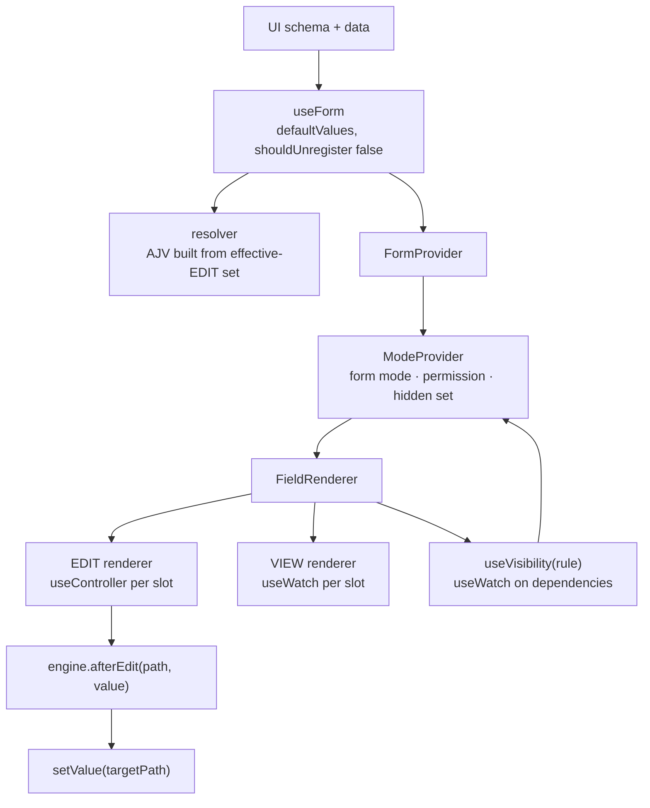
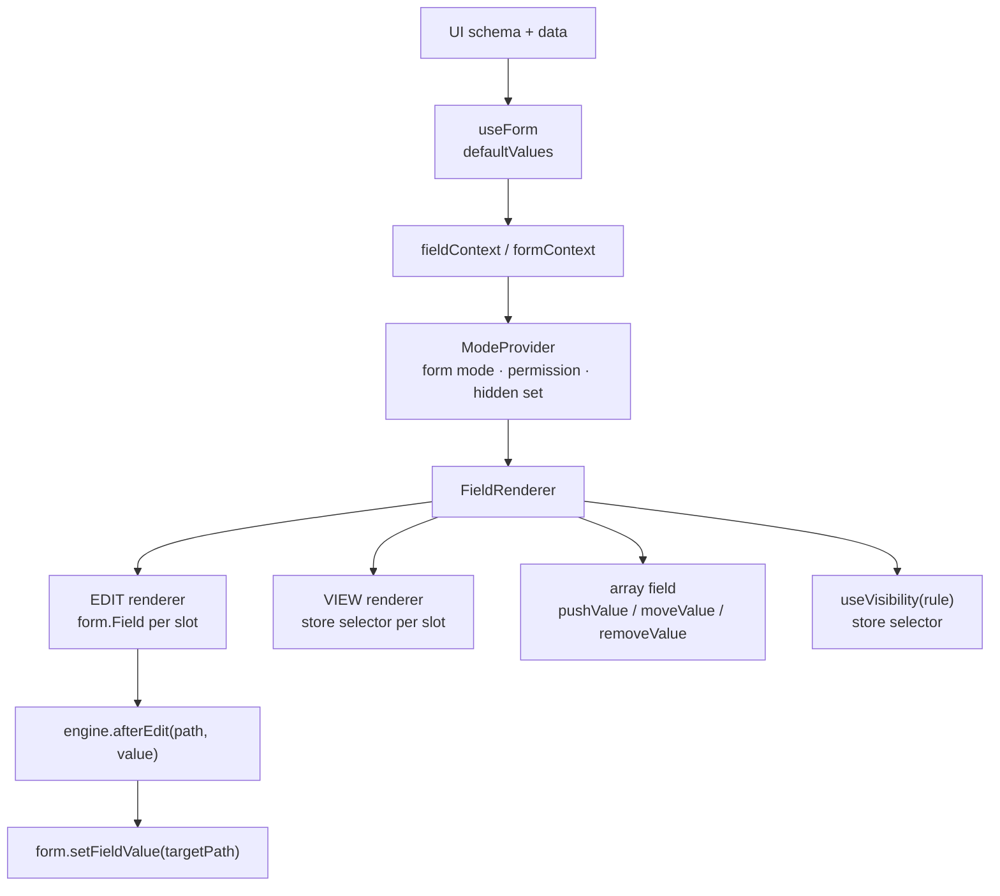

# Form Library Evaluation — React Hook Form vs TanStack Form

**Research note**
Status: analysis complete, no implementation started
Scope: which form library hosts the runtime-generated form engine
Last updated: 2026-11-06
Revision: corrected after source review (v8 beta / v2 alpha / array-key checks)
Debate: [form-library-evaluation-debate.md](form-library-evaluation-debate.md)

Requirements come from [problem-form-engine.md](problem-form-engine.md). This note
answers one question: given a form generated at runtime from a backend UI schema,
which library owns values and errors underneath it.

---

## 1. The market splits in two

| | What it owns | Examples |
|---|---|---|
| **Headless form state** | values, errors, touched, dirty, submit. You supply every field. | React Hook Form, TanStack Form, React Final Form, Formik, Conform |
| **Schema renderers** | generation. You supply a schema, it supplies the fields. | JSON Forms, RJSF, Formily, SurveyJS, Form.io, uniforms |

The split is a working distinction, not a strict taxonomy: Formily's core is headless,
RHF has resolver integrations, and several renderers expose headless APIs.

The requirement is generation-shaped, so the second column looks close. It is not a
direct fit: the field vocabulary and rule semantics are custom, so adopting a renderer
means converting the document and extending its rule engine.

---

## 2. Constraints that eliminate candidates

1. **Multi-slot fields.** `InputWithNA` owns `value` and `isNA`. Most libraries model
   one name to one value. Multi-slot is a custom component everywhere.
2. **Shape unknown at compile time.** Type-safe generics assume a known shape. Both
   remaining candidates degrade to `Record<string, unknown>`.
3. **VIEW and EDIT are separate renderers.** A library that also renders would own
   presentation we need to keep separate.
4. **Validation is compiled from the effective-EDIT subset.** The library must accept
   a rule set that changes when modes change, not a fixed schema at mount.
5. **Cascades write into other fields by data path.** Needs a reliable `setValue`
   that updates only the subscribed fields.
6. **Complex fields own fetch and submit.** Outside every form library's model.

---

## 3. Shortlist

**React Hook Form.** `useController` per slot, `setValue` by path, `useFieldArray`,
per-field subscription, and an AJV resolver in `@hookform/resolvers`. Mature, widely
understood. V8 beta is in flight; the current stable is v7.

**TanStack Form.** Field components subscribe individually, validators per field and
per form, standard-schema support, store-based value model, explicit array API. V1
stable since 2025; v2 alpha in flight; more ceremony per generated field.

**Formily.** Its `x-reactions` model (`dependencies`, `when`, `fulfill`, async) is the
closest existing design to the cascade and visibility rules here. Rejected: the
x-reactions design depends on its schema protocol, and adopting that protocol would
replace the backend's document. The core can be used headless, but then the linkage
model that makes it interesting is gone. Public maintenance is also stale:
`@formily/core` 2.3.7 was published 2025-05-15 and the repository's
last push was 2025-06-21. Its site returned 503 (`usage_exceeded`) during this check,
but that is a hosting quota, not evidence of abandonment. Formily is Alibaba's unified
form solution, so large-company use exists; the problem is public maintenance and
schema ownership.

**JSON Forms.** The closest architecture: renderer registry plus UI schema. Wrong
vocabulary. Adopting it means converting the backend document into JSON Schema and
UI Schema and mapping the rule semantics. Custom renderers can still model multi-slot
fields, so that is not the blocker. Worth reading for design ideas only.

**RJSF.** One widget per property and a limited UI schema. Custom fields can model
multi-slot, but the conversion cost is high. No.

**SurveyJS, Form.io.** Full platforms with their own authoring model. SurveyJS's
Form Library is MIT, while Creator, Dashboard and PDF Generator are commercial;
Form.io's JS renderer is MIT, while its platform is commercial. Adopting either
means translating the backend document into its schema protocol, which conflicts
with the central requirement.

**Formik, React Final Form, Conform.** Formik re-renders too broadly. Final Form's
subscription model is good and it has no JSON Schema path; its ecosystem is quieter
than RHF's but not inactive (2.7M downloads/month, releases in 2026). Conform is
progressive-enhancement and server-action oriented; client-side AJV needs a custom
validator.

**React 19 form actions.** Not a fit alone: it is an action/transport primitive, not
a form-state layer, and the fields are generated.

---

## 4. The mapping that makes both easy

Both libraries address fields by path string. The backend already sends full
data paths (`properties.textWithNA.value`). So the library name **is** the binding
path: no id indirection.

Two caveats:

- Both parsers accept dot and bracket syntax (`properties.items[0].value` and
  `properties.items.0.value`). Normalise once for consistency; the difference is
  numeric segment handling, not a translation layer.
- With a runtime shape, typed field names are decorative. Both work on
  `Record<string, unknown>`.

---

## 5. React Hook Form — high-level design

Ownership: RHF owns values, dirty, errors and submit. The engine owns the document,
registry, modes, rules, validation assembly and complex fields.

How each requirement lands:

- **Multi-slot.** `useController({ name: 'properties.textWithNA.value' })` and the
  same for `isNA`. Two subscriptions, one component.
- **Cascade.** `field.onChange(v)` writes synchronously, so `getValues()` reflects it
  immediately. Run `engine.afterEdit(path)` in the same handler and `setValue` the
  targets. React batches both into one render, so the cascade is applied in the same
  update.
- **Async cascade.** After the fetch, check the target is still effective EDIT, then
  `setValue`. RHF knows nothing about modes; the engine gates the write.
- **Visibility.** One `useWatch` per rule dependency, not one watcher over the whole
  form. Cost stays proportional to the rules that depend on the changed value, not
  to the whole form.
- **Mode-derived validation.** The resolver is a function the engine owns. Inside it,
  call the compiled AJV validator for the current EDIT set. RHF does not care how
  errors are produced. Rebuild the validator only when the field-set signature
  changes. RHF reads the resolver from current options at validation time, so a swap
  takes effect on the next `trigger()` or validation pass.
- **Arrays.** `useFieldArray` covers object arrays. V7 rejects flat scalar arrays;
  wrap them (`{ value: scalar }`) or use v8 beta. The `name` must stay stable for
  the life of the hook.
- **VIEW toggle.** `shouldUnregister: false` keeps unmounted values. To strip unsaved
  edits, `reset(savedSnapshot)` then flip the mode.
- **VIEW submit.** Skip `handleSubmit`, because it validates. Read `getValues()` and
  submit directly.

Costs:

- AJV error paths (`/properties/x/value`) must be mapped to dotted names.
- `useFieldArray` adds a render key to `fields` (`id` in v7, `key` in v8). It is not
  form data and does not reach the payload; use it only as the React key. In v7, a
  generated `id` shadows a real `id` inside `fields` unless `keyName` is set; read the
  data id from `getValues()` or configure a separate key. V8 removes `keyName` and
  keeps data `id`/`key` separate.
- Subscribing to `formState.errors` at the form root re-renders the root on every
  error change. Read errors through `useController` instead.

---

## 6. TanStack Form — high-level design

Ownership is the same split. The store is TanStack Store instead of RHF refs.

How each requirement lands:

- **Multi-slot.** Two `form.Field` components, or `useField` twice. Equivalent.
- **Cascade.** `field.handleChange(v)` then `setFieldValue(target, value)` in the same
  handler. React batches both. TanStack's setter validates and runs listeners by
  default; pass the options to suppress them if the engine already does that work.
- **Async cascade.** Same engine-side gating.
- **Visibility.** `useSelector(form.store, selector)` per rule dependency (v1.33+).
  V2 subscribes to `form.atom` instead. Same shape as `useWatch`.
- **Validation.** There is no dedicated `resolver` prop, but a form-level validator
  can be a function or a Standard Schema; call AJV from that function and have it
  read the current EDIT set. Per-field validators are optional, not required.
- **VIEW toggle.** Values live in the store, not in mounted fields, so unmounting
  keeps them. Stripping requires an explicit reset to the saved snapshot.
- **Arrays.** V1 uses `mode="array"` with `pushValue`, `moveValue`, `removeValue`.
  V2 alpha replaces this with `form.ArrayField` and path-based methods. Nothing is
  injected into items, so React keys become your job.

Costs: v1 is stable since March 2025, but v2 alpha (August 2026) changes arrays,
listeners, subscriptions and validators; fewer named large-company examples; the
AJV adapter must be written; dynamic field names still require casts.

---

## 7. Where they actually differ

| Requirement | React Hook Form | TanStack Form |
|---|---|---|
| Multi-slot field | 2 × `useController` | 2 × `form.Field` |
| Per-field subscription | yes | yes |
| Cross-field validation | inside your resolver | form-level or per-field validators |
| AJV integration | resolver exists | call AJV from a form-level validator |
| Mode-derived rule set | swap resolver | form-level validator reads current EDIT set |
| Array item identity | render key (`id` v7, `key` v8), not payload | render key is yours; nothing injected |
| Flat scalar arrays | v7 no, v8 beta yes | not restricted to objects |
| Error paths | map AJV paths to names | same mapping |
| Maturity | very high; v8 beta in flight | v1 stable since 2025; v2 alpha in flight |
| Library footprint | one hook, proxies | store plus contexts |

**`onChangeListenTo` is not the deciding feature.** In v1 it reruns a field's
validators when a listed field changes; v2 renames it `watchFields`. It helps
dependent field validators. Cross-field rules here live in AJV, which validates the
whole object at form level, so the feature is not needed for this design. It is not
"the feature that most distinguishes" TanStack Form, and its absence does not decide
the library choice.

---

## 8. Verdict

**React Hook Form**, behind a `useSlot(path)` adapter so the choice stays reversible.

Reasons, in order:

1. Validation is schema-based, so the resolver hook is a better fit than per-field
   validators: it is exactly one place to inject the assembled AJV.
2. Object-array handling is mature, and the render key is not a payload problem. The
   v7 limitation is flat scalar arrays; v8 beta adds them. If flat arrays are in
   scope, either wrap them or accept the v8 beta.
3. Adoption and debugging matter more than model elegance for an engine that will be
   read by people who did not write it. RHF has the stronger enterprise evidence:
   Thoughtworks Technology Radar "adopted since 2025", 209M downloads/month, and
   enterprise sponsors including Principal. TanStack Form is stable and widely used
   (18.7M downloads/month) but no named large-company case study was found.

Choose TanStack Form if flat scalar arrays are in scope and RHF v8 beta is not
acceptable, or if its store and typing model outweigh RHF's resolver ecosystem. AJV
can be used with either. Both libraries have a major in flight: RHF v8 beta and
TanStack v2 alpha. Budget the migration either way.

---

## 9. Spike checklist

One page, one `InputWithNA`, one nested array, one flat scalar array. One day.

1. Does typing in one field re-render only that field? Count renders.
2. Can one field write `value` and `isNA` without a whole-form update?
3. Does an unmounted field survive a VIEW toggle with its value intact?
4. Does swapping the resolver when the EDIT set changes re-validate correctly?
5. Does a flat scalar array (`string[]`) add, remove and reorder without changing
   the payload shape?
6. Does a row with a real `id` keep that `id` in `getValues()` while the render key
   stays separate?

Any two failing is enough to reconsider the choice. Checks 3, 4, 5 and 6 are the
ones that would change the verdict.

---

## 10. Sources and caveats

- TanStack Form v1 docs: quick start, arrays, validation, linked fields.
  https://tanstack.com/form/latest/docs/framework/react/quick-start
  https://tanstack.com/form/latest/docs/framework/react/guides/arrays
  https://tanstack.com/form/latest/docs/framework/react/guides/validation
  https://tanstack.com/form/latest/docs/framework/react/guides/linked-fields
- TanStack Form v2 alpha announcement and migration guide.
  https://tanstack.com/blog/announcing-tanstack-form-v2-alpha
  https://tanstack.com/form/alpha/docs/migrate-from-v1
- TanStack Form `useStore` deprecation, v1.33.1.
  https://github.com/TanStack/form/blob/main/packages/react-form/CHANGELOG.md
  https://github.com/TanStack/form/issues/2203
- React Hook Form `useController`, `useFieldArray`, `useForm`, resolver docs.
  https://react-hook-form.com/docs/usecontroller
  https://react-hook-form.com/docs/usefieldarray
  https://react-hook-form.com/docs/useform
- React Hook Form v8 migration notes (`keyName` removed, `id` renamed `key`, flat arrays).
  https://react-hook-form.com/migrate-v7-to-v8
- RHF maintainer note that the `useFieldArray` key is render-only, not form data.
  https://github.com/orgs/react-hook-form/discussions/6621
- `@hookform/resolvers` AJV resolver.
  https://github.com/react-hook-form/resolvers#ajv
- Formily package and repository history.
  https://www.npmjs.com/package/@formily/core
  https://github.com/alibaba/formily
- JSON Forms custom renderers; RJSF custom fields.
  https://jsonforms.io/docs/tutorial/custom-renderers
  https://rjsf-team.github.io/react-jsonschema-form/docs/advanced-customization/custom-widgets-fields
- SurveyJS licensing; Form.io JS repository.
  https://surveyjs.io/licensing
  https://github.com/formio/formio.js
- Adoption signals: RHF site/Thoughtworks Radar and npm downloads; TanStack showcase.
  https://react-hook-form.com/
  https://www.npmjs.com/package/react-hook-form
  https://tanstack.com/showcase
  https://www.npmjs.com/package/@tanstack/react-form

Caveats:

- Versions checked: RHF 7.91.0 and 8.0.0-beta.5; TanStack Form 1.33.5 and
  2.0.0-alpha.3; Formily 2.3.7.
- Formily's public maintenance is stale: `@formily/core` 2.3.7 (2025-05-15), last
  repository push 2025-06-21. Its site returns 503 (`usage_exceeded`), which is a
  hosting quota, not a maintenance signal. Alibaba's internal use may be current.
- React Hook Form v8 beta changes the field-array key API: `keyName` is removed and
  `id` becomes `key`. TanStack Form v2 alpha changes arrays, listeners, stores and
  validators. Confirm the target major in the spike.
- Exact `shouldUnregister` and TanStack `reset` behaviour vary by version. Confirm
  both in the spike rather than trusting this note.
- No benchmark was run. Render claims describe subscription scope, not measured cost.
- Adoption evidence is not a fitness proof. RHF has the stronger enterprise signal;
  TanStack Form has no named large-company case study in the sources checked.
