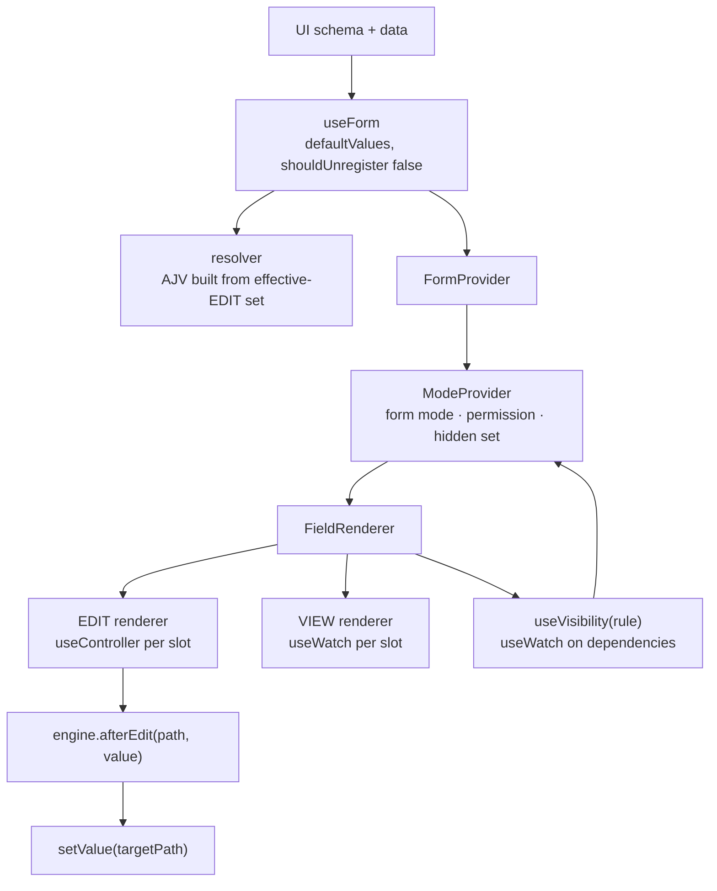
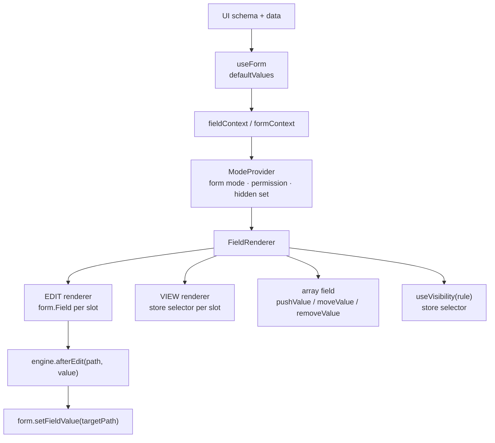

# Form Library Evaluation — React Hook Form vs TanStack Form

**Research note**
Status: analysis complete, no implementation started
Scope: which form library hosts the runtime-generated form engine
Last updated: 2026-11-06

Requirements come from [problem-form-engine.md](problem-form-engine.md). This note
answers one question: given a form generated at runtime from a backend UI schema,
which library owns values and errors underneath it.

---

## 1. The market splits in two

| | What it owns | Examples |
|---|---|---|
| **Headless form state** | values, errors, touched, dirty, submit. You supply every field. | React Hook Form, TanStack Form, React Final Form, Formik, Conform |
| **Schema renderers** | generation. You supply a schema, it supplies the fields. | JSON Forms, RJSF, Formily, SurveyJS, Form.io, uniforms |

The requirement is generation-shaped, so the second column looks right. It is not,
because the field vocabulary and the rule semantics are custom.

---

## 2. Constraints that eliminate candidates

1. **Multi-slot fields.** `InputWithNA` owns `value` and `isNA`. Most libraries model
   one name to one value. Multi-slot is a custom component everywhere.
2. **Shape unknown at compile time.** Type-safe generics assume a known shape. Both
   remaining candidates degrade to `Record<string, unknown>`.
3. **VIEW and EDIT are separate renderers.** Any library that also renders owns too
   much.
4. **Validation is compiled from the effective-EDIT subset.** The library must accept
   a rule set that changes when modes change, not a fixed schema at mount.
5. **Cascades write into other fields by data path.** Needs a reliable `setValue`
   that does not re-render the tree.
6. **Complex fields own fetch and submit.** Outside every form library's model.

---

## 3. Shortlist

**React Hook Form.** `useController` per slot, `setValue` by path, `useFieldArray`,
per-field subscription, and an AJV resolver in `@hookform/resolvers`. Mature, widely
understood.

**TanStack Form.** Field components subscribe individually, validators per field and
per form, standard-schema support, store-based value model, explicit array API. v1,
younger, more ceremony per generated field.

**Formily.** Its `x-reactions` model (`dependencies`, `when`, `fulfill`, async) is the
closest existing design to the cascade and visibility rules here. Rejected: it brings
its own schema protocol and would replace the backend's document. Its site returned
503 during this check, so current maintenance could not be confirmed.

**JSON Forms.** The closest architecture: renderer registry plus UI schema. Wrong
vocabulary. Adopting it means converting the backend document and losing multi-slot
fields. Worth reading for design ideas only.

**RJSF.** One widget per property, limited UI schema, awkward for multi-slot. No.

**SurveyJS, Form.io.** Full platforms with their own authoring model and licensing.
Adopting one means the backend no longer owns the schema, which conflicts with the
central requirement.

**Formik, React Final Form, Conform.** Formik re-renders too broadly. Final Form's
subscription model is good but the ecosystem is quiet and it has no JSON Schema path.
Conform is server-action oriented, wrong shape for client-side AJV.

**React 19 form actions.** Not a fit alone: validation is client-side and fields are
generated.

---

## 4. The mapping that makes both easy

Both libraries address fields by dotted string names. The backend already sends full
data paths (`properties.textWithNA.value`). So the library name **is** the binding
path: no translation layer, no id indirection.

Two caveats:

- Normalise array syntax to one form (`properties.items[0].value`), because the two
  libraries parse brackets slightly differently.
- With a runtime shape, typed field names are decorative. Both work on
  `Record<string, unknown>`.

---

## 5. React Hook Form — high-level design

Ownership: RHF owns values, dirty, errors and submit. The engine owns the document,
registry, modes, rules, validation assembly and complex fields.

How each requirement lands:

- **Multi-slot.** `useController({ name: 'properties.textWithNA.value' })` and the
  same for `isNA`. Two subscriptions, one component.
- **Cascade.** `field.onChange(v)` writes synchronously, so `getValues()` reflects it
  immediately. Run `engine.afterEdit(path)` in the same handler and `setValue` the
  targets. React batches both into one render, so the cascade wins in the same paint.
- **Async cascade.** After the fetch, check the target is still effective EDIT, then
  `setValue`. RHF knows nothing about modes; the engine gates the write.
- **Visibility.** One `useWatch` per rule dependency, not one watcher over the whole
  form. Cost stays proportional to rules, not to keystrokes.
- **Mode-derived validation.** The resolver is a function the engine owns. Inside it,
  call the compiled AJV validator for the current EDIT set. RHF does not care how
  errors are produced. Rebuild the validator only when the field-set signature
  changes.
- **VIEW toggle.** `shouldUnregister: false` keeps unmounted values. To strip unsaved
  edits, `reset(savedSnapshot)` then flip the mode.
- **VIEW submit.** Skip `handleSubmit`, because it validates. Read `getValues()` and
  submit directly.

Costs:

- AJV error paths (`/properties/x/value`) must be mapped to dotted names.
- `useFieldArray` injects an `id` into every item unless `keyName` is set, and that
  id reaches the payload if forgotten.
- Subscribing to `formState.errors` at the form root re-renders the root on every
  error change. Read errors through `useController` instead.

---

## 6. TanStack Form — high-level design

Ownership is the same split. The store is TanStack Store instead of RHF refs.

How each requirement lands:

- **Multi-slot.** Two `form.Field` components, or `useField` twice. Equivalent.
- **Cascade.** `field.handleChange(v)` then `setFieldValue(target, value)` in the same
  handler. Same batching behaviour.
- **Async cascade.** Same engine-side gating.
- **Visibility.** `useStore(form.store, selector)` per rule dependency. Same shape as
  `useWatch`.
- **Validation.** No schema resolver to swap. Attach validators only to effective-EDIT
  fields, plus one form-level validator for the cross-field assembly. Conceptually
  cleaner: absent validator, absent rule.
- **VIEW toggle.** Values live in the store, not in mounted fields, so unmounting
  keeps them. Stripping requires an explicit reset to the saved snapshot.
- **Arrays.** `mode="array"` with `pushValue`, `moveValue`, `removeValue`. Nothing is
  injected into items, so payload hygiene is better, but React keys become your job.

Costs: younger, API still settling after v1; fewer large dynamic-form examples; the
AJV adapter must be written; dynamic field names still require casts.

---

## 7. Where they actually differ

| Requirement | React Hook Form | TanStack Form |
|---|---|---|
| Multi-slot field | 2 × `useController` | 2 × `form.Field` |
| Per-field subscription | yes | yes |
| Cross-field validation | inside your resolver | per-field and form validators |
| AJV integration | resolver exists | write a small wrapper |
| Mode-derived rule set | swap resolver | attach validators conditionally |
| Array item identity | injects `id`, strip or configure | nothing injected |
| Error paths | map AJV paths to names | same mapping |
| Maturity | very high | v1, smaller ecosystem |
| Library footprint | one hook, proxies | store plus contexts |

**The `onChangeListenTo` advantage does not apply here.** It solves dependent
*function* validators. Cross-field rules live in AJV, which validates the whole object
anyway, so the feature that most distinguishes TanStack Form is largely irrelevant to
this design.

---

## 8. Verdict

**React Hook Form**, behind a `useSlot(path)` adapter so the choice stays reversible.

Reasons, in order:

1. Validation is schema-based, so the resolver hook is a better fit than per-field
   validators: it is exactly one place to inject the assembled AJV.
2. Array handling is mature; the injected `id` is a known, one-line fix.
3. Ecosystem and debugging matter more than model elegance for an engine that will be
   read by people who did not write it.

Choose TanStack Form only if cross-field rules move out of AJV and into function
validators. That is a product decision, not a library one.

---

## 9. Spike checklist

One page, one `InputWithNA`, one nested array. One day.

1. Does typing in one field re-render only that field? Count renders.
2. Can one field write `value` and `isNA` without a whole-form update?
3. Does an unmounted field survive a VIEW toggle with its value intact?
4. Does swapping the resolver when the EDIT set changes re-validate correctly?

Any two of four failing is enough to reconsider the choice. Checks 3 and 4 are the
ones that would change the verdict.

---

## 10. Sources and caveats

- TanStack Form React quick start, fetched 2026-11-06.
  https://tanstack.com/form/latest/docs/framework/react/quick-start
- React Hook Form `useController`, `useFieldArray`, `resolver` documentation.
  https://react-hook-form.com/docs
- `@hookform/resolvers` AJV resolver.
  https://github.com/react-hook-form/resolvers
- JSON Forms, RJSF, Formily and SurveyJS documentation for the renderer comparison.

Caveats:

- Formily's site returned 503 during this check; its verdict rests on prior
  knowledge and should be re-verified before adopting it.
- Exact `keyName`, `shouldUnregister` and TanStack `reset` behaviour vary by version.
  Confirm all three in the spike rather than trusting this note.
- No benchmark was run. Render claims describe subscription scope, not measured cost.
