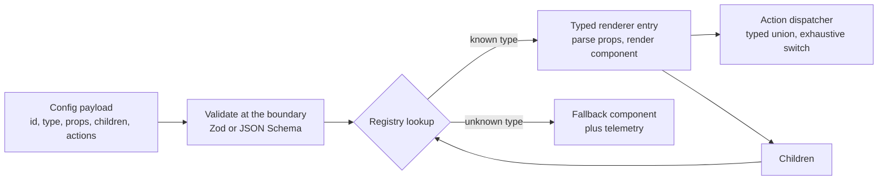
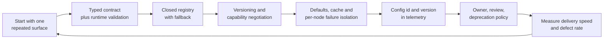
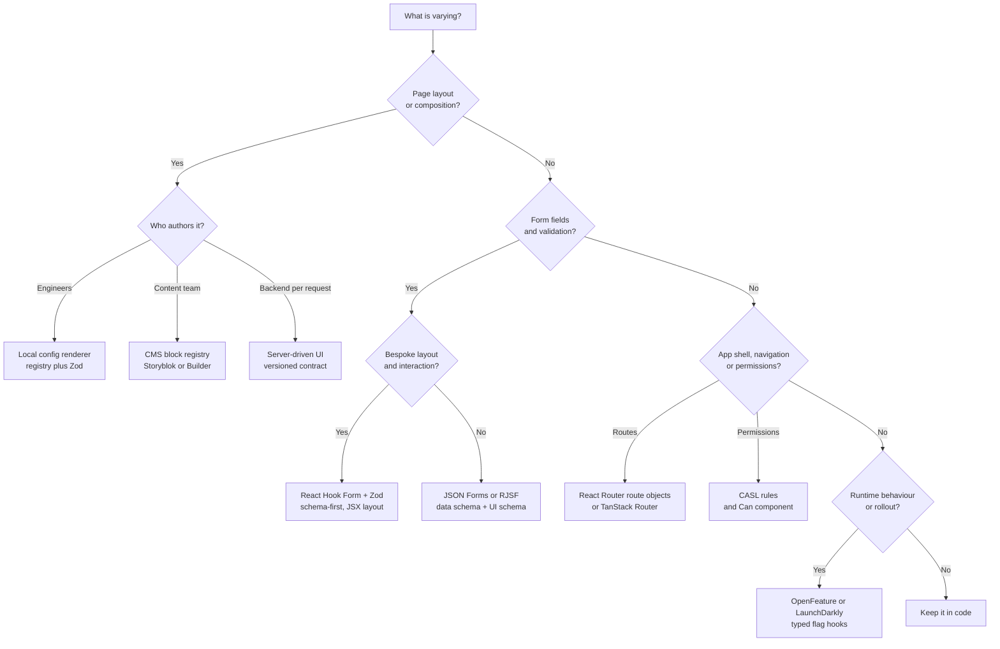

# React + TypeScript Patterns for Config-Driven Architecture

**Research report**
Status: research complete, no implementation started
Scope: patterns with demonstrated use in React and TypeScript
Last updated: 2026-11-01

Code snippets are illustrative. They omit imports and app-specific wiring, and none of them were executed as part of this research.

---

## 1. Research question and method

This report asks a narrower question than the general config-driven architecture report:

> Which config-driven patterns have actually been used successfully in React and TypeScript, and what concrete shape do they take?

The evidence was grouped into three tiers:

| Tier | Meaning | Examples in this report |
|---|---|---|
| **Production at scale** | Public first-hand accounts or official engineering material from a company running the pattern | Airbnb Ghost, Lyft, Shopify, Spotify/Backstage, Glovo |
| **Mature library or platform** | Widely adopted open-source or commercial system with React and TypeScript support | JSON Forms, RJSF, Refine, CASL, React Router, TanStack Router, OpenFeature, LaunchDarkly, Style Dictionary, Module Federation, Storyblok, Builder.io |
| **Documented pattern only** | Useful implementation guidance without independent production evidence | Minimal SDUI tutorials, personal blogs |

Patterns that only appear in demo repositories were excluded. The goal is to identify what survives contact with real products.

**Main finding:** the successful patterns are narrow. Each one configures a specific layer, keeps a typed contract, and preserves a code path for everything that does not fit. The failures come from trying to make one configuration system cover layout, data, behaviour, permissions, theming and workflow at once.

---

## 2. Executive summary

There are nine core patterns and three adjacent ones that have demonstrated success in React and TypeScript.

```mermaid
flowchart LR
  subgraph Render["Render configuration"]
    R1["1. Node tree + registry<br/>+ recursive renderer"]
    R2["2. Data schema + UI schema<br/>form renderer"]
    R3["3. Schema-first forms<br/>React Hook Form + Zod"]
    R4["4. Widget and field registry"]
    R5["5. CMS block registry"]
  end

  subgraph App["Application configuration"]
    A1["6. Resource config<br/>CRUD and admin"]
    A2["7. Typed route and shell config"]
    A3["8. Policy config<br/>authorization"]
  end

  subgraph Runtime["Runtime configuration"]
    T1["9. Typed flag and remote config<br/>provider"]
  end

  subgraph Build["Build and composition"]
    B1["10. Design token pipeline"]
    B2["11. Module federation manifest"]
    B3["12. Scaffolding templates"]
  end

  Render --> App --> Runtime --> Build
```



| # | Pattern | Strongest evidence | React/TypeScript mechanism | Best fit |
|---|---|---|---|---|
| 1 | Node tree + registry + recursive renderer | Airbnb, Lyft, Glovo, Shopify | `type` string to component map, recursive renderer, typed actions | High-churn, multi-client, compositional screens |
| 2 | Data schema + UI schema form renderer | JSON Forms, RJSF, Backstage | `schema`, `uischema`, renderer sets | Forms whose fields churn but layout is standard |
| 3 | Schema-first forms with hand-written layout | shadcn/ui, React Hook Form, Zod | `z.infer`, `zodResolver`, `Controller` | Forms with bespoke UX and shared validation |
| 4 | Widget and field registry | RJSF, JSON Forms | `widgets`/`fields` maps, `ui:widget` | Branded controls without forking the renderer |
| 5 | CMS block registry | Storyblok, Builder.io | `components` map, `blok` prop, editor inputs | Content and marketing pages |
| 6 | Resource config for CRUD | Refine | `resources` array, data provider, hooks | Admin panels, internal tools, B2B apps |
| 7 | Typed route and shell config | React Router, TanStack Router | Route objects, module augmentation, typed params | App shell, navigation, permissions |
| 8 | Policy config for authorization | CASL | Rules as data, `<Can>`, `useAbility` | UI gating and permission-driven navigation |
| 9 | Typed flag and remote config provider | OpenFeature, LaunchDarkly, Firebase | Provider at root, typed hooks, defaults | Rollouts, kill switches, experiments |
| 10 | Design token pipeline | Style Dictionary | Tokens to CSS variables and TypeScript types | Multi-brand theming and design systems |
| 11 | Module federation manifest | Module Federation 2.0 | Manifest, runtime, shared dependencies | Multi-team micro-frontends |
| 12 | Scaffolding templates | Backstage | YAML template, JSON Schema parameters, actions | Golden paths and project creation |

The rest of this report describes each pattern, its TypeScript shape, its failure modes and the conditions under which it is worth using.

---

## 3. Core patterns

### 3.1 Pattern 1 — Typed node tree, registry and recursive renderer

This is the canonical form of config-driven UI. It has three parts:

1. a serialisable node tree;
2. a registry from `type` strings to React components or renderers;
3. a recursive renderer that walks the tree.



**Evidence.**

- **Airbnb Ghost Platform.** One shared GraphQL schema across web, iOS and Android. The web client is written in TypeScript. Sections are context-free data models; screens own layout; `SectionComponentType` controls rendering. Airbnb states that most of its most-used features run on this system, and that the cost is a substantial platform investment.
- **Lyft.** A backend-for-frontend returns view models and actions. Declarative components are generic; semantic components are the escape hatch. Actions are decoupled from layouts. Lyft reports that the platform compounds: each new primitive makes later features easier.
- **Glovo.** A first-hand account of the store page: three clients, three pull requests per variation, and different release trains. The proposed contract is a four-field node (`type`, `props`, `children`, `actions`), a registry, and a renderer. The article includes a minimal TypeScript implementation.
- **Shopify Remote DOM.** The host renders a remote tree with host-owned components. `RemoteRootRenderer` takes a `components` map. The extension runs in a sandbox and communicates by message passing.

**React + TypeScript shape.**

The contract should be a discriminated union. Keep the runtime parser separate from the static type.

```ts
import type { ComponentType, ReactNode } from 'react'
import { z } from 'zod'

const bannerProps = z.object({
  imageUrl: z.string().url(),
  title: z.string(),
  subtitle: z.string().optional(),
})

type BannerProps = z.infer<typeof bannerProps>

export type Node = {
  id: string
  type: string
  props?: unknown
  children?: Node[]
  actions?: Action[]
}

export type Action =
  | { type: 'navigate'; payload: { to: string } }
  | { type: 'track'; payload: { name: string } }
  | { type: 'add-to-cart'; payload: { id: string } }
```

The registry should preserve per-entry types. A plain `Record<string, ComponentType<any>>` throws type safety away at the exact point where the server controls the input.

A practical pattern is to let each entry validate its own props and return `ReactNode`:

```ts
type NodeEntry = {
  parse: (props: unknown) => unknown
  render: (props: unknown) => ReactNode
}

const registry = {
  banner: {
    parse: (props) => bannerProps.parse(props),
    render: (props) => {
      const parsed = bannerProps.parse(props)
      return <Banner {...parsed} />
    },
  },
} satisfies Record<string, NodeEntry>

export type KnownNodeType = keyof typeof registry
```

The lookup still returns a union or `undefined`, because the server can send any string. The renderer handles that explicitly:

```tsx
export function NodeRenderer({ node }: { node: Node }) {
  const entry = registry[node.type as KnownNodeType]

  if (!entry) {
    reportUnknownType(node.type)
    return <UnknownNode id={node.id} />
  }

  return (
    <NodeErrorBoundary id={node.id}>
      {entry.render(node.props)}
      {node.children?.map((child) => (
        <NodeRenderer key={child.id} node={child} />
      ))}
    </NodeErrorBoundary>
  )
}
```

This avoids the common `ComponentType<any>` shortcut and keeps the validation next to the component that owns the prop shape.

**Actions.** Model actions as a discriminated union and dispatch them in one place. Components should not know action types.

```ts
function dispatch(action: Action) {
  switch (action.type) {
    case 'navigate':
      router.navigate(action.payload.to)
      return
    case 'track':
      analytics.track(action.payload.name)
      return
    case 'add-to-cart':
      cart.add(action.payload.id)
      return
    default: {
      const exhaustive: never = action
      return exhaustive
    }
  }
}
```

**What made these implementations work.**

- A closed set of primitives, not one component type per feature.
- A shared schema and contract, not per-client JSON dialects.
- Server-owned compatibility and versioning.
- Fallback for unknown types.
- Per-node error boundaries.
- A clear escape hatch. Lyft's semantic components are the best documented example.

**Failure modes.**

- Rendering props with `{...node.props}` without validation lets config set arbitrary values and attributes.
- Using array indexes as keys breaks focus and input state on reorder. Use the config `id`.
- One universal schema tries to cover every feature and becomes a god protocol.
- The registry becomes a public API without a versioning or deprecation policy.
- A missing fallback turns a stale client into a blank page.

**Fit.** Strong for high-churn, multi-client, compositional screens. Weak for a single web client that deploys same-day, or for highly interactive UI where generic components flatten the experience.

---

### 3.2 Pattern 2 — Data schema plus UI schema form renderer

Instead of rendering a page tree, this pattern renders a form from two schemas:

- a **data schema** describing the values and validation;
- a **UI schema** describing layout, order, visibility and widgets.

**Evidence.**

- **JSON Forms.** The core is UI-framework agnostic, with React, Angular and Vue bindings. It splits data schema and UI schema and supports rules such as `HIDE` and `SHOW`. The React component takes `schema`, `uischema`, `data`, `renderers`, `cells`, `onChange` and `config`.
- **react-jsonschema-form (RJSF).** A React component that builds HTML forms from JSON Schema, with `uiSchema`, custom fields, custom widgets and themes. It is used by Backstage for software template parameters, which gives it production evidence beyond its own repository.
- **Backstage.** Template parameters are JSON Schema plus `ui:*` extensions, rendered through RJSF, with custom field extensions for repository pickers, owner pickers and secrets.

**React + TypeScript shape.**

```tsx
import { JsonForms } from '@jsonforms/react'
import { materialCells, materialRenderers } from '@jsonforms/material-renderers'
import type { JsonSchema, UISchemaElement } from '@jsonforms/core'

const schema: JsonSchema = {
  type: 'object',
  required: ['name'],
  properties: {
    name: { type: 'string', minLength: 1 },
    active: { type: 'boolean' },
  },
}

const uischema: UISchemaElement = {
  type: 'VerticalLayout',
  elements: [
    { type: 'Control', scope: '#/properties/name' },
    { type: 'Control', scope: '#/properties/active' },
  ],
}

export function ProfileForm() {
  const [data, setData] = useState({})
  return (
    <JsonForms
      schema={schema}
      uischema={uischema}
      data={data}
      renderers={materialRenderers}
      cells={materialCells}
      onChange={({ data }) => setData(data)}
    />
  )
}
```

**When it works.**

- Many forms share the same layout grammar.
- Fields change frequently, but the screen structure is stable.
- Validation must run on the client and the server from the same contract.
- The backend already owns a JSON Schema or OpenAPI schema.

**When it fails.**

- The design requires pixel-specific layout that a UI schema cannot express.
- The form is highly interactive: dependent fields, async lookups, wizards with branching logic.
- The team starts inventing UI-schema extensions for every new design request.

**TypeScript notes.**

- JSON Schema and TypeScript types duplicate each other unless you generate one from the other.
- `json-schema-to-ts` infers types from a schema written `as const`. It is type-space only and has no runtime cost.
- For runtime validation, pair the schema with AJV. For a TypeScript-first approach, use Zod and derive types with `z.infer`.
- Avoid casting the form payload with `as MyType`. Parse it at the boundary.

---

### 3.3 Pattern 3 — Schema-first forms with hand-written layout

This is the pragmatic alternative to a generic form renderer. The schema is the source of truth for data and validation, but the JSX layout stays hand-written.

**Evidence.**

- **shadcn/ui forms.** The documented pattern uses React Hook Form with a Zod schema, `zodResolver`, `Controller`, and accessible `Field` primitives. It keeps full control of markup while sharing validation.
- **React Hook Form.** A mainstream React form library with controlled inputs, field arrays and resolver support.
- **Zod.** A TypeScript-first schema library whose inferred types are used directly by the form.

**React + TypeScript shape.**

```tsx
import { zodResolver } from '@hookform/resolvers/zod'
import { useForm } from 'react-hook-form'
import * as z from 'zod'

const formSchema = z.object({
  title: z.string().min(5).max(32),
  description: z.string().min(20).max(100),
})

type FormValues = z.infer<typeof formSchema>

export function BugReportForm() {
  const form = useForm<FormValues>({
    resolver: zodResolver(formSchema),
    defaultValues: { title: '', description: '' },
  })

  return (
    <form onSubmit={form.handleSubmit((values) => save(values))}>
      <Controller
        name="title"
        control={form.control}
        render={({ field, fieldState }) => (
          <Field data-invalid={fieldState.invalid}>
            <FieldLabel htmlFor={field.name}>Bug title</FieldLabel>
            <Input {...field} id={field.name} aria-invalid={fieldState.invalid} />
            {fieldState.invalid && <FieldError errors={[fieldState.error]} />}
          </Field>
        )}
      />
    </form>
  )
}
```

**Why this succeeds.**

- One schema drives runtime validation and the TypeScript type.
- The layout remains explicit, so design work is not constrained by a renderer.
- Accessibility is handled in the layout, not generated blindly.
- It is easy to test and refactor.

**Tradeoff.** It is not dynamic. Adding a field means changing code. That is acceptable when the form layout is part of the product, and unacceptable when the form is generated per tenant or per data model.

**Failure modes.**

- Duplicating validation in the schema and in the JSX.
- Using `as FormValues` on unvalidated data.
- Forgetting `aria-invalid` and error association.
- Using `form.watch()` for everything and re-rendering the whole form.

---

### 3.4 Pattern 4 — Widget and field registry

This pattern keeps a generic form renderer but lets the design system own the controls. It is the extension mechanism inside Patterns 1 and 2.

**Evidence.**

- **RJSF.** `widgets` and `fields` props override any default control. A `ui:widget` string in the UI schema selects a registered widget. `RegistryWidgetsType` and `RegistryFieldsType` are the TypeScript types. The registry object is passed down the tree, so custom fields can use it.
- **JSON Forms.** `renderers` and `cells` are the equivalent. Renderer sets are swappable, and custom renderers are a first-class tutorial.
- **Storyblok and Builder.io.** Both expose a component map that plays the same role at the block level.

**React + TypeScript shape.**

```tsx
import type { RegistryWidgetsType, WidgetProps } from '@rjsf/utils'

function CurrencyWidget({ value, onChange, id }: WidgetProps) {
  return (
    <input
      id={id}
      value={value ?? ''}
      onChange={(event) => onChange(Number(event.target.value))}
      inputMode="decimal"
    />
  )
}

const widgets: RegistryWidgetsType = {
  currency: CurrencyWidget,
}
```

**What made it work.**

- The generic renderer stays generic. Brand-specific behaviour enters through a small map.
- The registry key is part of the config contract, so it is versioned like any other public API.
- The default renderer set is a safe fallback.

**Failure modes.**

- The registry key becomes an undocumented public API. Rename it and every stored config breaks.
- Widgets bypass validation and submit invalid values.
- Custom widgets duplicate accessibility work that the design system already solved.

---

### 3.5 Pattern 5 — CMS block registry

Content platforms use the same registry idea, but the config author is a content team and the nodes are blocks in a visual editor.

**Evidence.**

- **Storyblok.** `storyblokInit({ components: { page: Page, feature: Feature } })` maps block names to React components. `StoryblokComponent` receives a `blok` prop and recursively renders nested blocks. The SDK supports client, SSR and React Server Component entry points, and has a fallback component for unknown blocks.
- **Builder.io.** `Builder.registerComponent(Component, { name, inputs, ... })` registers a component and its editable inputs. The same `inputs` declaration drives the visual editor and the component props. `BuilderComponent` renders the stored content.
- **Headless CMS pattern.** Contentful, Sanity and similar platforms produce block trees that teams map to React components, often with generated TypeScript types.

**React + TypeScript shape.**

```tsx
import { storyblokInit, apiPlugin, StoryblokComponent } from '@storyblok/react'

storyblokInit({
  accessToken: import.meta.env.VITE_STORYBLOK_TOKEN,
  use: [apiPlugin],
  components: {
    page: Page,
    feature: Feature,
    hero: Hero,
  },
  enableFallbackComponent: true,
})

export function App({ story }) {
  return <StoryblokComponent blok={story.content} />
}
```

Builder.io uses a similar map:

```ts
import { Builder } from '@builder.io/react'

Builder.registerComponent(Heading, {
  name: 'Heading',
  inputs: [{ name: 'title', type: 'text' }],
})
```

**Why it succeeds.**

- Content teams get a visual editor, while engineers keep component ownership.
- The block map is a closed set, so the editor cannot invent new runtime behaviour.
- Unknown blocks can render a fallback instead of breaking the page.
- Preview and production share the same renderer.

**Failure modes.**

- Design drift: content authors combine primitives in ways the design system never intended.
- Editor schema and runtime types drift apart. Generate types or validate props.
- RSC support differs by vendor. Storyblok documents RSC entry points; Builder.io currently does not support React Server Components as custom components.
- Preview-only fields leak into production payloads.

**Fit.** Strong for marketing, content and documentation surfaces. Weak for transactional flows or highly interactive product UI.

---

### 3.6 Pattern 6 — Resource config for CRUD and admin apps

This pattern configures data resources rather than pixels. A resource declaration drives routes, menus, list/create/edit/show screens and data fetching.

**Evidence.**

- **Refine.** A React meta-framework for CRUD-heavy applications. The `resources` array declares names, paths and metadata. Data providers, auth providers, router providers and access-control providers are pluggable. The core is headless, so the UI layer is a choice.
- Refine explicitly positions itself between "from scratch" and low-code: it keeps code ownership and flexibility while removing repetitive CRUD wiring.

**React + TypeScript shape.**

```tsx
<Refine
  dataProvider={dataProvider}
  routerProvider={routerProvider}
  authProvider={authProvider}
  accessControlProvider={accessControlProvider}
  resources={[
    {
      name: 'products',
      list: '/products',
      create: '/products/new',
      edit: '/products/:id/edit',
      show: '/products/:id',
      meta: { canDelete: true },
    },
  ]}
>
  <Routes>{/* route elements */}</Routes>
</Refine>
```

**Why it succeeds.**

- The repeated unit is a resource, not a page. Most admin apps have many similar resources.
- Providers keep data, auth and routing replaceable.
- Hooks such as `useTable`, `useForm` and `useList` keep custom behaviour possible.

**Failure modes.**

- Forcing complex, bespoke workflows into resource metadata.
- Treating the resource config as the whole architecture and losing the escape hatch.
- Provider abstractions that hide important query behaviour.

**Fit.** Strong for internal tools, admin panels, dashboards and B2B CRUD. Weak for consumer-facing UI with unusual interaction models.

---

### 3.7 Pattern 7 — Typed route and app-shell config

Routes are configuration. Two mainstream React routers make this explicit and type-safe.

**Evidence.**

- **React Router data routers.** `createBrowserRouter` takes an array of route objects with `path`, `Component`, `loader`, `action`, `lazy`, `handle`, `middleware` and `shouldRevalidate`. This is a route tree as data, with data loading, mutations, error boundaries and code splitting attached to nodes.
- **TanStack Router.** Built for full type inference across routes. It uses module augmentation on a `Register` interface so `Link`, `useNavigate`, `useParams` and `useSearch` know the route tree. It documents `as const satisfies` to keep route config precise without expensive broad type checks.

**React + TypeScript shape.**

```tsx
const router = createBrowserRouter([
  {
    path: '/',
    Component: App,
    children: [
      {
        path: 'products',
        lazy: async () => {
          const { Products, loader } = await import('./products')
          return { Component: Products, loader }
        },
        handle: { breadcrumb: 'Products' },
      },
    ],
  },
])
```

TanStack Router uses a generated route tree and module augmentation:

```ts
const router = createRouter({ routeTree })

declare module '@tanstack/react-router' {
  interface Register {
    router: typeof router
  }
}
```

**Why it succeeds.**

- Navigation is genuinely a tree of data, so config fits naturally.
- Loaders and actions keep data fetching next to the route.
- `handle` supports cross-cutting UI such as breadcrumbs and titles.
- Type inference catches broken links and wrong params at compile time.

**Failure modes.**

- Trying to fetch the route tree at runtime. Route config is build-time code, not server JSON.
- Putting authorization only in UI route config. Server checks are still required.
- Over-abstracting routes into a custom DSL. The router's own config is already the DSL.

---

### 3.8 Pattern 8 — Policy config for authorization

Permissions are rules, and rules can be data. CASL is the most established React + TypeScript example.

**Evidence.**

- **CASL.** `@casl/ability` defines rules as data. `@casl/react` provides `AbilityProvider`, a declarative `<Can>` component and a `useAbility` hook. The package is written in TypeScript, so actions, subjects and aliases are checked by the editor and compiler.

**React + TypeScript shape.**

```tsx
import { createMongoAbility } from '@casl/ability'
import { AbilityProvider, Can, useAbility } from '@casl/react'

const ability = createMongoAbility([
  { action: 'read', subject: 'Post' },
  { action: 'update', subject: 'Post', conditions: { authorId: user.id } },
])

export function App() {
  return (
    <AbilityProvider value={ability}>
      <Can I="update" a="Post">
        <EditPostButton />
      </Can>
    </AbilityProvider>
  )
}

function EditPostButton() {
  const ability = useAbility()
  return ability.can('update', 'Post') ? <button>Edit</button> : null
}
```

**Why it succeeds.**

- Rules are compact and testable.
- The same rules can gate navigation, buttons and field-level UI.
- `<Can>` keeps JSX readable; `useAbility` handles complex logic.
- CASL supports subject conditions, so rules can depend on the object, not only its type.

**Failure modes.**

- Treating UI gating as security. The server must enforce the same policy.
- Rule explosion: thousands of ad hoc rules with no ownership.
- Stale ability after login or role change. Update the ability and rely on `ability.rules` in memo dependencies.

---

### 3.9 Pattern 9 — Typed feature flag and remote config provider

Feature flags are runtime configuration for behaviour. The successful React pattern is a provider at the root, typed hooks in components, and a test provider for stories and tests.

**Evidence.**

- **LaunchDarkly React Web SDK.** `createLDReactProvider` initialises the client and provides context. Typed hooks include `useBoolVariation`, `useStringVariation`, `useNumberVariation` and `useJsonVariation`, plus detail variants. It supports streaming updates and React Server Components through a server session wrapper.
- **OpenFeature React SDK.** A vendor-neutral CNCF project. `OpenFeatureProvider` binds a client to the subtree. `useFlag`, `useBooleanFlagValue`, `useFlagDetails` and the declarative `FeatureFlag` component cover common cases. `OpenFeatureTestProvider` makes flag-dependent components testable.
- **Firebase Remote Config.** The same shape at a simpler level: in-app defaults, remote overrides, conditional values, versioned templates and explicit activation. It warns against storing confidential data in Remote Config.

**React + TypeScript shape.**

```tsx
import { OpenFeatureProvider, useFlag } from '@openfeature/react-sdk'

function App() {
  return (
    <OpenFeatureProvider>
      <Checkout />
    </OpenFeatureProvider>
  )
}

function Checkout() {
  const { value: newCheckout } = useFlag('new-checkout', false)
  return newCheckout ? <NewCheckout /> : <LegacyCheckout />
}
```

**Why it succeeds.**

- Components read flags through a stable hook, not a global.
- Defaults keep the app working when the provider is unavailable.
- Targeting and rollout happen outside the codebase.
- Test providers make both branches testable.

**Failure modes.**

- Flag debt: old flags and dead branches accumulate.
- Testing only one state.
- Hydration flicker when the client evaluates a different value than the server.
- Using flags for configuration that belongs in a typed config file.
- Treating client-side flags as security or entitlement enforcement.

---

## 4. Adjacent patterns

These are not UI renderers, but they are commonly part of a config-driven frontend architecture.

### 4.1 Pattern 10 — Design token pipeline

Design tokens are build-time configuration for style.

**Evidence.** Style Dictionary transforms a token dictionary into CSS, JavaScript, Swift, Kotlin and other outputs. It supports the Design Token Community Group format and allows custom parsers, transforms and formats.

**React + TypeScript shape.**

```json
{
  "color": {
    "background": {
      "primary": { "value": "#ffffff" }
    }
  }
}
```

```ts
export const tokens = {
  color: {
    background: { primary: 'var(--color-background-primary)' },
  },
} as const
```

**Why it succeeds.**

- One source of truth for multi-brand and multi-platform theming.
- Generated TypeScript types prevent token typos.
- Runtime theming becomes a CSS variable swap, not a React re-render.

**Failure modes.**

- Token naming collisions across brands.
- Generated files drift because the build step is skipped.
- Using tokens for component behaviour instead of style.

---

### 4.2 Pattern 11 — Module federation manifest

Module Federation is configuration for composing independently deployed applications.

**Evidence.** Module Federation 2.0 provides a manifest, a runtime, a plugin system and dynamic type hints, on top of the Webpack 5 module export/loading and shared dependency model. It is the mainstream micro-frontend approach in the Webpack/Rspack ecosystem.

**React + TypeScript shape.**

A host loads a remote from a manifest and renders an exported component. The shared contract should be a published TypeScript package, not an informal agreement.

```ts
const RemoteWidget = React.lazy(() => loadRemote('widgets/Widget'))
```

**Why it succeeds.**

- Independent deploys for large organizations.
- Shared dependencies reduce bundle duplication.
- Manifest and runtime make remotes discoverable.

**Failure modes.**

- Version skew between host and remote.
- Duplicate React copies and broken context.
- Runtime failures that are invisible until a route is opened.
- CSS and design-system isolation.

---

### 4.3 Pattern 12 — Scaffolding templates

Backstage software templates are configuration for a workflow: parameters, steps and actions.

**Evidence.** A `template.yaml` declares metadata, JSON Schema parameters and an ordered list of actions. Backstage renders the parameters with RJSF and executes the actions in series. It supports dry runs, custom fields and feature-flagged fields.

**Why it succeeds.**

- The repeated unit is a project or service, not a page.
- JSON Schema gives validation and a form for free.
- Actions are composable and auditable.
- Dry-run mode reduces the cost of a bad template.

**Failure modes.**

- Template drift as the underlying platform changes.
- Secrets handled as ordinary parameters.
- Non-idempotent actions that leave half-created resources.

---

## 5. Cross-cutting success factors

The case studies converge on a small set of practices.



1. **Start narrow.** One repeated surface, not the whole app. Felix Dolderer's guardrail is to solve one repeated use case well before generalising.
2. **Keep a closed primitive set.** Airbnb sections, Lyft components, Storyblok blocks and Builder components all work because the server chooses from a known set.
3. **Preserve an escape hatch.** Lyft's semantic components are the clearest example. Every config system needs a "render this client-known component with these props" path.
4. **Type the contract and validate at runtime.** TypeScript checks your code, not the server payload. A schema parse at the boundary is mandatory.
5. **Make the registry the only path to UI.** If config can import arbitrary modules or render arbitrary HTML, the registry is not a boundary.
6. **Version the contract and negotiate capabilities.** Old clients exist. The server must filter.
7. **Design the failure path.** Bundled default, skeleton, cached last-known-good, per-node error boundary.
8. **Observe the config.** Put config id and version in analytics and error reports. Emit unknown-type telemetry.
9. **Treat config as a product.** Review, validate in CI, document, version, deprecate, audit.
10. **Measure the outcome.** Delivery speed, defect rate, parity, experiment velocity. If the abstraction does not improve them, remove it.

---

## 6. The TypeScript playbook

TypeScript is what makes these patterns tolerable, but only if the runtime boundary is handled correctly.

### 6.1 Parse at the boundary, then trust the type

```ts
const nodeSchema = z.object({
  id: z.string(),
  type: z.string(),
  props: z.unknown().optional(),
  children: z.lazy(() => z.array(nodeSchema)).optional(),
})

type Node = z.infer<typeof nodeSchema>

const node = nodeSchema.parse(payload)
```

Never do `const node = payload as Node`. That moves the failure from the network boundary to a random component.

### 6.2 Prefer discriminated unions over optional fields

```ts
type Field =
  | { kind: 'text'; name: string; label: string }
  | { kind: 'select'; name: string; label: string; options: string[] }
  | { kind: 'checkbox'; name: string; label: string }
```

This gives exhaustive switches and useful editor completion. Optional-field models produce `if (field.options)` checks scattered across the renderer.

### 6.3 Use `satisfies` to keep literal types

```ts
const registry = {
  banner: { render: renderBanner },
  card: { render: renderCard },
} satisfies Record<string, NodeEntry>

type KnownType = keyof typeof registry
```

`satisfies` checks the shape without widening the keys to `string`. `as` would erase the information you need for `KnownType`.

### 6.4 Derive types from schemas, not the other way around

- **Zod:** `z.infer<typeof schema>`.
- **JSON Schema:** `FromSchema<typeof schema>` from `json-schema-to-ts`, with `as const`.
- **GraphQL:** GraphQL Code Generator.
- **OpenAPI:** `openapi-typescript`.
- **CMS:** generated block types from the content schema.

The goal is one source of truth. Two hand-maintained definitions will drift.

### 6.5 Avoid broad component types in the registry

`ComponentType<any>` disables checking at the most important boundary. Prefer a per-entry `render` function that parses its own props, or a generic `defineEntry` helper that preserves `P`.

### 6.6 Type the action dispatcher as a union

An exhaustive switch with a `never` default catches new actions at compile time. This is cheaper and more reliable than a stringly typed event bus.

### 6.7 Watch TypeScript performance

TanStack Router's documentation makes the tradeoff explicit: broad types such as `LinkProps` cause expensive structural checks, especially with large route unions. Use `as const satisfies` with narrow types, and avoid inferring large loader return types that are never used.

---

## 7. The React playbook

### 7.1 Provider at the root, hooks in components

Put config, flags and ability in context providers. Components read them through hooks. This keeps components testable and avoids prop drilling.

### 7.2 Split context by change frequency

A single provider that carries config, flags, user and theme will re-render every consumer on any change. Split contexts or use selectors so a flag change does not re-render the whole page.

### 7.3 Keep identity stable

Modules and controllers should return stable objects. Rebuilding a controller object every render breaks memoisation and effects. This is the same problem documented in the repository's related-asset-fetching demo.

### 7.4 Isolate failure per node

An error boundary around the whole tree turns one bad section into a blank page. Put a boundary around each node. Log the node id and config version.

### 7.5 Use stable keys

Use the config `id`, not the array index. Index keys break focus, selection and input state when the server reorders nodes.

### 7.6 Code-split the registry

`React.lazy` per registry entry keeps the initial bundle small. Preload likely entries when the config arrives. Do not dynamically import by an unvalidated string.

### 7.7 Handle SSR and React Server Components deliberately

- Fetch config on the server when first paint matters.
- Keep the payload serialisable. No functions, no component references.
- Client components still need the action handlers.
- Check vendor support. Storyblok documents RSC entry points; Builder.io currently does not support React Server Components as custom components.
- Server-render the shell and the static sections; hydrate interactive islands.

### 7.8 Test the config, not only the components

- Fixture corpus of real configs in version control.
- Schema validation in CI.
- Contract test: every type in production telemetry exists in the registry.
- Visual regression per primitive.
- Accessibility tests on rendered configs.
- End-to-end tests for the top journeys, not every combination.
- Flag tests with a test provider that returns both values.

### 7.9 Keep accessibility in the renderer

The renderer must generate label association, `aria-describedby`, `aria-invalid`, heading levels, focus management and hidden-state semantics. Do not leave these to config authors.

---

## 8. Pattern selection guide



### 8.1 Recommended stack combinations

| Context | Recommended combination |
|---|---|
| Marketing or content site | Storyblok or Builder.io block registry + design system + TypeScript block types |
| Internal admin or B2B app | Refine resources + React Hook Form/Zod + CASL + route config |
| Multi-tenant SaaS | Runtime config provider + typed flags + route config + design tokens |
| High-churn product surface | Custom node registry + Zod contract + versioning + fallback + telemetry |
| Form-heavy product | JSON Forms or RJSF if layout is standard; React Hook Form + Zod if layout is bespoke |
| Large multi-team app | Module Federation 2.0 + shared contract package + typed remotes |
| Platform portal | Backstage software templates + RJSF parameters + dry-run |

### 8.2 Choose the simplest pattern that covers the variability

- If only validation varies, use Zod and keep JSX.
- If fields and layout vary, use JSON Forms or RJSF.
- If whole pages vary, use a node registry.
- If content teams author pages, use a CMS block registry.
- If only rollout varies, use flags.
- If only navigation varies, use route config.
- If only permissions vary, use CASL.
- If only theme varies, use design tokens.

Most teams need two or three of these, not all of them.

---

## 9. Anti-patterns observed in React and TypeScript

1. **`ComponentType<any>` in the registry.** The boundary where the server controls input is exactly where type safety disappears.
2. **`props as MyProps` without parsing.** Same problem, one level down.
3. **A hand-rolled expression language.** `eval`, `new Function` or a string mini-language creates a security and maintenance surface. Use JSON Schema rules or JsonLogic.
4. **One universal node schema.** It becomes a god protocol. Prefer a closed set of primitives plus escape hatches.
5. **Arbitrary dynamic imports by string.** It turns the registry into a remote-code loader. Allowlist.
6. **Props spread onto DOM.** `{...node.props}` can set arbitrary attributes. Validate and allowlist.
7. **Index keys.** They break focus and input state on reorder.
8. **No fallback for unknown types.** A stale client shows a blank page.
9. **No config version in telemetry.** Debugging becomes guesswork.
10. **Treating config changes as not-code.** No review, no tests, no audit, no rollback.
11. **UI-only authorization.** Hiding a button is not access control.
12. **Generic forms for bespoke UX.** The design suffers and the UI schema grows escape hatches.
13. **Flag debt.** Old flags and dead branches accumulate. Set an expiry policy.
14. **Runtime route config.** Route trees are build-time code. Keep them there.

---

## 10. What the evidence does and does not prove

**Proven.**

- A typed registry plus recursive renderer can run high-traffic, multi-platform product surfaces. Airbnb, Lyft, Shopify and Glovo are credible examples.
- Schema-driven forms work at scale when the layout grammar is stable. JSON Forms, RJSF and Backstage are evidence.
- CMS block registries work for content teams. Storyblok and Builder.io are mature products built on the pattern.
- Resource config works for CRUD-heavy apps. Refine is a mature framework with production use.
- Typed routes work. React Router and TanStack Router are mainstream.
- Rules-as-data authorization works. CASL is a mature library.
- Typed flag providers work. LaunchDarkly and OpenFeature are industry standard.
- Token pipelines work. Style Dictionary is widely used.
- Module federation works for large organizations, with well-known operational costs.
- Scaffolding config works. Backstage is widely adopted.

**Not proven by public evidence.**

- That config-driven UI improves delivery speed for a single web client with same-day deploys. The main case is mobile release latency and multi-client parity.
- That a universal schema can cover every feature without becoming a maintenance burden.
- That non-engineers can safely author complex interactive UI without engineering review.
- That runtime config reduces total complexity. It usually moves complexity into the platform.

---

## 11. Open questions for this repository

1. Which pattern is the experiment about: node registry, schema forms, CMS blocks, CRUD resources, routes, permissions or flags?
2. Is the config local, build-time, or fetched from a server?
3. Who authors it: engineers, content editors, operations, or tenants?
4. What is the runtime boundary: trusted first-party payload, or untrusted input?
5. What is the smallest surface that proves the pattern?
6. Which TypeScript schema tool fits the repo: Zod, JSON Schema plus `json-schema-to-ts`, or both?
7. Is React Server Components part of the target stack, or client-only React?
8. What is the failure demo: unknown type, bad props, offline config, or stale version?
9. How will success be measured?
10. What is the deletion plan if the abstraction does not pay off?

---

## 12. Sources

### Production and engineering accounts

- Airbnb Engineering, *A Deep Dive into Airbnb's Server-Driven UI System*, Ryan Brooks, 2021. https://medium.com/airbnb-engineering/a-deep-dive-into-airbnbs-server-driven-ui-system-842244c5f5
- Lyft Engineering, *The Journey to Server Driven UI at Lyft Bikes and Scooters*, Alex Hartwell and Tim Miko, 2023. https://eng.lyft.com/the-journey-to-server-driven-ui-at-lyft-bikes-and-scooters-c19264a0378e
- Neciu Dan, *Server-Driven UI in 22 lines of TypeScript*, 2026. First-hand Glovo experience and a minimal implementation. https://neciudan.dev/implementing-server-driven-ui/
- Shopify Engineering, *Remote rendering: Shopify's take on extensible UI*, 2021, updated 2025. https://shopify.engineering/remote-rendering-ui-extensibility
- Shopify Remote DOM React package documentation. https://github.com/Shopify/remote-dom/blob/main/packages/react/README.md
- Thoughtworks Technology Radar, *Server-driven UI*, April 2026. https://www.thoughtworks.com/radar/techniques/server-driven-ui

### Forms and schemas

- JSON Forms documentation and React integration. https://jsonforms.io/docs/ and https://jsonforms.io/docs/integrations/react
- react-jsonschema-form documentation. https://rjsf-team.github.io/react-jsonschema-form/docs/
- react-jsonschema-form custom widgets and fields. https://rjsf-team.github.io/react-jsonschema-form/docs/advanced-customization/custom-widgets-fields
- shadcn/ui React Hook Form guide. https://ui.shadcn.com/docs/forms/react-hook-form
- `json-schema-to-ts`. https://github.com/ThomasAribart/json-schema-to-ts

### CMS and page building

- Storyblok React SDK documentation. https://www.storyblok.com/docs/libraries/js/react-sdk
- Builder.io custom component registration. https://www.builder.io/c/docs/custom-components-setup
- Builder.io `registerComponent` options. https://www.builder.io/c/docs/register-components-options

### Application configuration

- Refine documentation. https://refine.dev/core/docs/
- React Router route object documentation. https://reactrouter.com/start/data/route-object
- TanStack Router type safety guide. https://tanstack.com/router/latest/docs/framework/react/guide/type-safety
- CASL React README. https://github.com/stalniy/casl/blob/main/packages/casl-react/README.md

### Runtime configuration

- LaunchDarkly React Web SDK reference. https://launchdarkly.com/docs/sdk/client-side/react/react-web
- OpenFeature React SDK reference. https://openfeature.dev/docs/reference/sdks/client/web/react
- Firebase Remote Config documentation. https://firebase.google.com/docs/remote-config

### Build and composition

- Style Dictionary design tokens documentation. https://styledictionary.com/info/tokens/
- Module Federation 2.0 introduction. https://module-federation.io/guide/start/index.html
- Backstage software templates. https://backstage.io/docs/features/software-templates/
- Backstage template authoring. https://backstage.io/docs/features/software-templates/writing-templates

### Caveats

- Medium returns 403 to direct fetch. The Airbnb and Lyft details came from full-text mirrors. Verify exact quotes against the originals before using this report in a formal document.
- Some sources are vendor documentation. They describe the pattern accurately but have an interest in presenting it favourably.
- The Glovo account is first-hand but not an independent case study.
- The minimal SDUI article uses array indexes as keys for a demo where nodes do not reorder. This report recommends stable ids for production.
