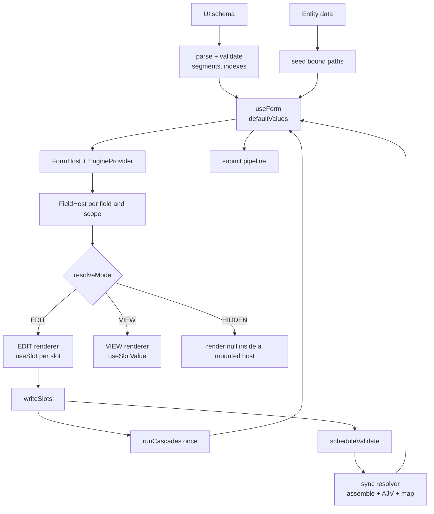

# Form Engine — RHF Detailed Design

**Design note**
Status: contract ready for the vertical slice
Scope: React Hook Form as the value and error layer under the generated form
Companion: [problem-form-engine.md](problem-form-engine.md),
[form-library-evaluation.md](form-library-evaluation.md)
Last updated: 2026-11-07
Revision: rev 2; resolves
[rhf-form-engine-design-review.md](rhf-form-engine-design-review.md)

Code sketches are JavaScript with JSDoc types and illustrative. None were
executed. The repo is plain JavaScript; no TypeScript tooling is added for this
demo.

---

## 0. Review resolution

The review's split is kept: RHF owns values, errors and dirty state; the engine
owns the document, modes, rules, validation assembly, cascades and submit. Every
blocker is resolved as a contract change below.

| Blocker | Resolution | Section |
|---|---|---|
| 1. Mode privilege escalation | Accept. Permission allowlist first, then visibility, ancestor, form mode last. | 7 |
| 2. Validation validates excluded values | Accept principle; **reject projection**. Closed leaf-only fragment vocabulary, no sibling-observing keywords, cross-field rules outside AJV. | 10 |
| 3. Cascade payload exfiltration | Accept. Source ids, declared params only, no arbitrary URLs. | 11 |
| 4. Stale async writes | Accept. Epoch plus per-target run token plus item identity. | 11 |
| 5. Submit is not a pipeline | Accept. Locked, ordered pipeline; VIEW saves only. | 14 |
| 6. Slot adapter skips cascades, drops ref | Accept. Values-only contract, all writes through `writeSlots`. | 6 |
| 7. Repeat groups have no scope | Accept. `Scope`, ancestor fold, `__key`, no per-item visibility. | 12 |
| 8. `required` passes empty values | Accept. Inject emptiness constraints per slot type. | 10 |
| 9. No document validation or fail-closed path | Accept. `parse` validates; blocking issues block the form and submit. | 18 |
| 10. Paths unsafe for open trees | Accept. Segment arrays internally; strict parse rejection. | 5 |
| 11. AJV, cache, resolver not runnable | Accept. Sync resolver, explicit options, tuple cache key. | 10 |
| 12. Mode toggle keeps wrong state | Accept. Single baseline, dirty ref, warning veto, cancellation. | 15 |
| 13. Multi-slot writes not atomic | Accept. `writeSlots` writes all slots, then one cascade pass. | 6 |
| 14. Render claim unproven | Accept. Claims removed; measure before repeating them. | 16 |

Rejected from the review:

- **Projection.** Dropping a hidden item renumbers every later array index, so
  AJV pointers no longer match RHF names. The closed fragment vocabulary makes
  it unnecessary.
- **Frontend permission as authorization.** Client grants decide rendering
  only. The server must omit unauthorized values on read and enforce field
  authorization on write.
- **Arbitrary cascade URLs.** Withdrawn. Sources are frontend registry ids.
- **JSON Logic as the condition language.** Dropped in favour of a closed,
  in-repo evaluator with an operator allowlist.
- **Five separate demos.** One pattern with six build milestones, not five
  duplicate engines.

---

## 1. Decision and boundaries

RHF owns: values, dirty state, errors, field registration, the resolver call.

The engine owns: the document, the registry, mode resolution, conditions,
visibility, cascades, validation assembly, complex-field orchestration, submit.

The engine is pure over a small port, so it can be tested without React:

```js
/**
 * @typedef {Object} FormApi
 * @property {() => Values} getValues
 * @property {(name: string, value: unknown) => void} setValue
 * @property {(name?: string) => Promise<boolean>} trigger
 * @property {(values?: Values) => void} reset
 * @property {(issue: EngineIssue) => void} record
 * @property {(name: string, error: FieldError) => void} setError
 * @property {() => void} clearErrors
 */
```

RHF lives only in `rhf/`. `engine/` imports neither React nor RHF.

```text
document + entity data
        |
   engine (pure over FormApi: parse, modes, conditions, schema, cascades)
        |
   RHF (values, errors, dirty)
        |
   field renderers (VIEW / EDIT)
```

---

## 2. Module map

```text
src/patterns/form-engine/
  engine/
    document.js       parse + validate + normalise the UI schema
    paths.js          segment parsing, toName, path <-> field maps
    conditions.js     closed condition evaluator
    modes.js          resolveMode lattice, ancestor fold
    visibility.js     rule index, evaluateHidden
    validation.js     assembleSchema, resolver factory, error mapping
    cascades.js       cascade index, run token state machine
    submit.js         submit pipeline
    issues.js         EngineIssue codes and blocking policy
  rhf/
    FormHost.jsx      useForm, providers, debounced trigger, mode toggle
    useSlot.js        useController adapter; the only RHF name boundary
    useSlotValue.js   read-only subscription
    useFormEngine.js  engine context access
  registry/
    index.js          field type -> entry map
    fields/           Text, Date, RepeatGroup, InputWithNA
  fixtures/
    documents.js      fixture UI schema
    sources.js        in-memory cascade sources
  README.md
```

---

## 3. Runtime flow



One direction only: values live in RHF; everything else is derived from them.

---

## 4. Form setup

Render the form after entity data arrives. RHF caches `defaultValues` at mount;
an edit-mode fetch after mount races `useFieldArray` and loses.

```js
const form = useForm({
  defaultValues: seedBoundPaths(document, cloneData(entity)),
  shouldUnregister: false,   // VIEW unmount must keep values
  mode: 'onSubmit',          // the engine drives validation
  reValidateMode: 'onSubmit',
  criteriaMode: 'firstError',
  resolver: engineResolver,  // one resolver per form instance
})
```

- No `context`: the resolver closes over the engine, and the engine reads its
  own live `ctx()`.
- Seed every bound path: string/date `''`, number `null`, boolean `false`,
  array `[]`, container `{}`. Never seed `undefined`.
- Keep the whole entity so unbound properties survive submit.
- `shouldUnregister: false` is load-bearing; never set it true.
- Never use `handleSubmit`: it always validates, and VIEW submit must not.
- Remount `FormHost` when the document or permissions change:
  `key={`${doc.id}@${doc.version}:${permissionsRev}`}`.

---

## 5. Paths and payload

Document bindings arrive as dotted paths: `properties.address.city`. Parse once
into segments; nothing downstream re-parses a string.

```js
// "properties.items.2.name" -> ['properties', 'items', '2', 'name']
const SEGMENT = /^[A-Za-z_][A-Za-z0-9_-]*$/
const INDEX = /^(0|[1-9]\d*)$/
const RESERVED = new Set(['__proto__', 'prototype', 'constructor'])

/** @param {string[]} segments */
export function toName(segments) {
  return segments.reduce(
    (name, segment) =>
      INDEX.test(segment)
        ? `${name}[${segment}]`
        : name === '' ? segment : `${name}.${segment}`,
    '',
  )
}
```

Rules:

- Internal representation is `segments: string[]`. `toName` runs only at the RHF
  boundary: `useSlot`, `useFieldArray`, `setValue`, error mapping.
- Numeric segments are array indices only under a declared `RepeatGroup`
  binding. Any other numeric segment (`properties.2024.value`) is rejected at
  parse. RHF would create an array where the entity had an object.
- Keys containing `.`, `[`, `]`, `'`, `"`, `~` or `/` are rejected at parse.
- Reserved names (`__proto__`, `prototype`, `constructor`) are rejected.
- Leading-zero indices (`items.01`) are rejected.
- No binding path may be a prefix of another binding path, except a group and
  the children in its template.
- The entity leaves the client **nested**, as `getValues()` returns it. Dotted
  paths are document syntax only. A backend that wants dotted keys needs a
  serializer in the save adapter, not in the engine.
- Decode JSON Pointer `~1` → `/` and `~0` → `~` before mapping AJV errors.

---

## 6. Slot adapter and writes

`useSlot` is the only place RHF names appear in a field component. It takes
values, never events.

```js
export function useSlot(path, slot) {
  const { control, writeSlots } = useFormEngine()
  const name = toName(path)
  const { field, fieldState } = useController({ control, name })

  return {
    id: domId(path),
    name,
    value: field.value,
    onChange: (next) => writeSlots([{ path, value: slot.normalize(next) }]),
    onBlur: field.onBlur,
    ref: field.ref,
    error: fieldState.error?.message,
    invalid: Boolean(fieldState.error),
    isTouched: fieldState.isTouched,
    required: slot.required,
    disabled: slot.disabled,
    describedBy: slot.helpId,
  }
}
```

- Renderers unwrap events: `onChange={(e) => slot.onChange(e.target.value)}`.
  A dev-only guard may record an `EngineIssue` when an `Event` reaches the
  adapter. It never changes the value.
- Do **not** wrap objects containing a `target` key in the `setValue` path.
  RHF v7 `setValue` stores the value verbatim; `field.onChange` is the only
  path that extracts events, and this design does not use it. A wrap would
  corrupt legitimate data of the shape `{ target: ... }`.
- `useSlot` is one subscription per slot. `InputWithNA` has two.

### Atomic multi-slot writes

```js
export function writeSlots(writes) {
  for (const { path, value } of writes) {
    form.setValue(toName(path), value, { shouldDirty: true })
  }
  runCascades(writes.map((w) => w.path))   // one pass, final values
  scheduleValidate()
}
```

`InputWithNA` calls `writeSlots` once with both slots, so a cascade never sees
`{ value: 'old', isNA: true }`.

### Empty-value normalisation

| Slot type | Empty value |
|---|---|
| string, date | `''` |
| number | `null` |
| boolean | `false` |
| array | `[]` |
| object | `{}` |

Normalisation lives in the registry entry, per slot. Text renderers coerce
`null`/`undefined` to `''` so the input never flips between controlled and
uncontrolled.

### Slot type check

Run once per field instance per document version. On mismatch: render the
read-only degraded renderer, record a warning issue, leave the value untouched.

---

## 7. Modes

Mode is a lattice: `HIDDEN` beats `VIEW` beats `EDIT`. Permission and
visibility are absolute. The form mode and ancestors only demote.

```js
const RANK = { HIDDEN: 0, VIEW: 1, EDIT: 2 }
const lower = (a, b) => (RANK[b] < RANK[a] ? b : a)

/**
 * @param {FieldDef} def
 * @param {() => Values} get
 * @param {Scope | null} scope
 * @param {ModeContext} ctx
 */
export function resolveMode(def, get, scope, ctx) {
  const key = ctx.permissionKeyByField.get(def.id) ?? def.id
  const grant = ctx.permissions.get(key)

  if (grant !== 'EDIT' && grant !== 'VIEW') return 'HIDDEN'
  if (isHidden(def.id, get, ctx)) return 'HIDDEN'

  const ancestor = ancestorMode(def, get, scope, ctx) // EDIT at top level
  if (ancestor === 'HIDDEN') return 'HIDDEN'

  const form = ctx.formMode === 'VIEW' ? 'VIEW' : 'EDIT'
  return lower(lower(grant, ancestor), form)
}
```

- `permissions`, `permissionKeyByField`, `registry`, `fieldsByPath` and
  `pathToFields` are `Map`s. Never index a plain object with a field id.
- Grant values are validated when the permission payload loads. Anything other
  than `'EDIT'` or `'VIEW'` is dropped with a warning issue and resolves to
  HIDDEN. `'edit'`, `'NONE'`, `true` and typos never become EDIT.
- `permissionKey` defaults to the field id. A missing key is a normal denial,
  not a document error.
- Missing grant = HIDDEN in every form mode. The frontend never infers read
  access from the form mode; readable fields need explicit VIEW grants.
- Ancestors fold: a HIDDEN group hides every child; a VIEW group demotes EDIT
  children to VIEW.
- **Trust boundary.** Client-side grants are rendering rules, not
  authorization. `defaultValues` and the submit payload carry the whole entity.
  The server must omit unauthorized values on read and enforce field-level
  authorization on write. Both this note and the problem statement say so.

`FieldHost` is mounted for every field, including HIDDEN ones; HIDDEN returns
`null` inside the component. Filtering at the parent would stop the
subscription and the field could never reappear. `BlockBoundary` wraps
`FieldHost` from the outside, plus one form-level boundary.

---

## 8. Visibility

At document load, invert the rules once:

```js
Map<fieldId, Rule[]>   // only rules that can hide this field
```

Each field subscribes to the union of its rules' dependency paths:

```js
function useResolvedMode(def, scope) {
  const rules = visibilityIndex.get(def.id) ?? []
  const deps = useMemo(() => unique(rules.flatMap((r) => r.dependsOn)), [rules])
  const watched = deps.length ? useWatch({ control, name: deps }) : []
  // read full values for condition evaluation; never rebuild a tree from leaves
  return resolveMode(def, () => getValues(), scope, ctx())
}
```

- `useWatch` with a name array returns values in dependency order. Do not assume
  an object keyed by path.
- Skip `useWatch` entirely when `deps` is empty.
- Hiding never clears a value. Hidden values stay and are submitted.
- Rules re-evaluate on any data change, including cascade writes.
- Visibility targets whole fields or whole groups. **A visibility rule may not
  target a template child**; per-item visibility is a blocking parse error.
  This is load-bearing for validation soundness, cache stability and the
  uniform `items` schema.

---

## 9. Conditions

JSON Logic is not used. The CVE surface and prototype-walking operators are not
worth a dependency the engine must validate anyway.

```js
/**
 * @typedef {Object} Condition
 * @property {'eq'|'neq'|'in'|'notIn'|'gt'|'gte'|'lt'|'lte'|'empty'|'and'|'or'|'not'} op
 * @property {Condition[]} [args]
 * @property {string[]} [path]
 * @property {unknown} [value]
 */
```

- Operator allowlist only. Unknown operators fail closed at parse.
- `path` must be a declared binding. Relative paths resolve against the current
  item scope inside a repeat group.
- Caps: depth ≤ 8, nodes ≤ 64.
- `and`/`or` short-circuit; `not` takes one argument.
- Conditions read values only. They never write.

---

## 10. Validation

### 10.1 Fragment subset

Per-slot fragments may use exactly:

`type`, `enum`, `const`, `minLength`, `maxLength`, `pattern`, `minimum`,
`maximum`, `exclusiveMinimum`, `exclusiveMaximum`, `multipleOf`, `minItems`,
`maxItems`.

Rejected at parse: `required`, `additionalProperties`, `propertyNames`,
`patternProperties`, `dependentRequired`, `dependentSchemas`, `if`/`then`/
`else`, `$ref`, `$data`, `not`, `anyOf`, `oneOf`, `uniqueItems`, `format`,
`properties`, `items`, and nested fragments.

Invariant, checked in tests:

> The compiled schema observes only the subtree of an effective-EDIT slot. No
> keyword may read a path outside that subtree.

Enforced by the allowlist, leaf-only fragments, no prefix-overlapping bindings,
and cross-field rules outside AJV. Therefore the resolver validates the full
values object directly. No projection, no clone.

### 10.2 Assembly

```js
/**
 * @param {Document} doc
 * @param {Map<string, Mode>} modes
 * @returns {{ schema: object, pathToFields: Map<string, FieldDef[]> }}
 */
export function assembleSchema(doc, modes) {
  // 1. insert each EDIT slot fragment at its segment path
  // 2. build { type: 'object' } containers at intermediate nodes
  // 3. parent required lists contain EDIT slots only
  // 4. repeat groups emit one uniform items schema
  // 5. never emit additionalProperties: false
  return { schema, pathToFields }
}
```

- Required injection, by slot type: string/date `minLength: 1`; array
  `minItems: 1`; required number `type: 'number'`; optional number
  `['number', 'null']` with `allowUnionTypes: true`. `0` and `false` stay
  valid. Whitespace-only strings count as non-empty in v1; pinned by a test.
- Unbound entity properties pass through untouched.
- Two fields constraining the same path: wrap in `allOf` and record the clash.

### 10.3 Cross-field rules

Cross-field logic is not JSON Schema:

```js
{ id, target: segments, group?: fieldId, dependsOn: [segments], invalidWhen: Condition, message }
```

Compiled only when `target` and every `dependsOn` path resolve to EDIT. Run
after AJV, with `group` resolving item-relative paths per row. This removes
`if/then`, `$data` and hidden-sibling reads in one cut.

### 10.4 Resolver and cache

```js
export function createResolver(engine) {
  return (values) => {                       // synchronous, no async
    try {
      const ctx = engine.ctx()
      const modes = computeModes(engine.document, values, ctx)
      const key = signature(engine.document, modes)
      const compiled = engine.validatorFor(key, () =>
        assembleSchema(engine.document, modes)
      )
      const errors = compiled.validate(values)
        ? {}
        : mapErrors(compiled, values)
      return {
        values,
        errors: applyCrossField(engine, values, modes, errors),
      }
    } catch (err) {
      return { values, errors: { root: { message: messageFor('internal', err) } } }
    }
  }
}
```

Cache key:

```js
JSON.stringify([
  ASSEMBLER_VERSION,
  doc.id,
  doc.version,
  sortedEditEntries,       // [fieldId, slot, templatePath], template child once
])
```

No array lengths: a repeat group compiles to one uniform `items` schema. LRU cap
20. Cache `{ validate, pathToFields }` together. One API:
`validatorFor(key, build) -> { validate, pathToFields }`.

AJV options, set explicitly:

```js
new Ajv({
  allErrors: true,
  strict: true,
  coerceTypes: false,
  useDefaults: false,
  removeAdditional: false,
  $data: false,
  $async: false,
  allowUnionTypes: true,
})
```

- No `format` and no `ajv-formats` in v1. Date slots normalise to
  `YYYY-MM-DD` and validate with a pattern. Limitation: `2026-02-31` passes.
- No coercion. The slot layer normalises types.
- Backend `pattern` is capped at 200 characters at parse; ReDoS remains a
  residual risk in production.

### 10.5 Error mapping

| AJV | Action |
|---|---|
| `instancePath: '/properties/items/0/name'` | name `properties.items[0].name` |
| `keyword: 'required'` | path plus `params.missingProperty` |
| `keyword: 'additionalProperties'` | path plus `params.additionalProperty` |
| structural keyword only | root banner, never dropped |

- Build the hierarchical object RHF expects, including arrays with `null`
  holes: `{ participants: [null, { name: { message } }] }`.
- Decode `~0`/`~1` first.
- `criteriaMode: 'firstError'`; `useSlot` reads `.message`.
- Any error that cannot map to a bound path goes to `errors.root` and a visible
  form-level banner. Never drop it.
- `messageFor(error, label)` owns wording. Never echo regexes, enum values or
  internal paths.
- `minItems` on a repeat group maps to the group path and renders through
  `useArrayError`; `useSlot` shows leaf errors only.

### 10.6 Validation scheduling

Do not debounce inside the resolver. Schedule from writes:

- `writeSlots`, cascade landings, and every `useFieldArray` operation
  (`append`, `remove`, `move`) call `scheduleValidate()`.
- Debounce 400 ms. Re-run immediately when the EDIT-set signature changes and
  on submit.
- No `form.watch(cb)` (deprecated) and no whole-values subscription. Both
  deep-clone values on every change.

---

## 11. Cascades

Index every rule under every path its condition reads, so a multi-source rule
fires on any dependency. Match template paths (`items.*.name`) against concrete
paths.

```js
export async function runCascades(sourceSegments, api) {
  for (const rule of matchTemplate(api.cascadeIndex, sourceSegments)) {
    try {
      const values = api.getValues()
      if (!evaluate(rule.when, values, rule.group)) continue
      for (const effect of rule.then) {
        const target = resolveTarget(effect.target, sourceSegments)
        switch (effect.kind) {
          case 'set': applySet(target, effect.value, api); break
          case 'fetch': applyFetch(rule, effect, target, sourceSegments, values, api); break
          default:
            api.record({ code: 'effect.unknown', severity: 'blocking', detail: effect })
        }
      }
    } catch (err) {
      api.record({ code: 'cascade.exception', severity: 'warning', detail: { rule: rule.id, err } })
    }
  }
}
```

Rules:

- Cascades do not chain. A cascade write never triggers another cascade.
- Targets must be leaf slot bindings. Container targets are rejected at parse.
- `*` in a target substitutes the source row's index.
- `getValues()` is re-read per effect; effect 1 may have hidden field B before
  effect 2 runs.
- Unknown effect kinds never fall into the fetch branch.
- One rule failing does not kill the change handler.

### Async freshness

```js
/** @typedef {Object} CascadeRun
 * @property {number} epoch
 * @property {number} runId
 * @property {string} ruleId
 * @property {string} targetKey
 * @property {unknown} [itemKey]
 * @property {unknown} sourceValue
 * @property {AbortController} controller
 */
```

At landing, all must hold: latest `runId` for the target; `epoch` current;
signal not aborted; target re-resolved (by item key when the row moved);
target EDIT; `rule.when` still true against fresh values; result matches the
target slot type. Fail any → discard.

Bump the epoch and abort pending runs on: reset, mode change, document or
permission change (remount), array mutation, submit start, unmount. Abort any
pending run for a target written by `set` or by the user. `AbortError` is
ignored, not recorded. When the group has no `itemKey`, every array mutation
discards all pending runs for that group.

### Source registry and fetch hardening

`effect.source` is a source id, never a URL:

```js
sources[id](declaredParams, { signal })
```

- Send only the paths declared in `effect.params`. Never the whole form.
- Demo sources are in-module mocks with latency. The demo makes no network
  requests. Document sources are untrusted input.
- Production contract, stated but mocked here: `credentials: 'omit'`,
  `redirect: 'error'`, `response.ok`, content-type check, 64 KB cap, 5 s
  timeout, JSON parse guard, shape and slot-type check before `setValue`.
- Fetch effects debounce 300 ms per target; a text source cannot fire per
  keystroke.
- Failure surfaces in the field or the root banner, not only in diagnostics.

---

## 12. Arrays and repeat groups

A `RepeatGroup` field declares a template:

```json
{
  "id": "items",
  "type": "RepeatGroup",
  "binding": { "value": "properties.items" },
  "itemKey": "id",
  "template": [
    { "id": "itemName", "type": "Text", "binding": { "value": "name" } }
  ]
}
```

- `Scope = { segments, index, key }`. Child path = group segments + index +
  child binding segments.
- `FieldHost({ def, scope })`; `useSlot(scope.path)`; `resolveMode` receives the
  scope.
- React key is always `field.__key`; `useFieldArray({ keyName: '__key' })`.
  A data `id` stays visible in `fields` and values and is never the React key.
- `newItem(template)` builds a complete object from child defaults.
  `append(newItem(def), { shouldFocus: false })`.
- `remove()` without an index removes every row; call sites always pass one.
- `update` remounts the row; document it.
- Every array operation bumps the cascade epoch, aborts pending runs for the
  group, and calls `scheduleValidate()`.

v1 limits, all enforced at parse:

- Whole-group visibility only; per-item visibility is a blocking error.
- Nested repeat groups rejected: v7 `useFieldArray` needs a fixed `name`, and a
  parent reorder changes it. Revisit with v8.
- Flat scalar arrays rejected: v7 needs object rows. Document the
  `{ value: scalar }` wrapper as the upgrade path.
- `itemKey` is optional. When present, validate uniqueness and stability; fall
  back to the hook key and record the fallback.

`minItems` violations render at the group path through `useArrayError`.

---

## 13. Complex fields

Complex fields are not in `properties`, so they are not in RHF values.

```js
/**
 * @typedef {Object} ComplexHandle
 * @property {() => Promise<FieldError[]>} validate
 * @property {(entity: Entity) => Promise<{ ok: boolean }>} submit
 * @property {() => boolean} isDirty
 */
```

- Register at the **form level**, keyed by `fieldId`, not per mount. VIEW
  unmounts the renderer but the handle must survive.
- StrictMode double mount is idempotent: re-register replaces by `fieldId`;
  cleanup removes only the same handle instance.
- `validate()` and `submit(entity)` are separate. `submit` never validates.
- Complex fields read form values; they never write them in v1. No setter until
  the problem statement scopes one.
- Validation never enters AJV.
- RichText is excluded from the demo. Adding it requires sanitising backend
  HTML and a CSP. Recorded, not built.
- The demo ships the contract as a stub; a real rich-text or file field is a
  later slice.

---

## 14. Submit

```js
export function createSubmit({ form, engine, complex, saveEntity, doc }) {
  let inFlight = false
  let idempotencyKey = crypto.randomUUID()

  return async function submit() {
    if (inFlight) return { ok: false, stage: 'busy' }
    inFlight = true
    try {
      const mode = engine.ctx().formMode

      if (mode === 'EDIT') {
        if (!(await form.trigger(undefined, { shouldFocus: true }))) {
          return { ok: false, stage: 'validation' }
        }

        const complexErrors = (
          await Promise.all([...complex.values()].map((h) => h.validate()))
        ).flat()
        if (complexErrors.length) {
          return { ok: false, stage: 'complex-validation', errors: complexErrors }
        }

        if (!(await settleCascades(3000))) {
          return { ok: false, stage: 'cascade-timeout' }
        }
      }

      const values = structuredClone(form.getValues())
      const entity = await saveEntity(
        { ...values, documentVersion: doc.version },
        { idempotencyKey },
      )
      if (!entity.ok) {
        applyServerErrors(form, entity.errors)
        return { ok: false, stage: 'entity', entity }
      }

      let complexResults = []
      if (mode === 'EDIT') {
        complexResults = await Promise.allSettled(
          [...complex.values()].map((h) => h.submit(entity.value)),
        )
      }

      form.reset(structuredClone(entity.value ?? values))
      idempotencyKey = crypto.randomUUID()

      return {
        ok: complexResults.every(
          (r) => r.status === 'fulfilled' && r.value.ok,
        ),
        entity,
        complex: complexResults,
      }
    } catch (err) {
      return { ok: false, stage: 'exception', error: err }
    } finally {
      inFlight = false
    }
  }
}
```

- `ok` is true only when the entity saved and every complex submit succeeded.
  Partial failure reports per-handle detail; retry failed handles only. No
  rollback.
- VIEW submit saves the current data unchanged: no `trigger`, no complex
  validation, no complex submit.
- The payload always includes `documentVersion`. The idempotency key is reused
  until a create succeeds.
- 422 maps to `setError`; unmapped paths go to the root banner.
- `structuredClone` protects the payload from later RHF mutation.
- `form.reset(savedEntity)` moves the saved baseline and clears `isDirty`.
- Complex submit receives the saved entity, so attachments get an id.

---

## 15. Mode toggle

```js
function requestMode(next) {
  if (next === mode) return

  const dirty = isDirtyRef.current || complex.isDirty()
  if (next === 'VIEW' && dirty && !warnUnsavedChanges()) return

  if (next === 'VIEW' && dirty) form.reset()  // defaultValues is the baseline
  modeRef.current = next                       // synchronous, before reset/state
  cancelValidation()
  cascades.bumpEpoch()
  cascades.abortAll()
  form.clearErrors()
  setMode(next)
  focusModeToggle()
}
```

- One baseline: `defaultValues` is the last saved entity. `form.reset(saved)`
  after save; `form.reset()` discards drafts. No parallel snapshot ref.
- `isDirty` is read during `FormHost` render and copied to a ref every render.
  A handler never trusts a stale closure.
- Complex `isDirty()` is consulted; unsaved complex edits are never discarded
  without a warning.
- The warning returns a boolean and gates both the reset and the toggle.
  Cancel means no reset and no toggle.
- Cancel the debounce, bump the epoch, abort fetches, clear errors. Errors from
  before the toggle must not reappear.
- Restore focus to the toggle or the form heading and announce the mode.
- Never `isValid` or `errors` at the root. `isDirty` only.

---

## 16. Re-render rules

| Rule | Reason |
|---|---|
| No `formState` at the root except `isDirty` | `errors`/`isValid` re-render the host on every validation |
| `useSlot` per slot; never `watch()` in a field | one subscription per slot (`InputWithNA` = two) |
| `useWatch` only with explicit, memoised names | a new array is a new subscription |
| Skip `useWatch` when a field has no rules | avoids empty-name behaviour |
| No `form.watch(cb)` | deprecated; writes already schedule validation |
| Memoise provider values | inline objects re-render every consumer |
| `BlockBoundary` outside `FieldHost` | hook and registry errors throw inside |
| Mount HIDDEN fields, return `null` inside | subscriptions must stay live |

`React.memo` compares props, not hook output. A shell memoised on `def` and
`scope` may wrap an inner subscriber; do not claim a comparator sees `mode`.

**Unmeasured claim.** A no-argument `trigger()` re-renders form state, and
`useSlot` reads `fieldState.error`. Whether every field re-renders on each
debounced validation is unknown until measured. The S3 milestone counts
renders. If it is too broad, the fallbacks are blur-only validation or
per-field rules. Do not write "nothing else re-renders" until the counter says
so.

---

## 17. Edge cases

| Case | Behaviour |
|---|---|
| Path missing in data | Valid; seeded to the slot's empty value |
| Path type mismatched | Degraded read-only field, warning issue, value untouched |
| Unknown field type | Read-only fallback, blocking issue |
| Field hidden mid-typing | Stays mounted, renders null, value kept, focus lost |
| Async cascade lands after hide | Discarded by the run token |
| Async cascade lands after array reorder | Re-resolved by item key, or discarded |
| Two fields bind one path | Both update; fragments merge via `allOf`, clash recorded |
| Cascade targets an unbound path | Parse error; at runtime, recorded and skipped |
| Cascade targets a container | Rejected at parse |
| Form flips to VIEW during a fetch | Epoch bump aborts; result discarded |
| Submit in VIEW with errors present | Submits, per requirement |
| `{ target: x }` data | Stored verbatim; no event sniffing on `setValue` |
| Duplicate field id | Document rejected |
| Document republished mid-session | FormHost remounts; pending work aborted |

---

## 18. Fail-closed policy

```js
/**
 * @typedef {Object} EngineIssue
 * @property {string} code
 * @property {'blocking'|'warning'} severity
 * @property {string} [fieldId]
 * @property {string} [ruleId]
 * @property {unknown} [detail]
 */
```

`document.parse` returns `{ ok, document, issues }`. Validation covers:

- unique, non-empty, safe field ids;
- every type and slot exists in the registry;
- canonical paths: no reserved segments, unsafe characters, leading zeros, or
  numeric segments outside declared array positions;
- `permissionKey` shape; grants validated at payload load;
- every rule parses, every operator and effect is known, every target is bound,
  every dependency exists;
- fragment keywords inside the allowlist; `pattern` length capped;
- template child ids unique; `itemKey` valid;
- depth, rule count and array limits bounded;
- no binding prefix overlap (except group/template);
- visibility never targets a template child.

Visibility cycles are not checked: hiding never writes values and cascades do
not chain, so a cycle is unreachable.

| Failure | Behaviour |
|---|---|
| Invalid document | Error panel, no partial form, submit disabled |
| Invalid visibility rule | Target fields hidden |
| Invalid cascade rule or effect | Rule skipped, blocking issue |
| Unknown effect kind | Never fetches |
| Unknown field type | Read-only fallback, blocking issue |
| Malformed AJV fragment or compile error | Submit blocked, banner |
| Unmappable AJV error | `errors.root`, banner |

`console.warn` is not a policy. Blocking issues have a visible state and a
disabled submit.

---

## 19. Testing

Pure modules run under the existing `node --test`:

- paths: reject unsafe characters, reserved names, leading zeros, numeric
  non-array segments, prefix overlap;
- modes: form VIEW with empty grants → HIDDEN; `'edit'`/`true`/`'NONE'` → HIDDEN;
  `permissionKey`; hidden group; VIEW group; ancestor fold;
- document parse: duplicate ids, unknown type, unbound target, bad keyword,
  bad pattern, size caps, per-item visibility rejection;
- conditions: unknown operator, depth and node caps, relative paths;
- assembly: required lists contain EDIT children only, no
  `additionalProperties`, one uniform `items`, no sibling-observing keyword;
- resolver: cache hit does not recompile, different `doc.id` does not collide,
  LRU cap;
- error map: arrays with `null` holes, `~0`/`~1`, root banner;
- cascades against a fake `FormApi`: stale run discarded, epoch bump, item key
  move, unknown effect, `AbortError` ignored, declared params only;
- submit against a fake API: double click, complex validation failure, partial
  complex failure, 422 mapping, exception, VIEW skips complex work, baseline
  reset;
- seed: missing containers, missing leaves, unbound data preserved.

Manual in the demo, because the repo has no DOM test runner:

- render counts per keystroke and per debounced validation;
- async race (switch country twice);
- mode toggle with dirty and cancel;
- hidden value survives and reappears;
- `{ target: x }` round-trips through `writeSlots` (spike gate for any wrap);
- accessibility: label, `aria-invalid`, `aria-describedby`, focus first
  invalid, focus restored after toggle.

The review's 72-item matrix is the backlog, with three deltas: items 14 and 15
become "assembler emits no sibling-observing keyword"; item 67 is the
`{ target }` round-trip; item 58 is "rejected, wrapper documented".

---

## 20. Deferred and limitations

- Nested repeat groups, flat scalar arrays, per-item visibility, container
  fragments, `uniqueItems`, `format` and `ajv-formats` are out of v1.
- Numeric object keys (`2024`, `0`) cannot be bound. Fails loud; a production
  version needs JSON Pointer or segment-preserving addressing.
- Whitespace-only strings pass `required` in v1.
- Date patterns accept invalid calendar dates (`2026-02-31`).
- Backend regexes are capped but catastrophic backtracking remains possible.
  Production should precompile patterns server-side or use RE2.
- The frontend permission model is not authorization.
- Complex fields are a stub in the demo; a real one is a later slice.
- v7 is pinned. v8 changes `useFieldArray` keys and removes `keyName`; the
  migration is budgeted separately.

---

## 21. Production concerns

These are contracts, not demo features:

- **Server field authorization.** Omit unauthorized values on read; enforce
  fields on write. The client engine is rendering only.
- **Optimistic concurrency.** Send the loaded entity version with the payload.
- **Idempotency.** Create requests carry a key, reused until success.
- **Server errors.** 422 maps to `{ path, message }[]`; the client applies
  `setError` and sends unmapped paths to the root banner.
- **RichText.** Sanitise backend HTML and set a CSP before rendering it in
  VIEW.
- **Fetch hygiene.** Origin/transport policy lives in the source registry, not
  in the document.

---

## 22. Repo integration

Dependencies, installed when the spike starts — they are the pattern under
test:

```text
react-hook-form@^7.91.0
ajv@^8.17.1
```

Not installed: `json-logic-js`, `ajv-formats`, `@hookform/resolvers`,
TypeScript, Vitest or RTL. `node --test` covers the pure engine; DOM checks are
manual.

One demo: `src/patterns/form-engine/`, one `App.jsx` switchboard entry. Build
order:

- **S1** paths, document parse, modes, permissions; pure tests.
- **S2** validation assembly, resolver, error mapping; pure tests.
- **S3** `FormHost`, `useSlot`, registry (Text, InputWithNA), visibility,
  render counter.
- **S4** cascades: sync set, async mock, epoch and run token.
- **S5** repeat group: scope, `__key`, `newItem`.
- **S6** submit pipeline, mode toggle.
- Complex fields: contract plus stub.

Fixture sources are in-memory mocks. The fixture README states that document
sources and URLs are untrusted and that the demo makes no network requests.

---

## 23. Open items

1. **Message ownership.** `messageFor` is frontend-owned for now; backend
   message strings are deferred.
2. **Partial-failure UI.** The contract reports per-handle detail; the visual
   retry surface is not designed.
3. **Whitespace policy.** v1 accepts whitespace-only required strings. Decide
   whether to trim or reject with a `\S` pattern.
4. **Complex field write interface.** Deferred until the problem statement
   scopes one.
5. **v8 migration.** Keys, `keyName` and `watch` change; pin v7 for the demo.

---

## 24. What this design deliberately avoids

- No schema renderer and no UI-schema library.
- No Redux slice for form values: RHF is the store; a second copy would
  desync.
- No cascade chaining and no general expression evaluator.
- No `handleSubmit`, no `register`, no `formState` beyond `isDirty` at the root.
- No arbitrary cascade URLs and no network in the demo.
