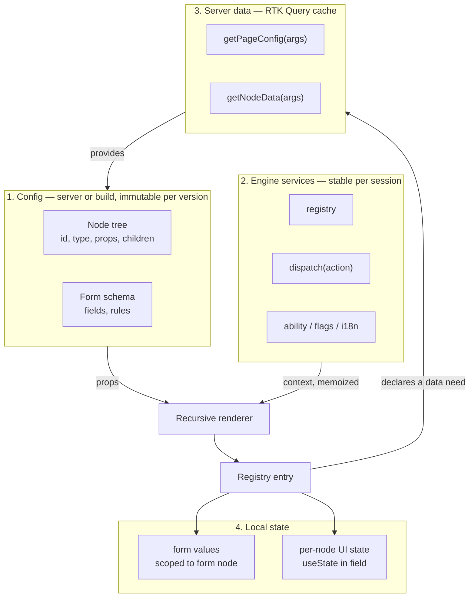
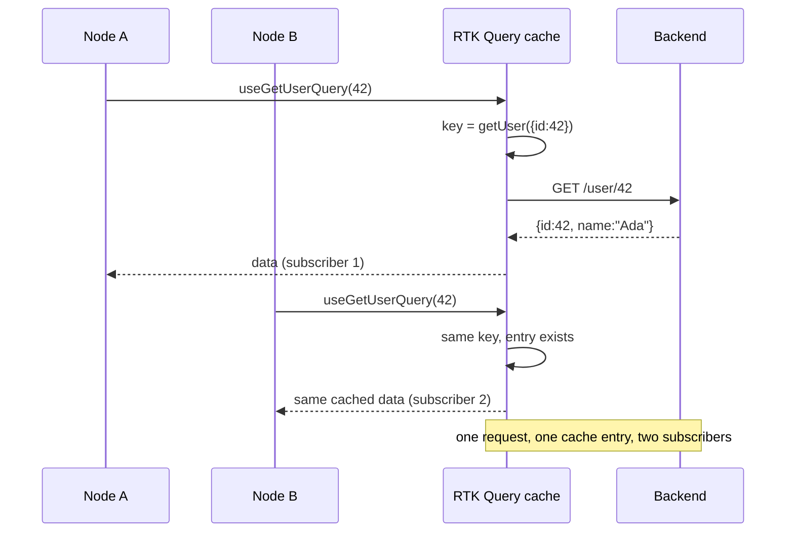
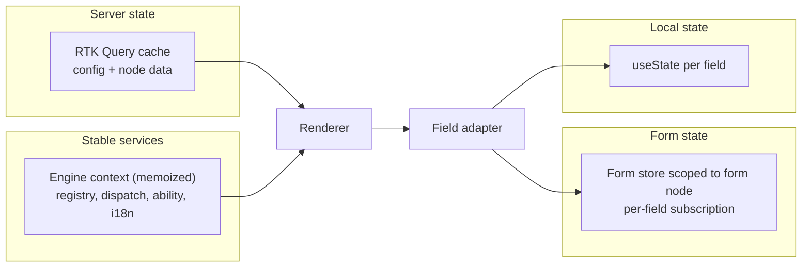
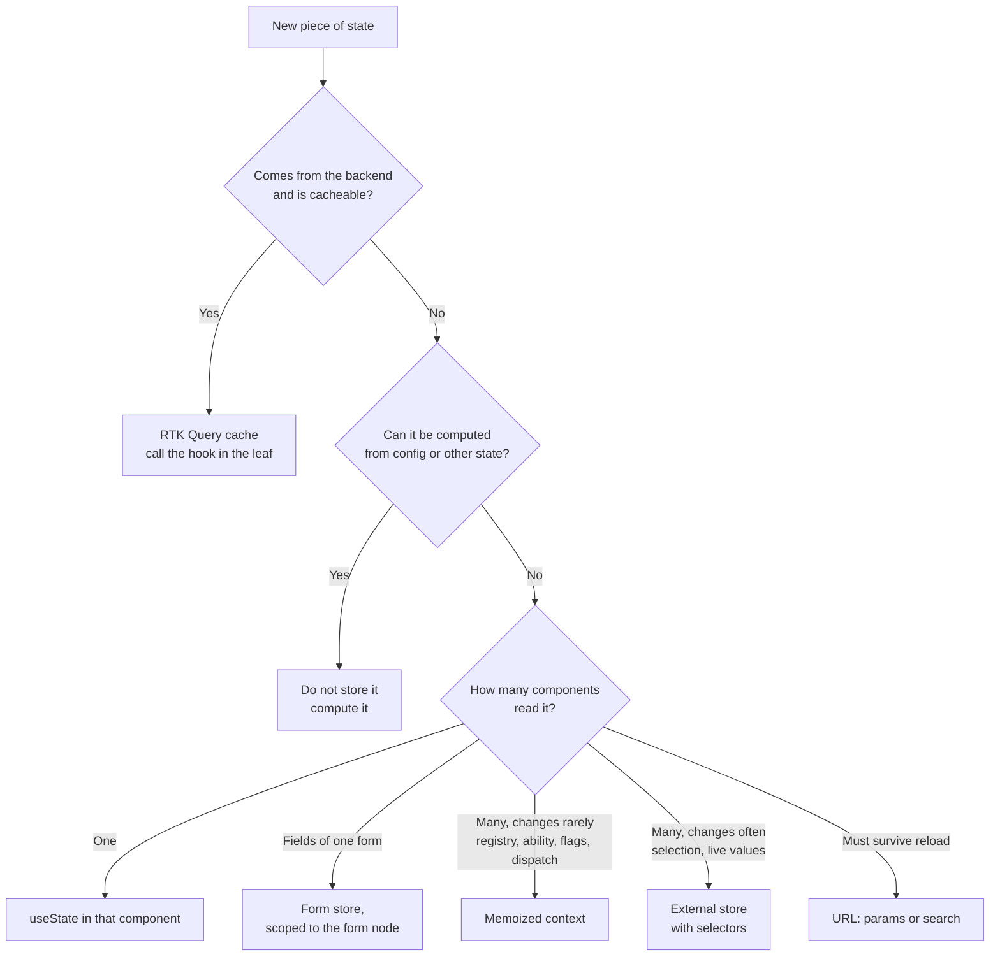

# State Management for a Config-Driven React Engine

**Research note**
Status: analysis complete, no implementation started
Scope: how a config-driven React + TypeScript engine holds config, server data,
form values and per-node UI state, and how RTK Query fits
Last updated: 2026-11-01

Code snippets are illustrative. They were not executed as part of this note.

---

## 1. Short answer

Yes, you can combine them, and the combination is the standard shape rather than a
compromise. But the question hides a wrong assumption, so state it plainly first:

> **RTK Query does not prevent duplicate renders. It prevents duplicate requests.**

That distinction is the whole answer. RTK Query deduplicates by *endpoint plus
serialized arguments*, and shares one cache entry between every component that asks
for the same thing. Duplicate *renders* are a React problem, solved by subscription
granularity, stable references and `React.memo`, not by a data-fetching library.

Second correction: config-driven architecture does **not** make prop drilling
disappear. It changes *where* the drilling happens.

The practical conclusion:

| State | Owner | Mechanism |
|---|---|---|
| Config (node tree, form schema) | server or build | RTK Query cache, or a static import |
| Engine services (registry, dispatch, ability, flags, i18n) | app code | one memoized Context |
| Server data per node | backend | RTK Query, called inside the leaf |
| Form values | the form node | scoped form store, not the app store |
| Per-node UI state (open, tab, draft text) | the field | `useState` in the component |
| Navigation and selection | URL | route params or search params |

One global client store is not on that list. It appears only when two distant
subtrees must share mutable state, and that condition is rarer than it feels.

---

## 2. Where the premise holds, and where it breaks

### 2.1 "No duplicate code, so no prop drilling" conflates two things

Prop drilling cost depends on **distance and fan-out**, not on how much code is
repeated across screens.

- Duplicate code is a problem *across screens*. Config-driven architecture removes
  it: screens become data, and the engine is written once.
- Prop drilling is a problem *inside one component tree*, between a state owner and
  a consumer. Config-driven architecture does not remove it. If anything it adds
  depth, because the recursive renderer inserts one frame per node level.

A page tree six levels deep puts six renderer frames between the engine root and a
leaf field. So drilling is bounded by tree depth, not eliminated.

### 2.2 But the premise is right in a more useful way

The honest reason a config-driven engine needs so little state is different:

- **The config is not state.** It is data fetched once and immutable per version.
  Copying it into a store is a mistake, not a feature.
- **Per-node UI state is local** by nature. A disclosure panel is open inside one
  component instance. Globalising it is what creates re-render storms.
- **Server data already has a store**: the RTK Query cache.

So the only genuinely shared mutable state left is **form values**, and sometimes a
selection or a wizard step. That is a much smaller problem than "a store for the
engine", and it is the one worth designing carefully.

### 2.3 The failure this analysis must prevent

The naive design is: put everything in state at the engine root, pass it down.

```tsx
// Illustrative. Do not do this.
function Engine({ config }) {
  const [formValues, setFormValues] = useState({})

  const renderNode = (node) => {
    const Entry = registry[node.type]
    return (
      <Entry.render
        {...node.props}
        values={formValues}
        onChange={setFormValues} // every field updates the root
      />
    )
  }

  return <>{renderNode(config.root)}</>
}
```

Each keystroke replaces `formValues`, re-renders `Engine`, and therefore re-renders
every node in the tree. With 80 fields that is 80 component renders per character.
That is exactly the duplicate-render problem worth avoiding, and it is caused by the
state design, not by the fetch layer.

The fix is not "add Redux". The fix is to let each field subscribe to its own slice
of the form state. React Hook Form does this internally; a selector-based store does
it too.

---

## 3. The four layers



Five rules make this work:

1. **Config flows down as props.** It is data. Do not put it in mutable state.
2. **Services flow through one memoized context.** They change rarely, so a context
   re-render is cheap and correct. This is the legitimate use of context.
3. **Server data is read where it is needed**, inside the leaf, with its own
   argument. Never lifted to the root and forwarded.
4. **Form values live in a store scoped to the form**, with per-field subscription.
5. **Per-node UI state never leaves the field component.**

---

## 4. What RTK Query actually deduplicates



Documented behaviour: the cache key is the endpoint plus the serialized query
parameters; extra subscriptions increment a reference count; the entry is dropped
after `keepUnusedDataFor` seconds once the count reaches zero. Identical requests are
shared automatically, with no context, no lifting, and no engine involvement.

That gives a clean config-driven shape: **the node declares its data need, and RTK
Query handles sharing**.

```tsx
// Illustrative.
type DataSource =
  | { kind: 'user'; id: number }
  | { kind: 'order'; id: string }
  | { kind: 'none' }

function NodeData({ source }: { source: DataSource }) {
  // One hook per branch, returned from that branch. Hook order stays stable
  // because each branch calls exactly one hook and returns.
  if (source.kind === 'user') return <UserView id={source.id} />
  if (source.kind === 'order') return <OrderView id={source.id} />
  return null
}
```

Two nodes that read the same entity share one request and one cache entry. That is
deduplication of work, and it is worth having. It is not deduplication of renders.

### 4.1 Where this breaks in a config-driven system

| Trap | Cause | Symptom |
|---|---|---|
| Cache key churn | Including unrelated or changing node props in the argument | Distinct serialized arguments create extra entries or refetches; an equivalent fresh object alone does not |
| Key drift | `{ id: 42 }` vs `{ id: '42' }` | Two entries, two requests, inconsistent UI |
| Duplicate copies | RTK Query has no normalized cache | Same entity cached under two endpoints |
| Idle subscriptions | Calling the hook in the renderer for every node | Hundreds of subscriptions nobody reads |
| Mirroring | Copying `data` into local state with `useEffect` | Double renders, stale values |
| Hook order | Looping `useQuery` over a varying children array | Rules-of-hooks violation |

The first four are about RTK Query. The last two are about React.

The argument rule is the one to enforce in the engine:

```ts
// Illustrative. Normalise the argument before it reaches the hook.
type NodeQueryArg = { kind: string; id: string; locale: string }

const toQueryArg = (source: DataSource, locale: string): NodeQueryArg => ({
  kind: source.kind,
  id: String(source.id), // kill 42 vs '42' drift
  locale,
})
```

Prefer a focused, serializable argument containing only the data that identifies the
request. A new object with the same serializable contents normally has the same cache
key; unrelated or changing fields can fragment the cache, and functions or other
non-serializable values do not belong in query arguments.

---

## 5. Can you combine them? Three viable combinations

RTK Query is not a separate universe. It is a Redux store with one reducer and one
middleware, and it can coexist with anything. The real choice is how much *other*
client state you add around it.

### Combination A — RTK Query only, plus context and local state

The store contains nothing but the API cache. Client state stays where it lives.

```js
// Illustrative. This is the shape already used by
// src/patterns/related-asset-fetching/store.js in this repo.
import { configureStore } from '@reduxjs/toolkit'
import { setupListeners } from '@reduxjs/toolkit/query'
import { api } from './api'

export const store = configureStore({
  reducer: { [api.reducerPath]: api.reducer },
  middleware: (gDM) => gDM().concat(api.middleware),
})

setupListeners(store.dispatch)
```

RTK Query also ships `<ApiProvider>`, which mounts a store for you if you have none.
Use it only if you genuinely have no other reason for a store; in this repo the
createApi store is already the convention.

- **Pros:** smallest surface; no client-state schema to maintain; server cache gets
  dedupe, invalidation, polling and devtools for free; one dependency already
  installed; the engine's public API stays about config, not about a store.
- **Cons:** no shared client state across distant subtrees. If two unrelated
  subtrees must share mutable state, you will build it anyway.
- **Fit:** the config-driven engine itself, most internal tools, most admin screens.

### Combination B — RTK Query plus Redux slices

Server cache in `api.reducer`, shared client state in slices.

- **Pros:** one store, one devtools timeline; selectors give fine-grained
  subscriptions; time travel; well-documented; the repo already has React Redux.
- **Cons:** more ceremony per feature; a global schema you must version; easy to
  drift into putting config and form drafts in it; selectors returning new objects
  cause silent re-render regressions.
- **Fit:** multi-pane workbenches, cross-route selection, undo, offline queues,
  anything where state outlives a single screen.

### Combination C — RTK Query plus a light store (Zustand, Jotai)

Two stores. RTK Query owns server cache; the light store owns client state.

- **Pros:** minimal ceremony; no provider for Zustand; selectors are explicit;
  per-instance stores are easy with a factory; atoms map naturally onto node ids.
- **Cons:** two stores, two devtools stories, two persistence strategies; the team
  now needs to know which store owns what, and that rule decays over time.
- **Fit:** teams that find Redux ceremony heavy but need cross-component client
  state, especially per-form or per-widget state.

**Recommendation for this repository: A now, B when a concrete need appears.**
A is achievable with zero new dependencies. C is a reasonable answer at work, but
here it would test two things at once and blur the pattern being studied.

---

## 6. Pattern catalogue

Each entry is a way to get state from an owner to a config-rendered field.

### 6.1 Props only, no context

State at the engine root, passed through the renderer.

- **Pros:** zero concepts; explicit; trivially debuggable; no context re-render
  subtleties; the tree shape is visible in the JSX.
- **Cons:** every consumer re-renders on any change; setters must be drilled and
  kept stable for memoisation; deep trees get noisy; the renderer's props grow
  without bound as features are added.
- **Verdict:** correct for the **config** itself and for immutable services. Wrong
  for form values. This is the user's current instinct, and it is half right.

### 6.2 Context for stable services

One provider holds registry, `dispatch`, ability, flags snapshot, i18n, formatters.

```tsx
// Illustrative.
const EngineContext = createContext<EngineServices | null>(null)

export function EngineProvider({ services, children }: Props) {
  // Memoise, or every consumer re-renders on every parent render.
  const value = useMemo(() => services, [services])
  return <EngineContext.Provider value={value}>{children}</EngineContext.Provider>
}

export function useEngine(): EngineServices {
  const value = useContext(EngineContext)
  if (!value) throw new Error('useEngine must be used inside <EngineProvider>')
  return value
}
```

- **Pros:** leaf components no longer receive plumbing props; the registry lookup is
  one call away; adding a service does not change any component signature; the value
  is stable, so context re-renders are rare.
- **Cons:** a new object literal in `value` re-renders the whole tree; implicit
  dependency; testing needs a provider wrapper.
- **Verdict:** the base of the recommended design.

### 6.3 Context as the store

All state in one provider, updated through callbacks.

- **Pros:** one obvious place; no library.
- **Cons:** every consumer re-renders on every update, because context has no
  selector; frequent updates make this unusable; splitting contexts later is a
  refactor across the tree.
- **Verdict:** avoid for anything that changes per keystroke. Acceptable for small
  trees with rare updates, which is exactly the shape of 6.2.

### 6.4 Redux Toolkit slices

- **Pros:** selectors give per-component subscription; devtools; middleware; the
  ecosystem matches RTK Query; time travel; `createEntityAdapter` for normalized
  collections.
- **Cons:** boilerplate; a global schema; easy to store the wrong things; the action
  layer is an extra indirection for a leaf field.
- **Verdict:** use when client state is shared across routes and must be observable.

### 6.5 RTK Query only

- **Pros:** smallest possible store; dedupe, invalidation, polling, streaming,
  optimistic updates; hooks called at the leaf keep subscriptions local.
- **Cons:** no answer for cross-subtree client state; hooks in a recursive renderer
  need discipline (stable arguments, constant hook count).
- **Verdict:** the server-state layer. Not a client-state solution, and the Redux
  docs say so explicitly ("data fetching and caching is really a different set of
  concerns than state management").

### 6.6 Zustand, global or per-instance

```ts
// Illustrative, per-instance via factory.
const createFormStore = (initial: Record<string, unknown>) =>
  createStore<FormState>()((set, get) => ({
    values: initial,
    setValue: (name, value) =>
      set((s) => ({ values: { ...s.values, [name]: value } })),
  }))
```

Pass the store handle through the engine context, then `useStore(store, selector)`
inside each field. The handle is stable; only the selected value re-renders.

- **Pros:** no provider for the global case; selectors are explicit and cheap;
  per-instance stores solve "two forms on one page" cleanly; tiny.
- **Cons:** one more concept; selector mistakes are silent (selecting an object
  literal re-renders always); no devtools timeline unless configured; a second store
  beside the Redux one.
- **Verdict:** the best fit when form state must be shared across node boundaries
  but you do not want a Redux slice per form.

### 6.7 Jotai atoms, one per node

```ts
// Illustrative shape. atomFamily caches one atom per key.
const fieldAtom = atomFamily((nodeId: string) => atom<unknown>(undefined))
```

- **Pros:** the most literal fit for a node tree. Each field subscribes to its own
  atom, so a keystroke re-renders one field. No prop drilling at all, no selectors,
  no store schema.
- **Cons:** atom families hold a keyed map, so long-lived apps must free unused
  atoms or leak; behaviour is spread across the tree rather than visible in one
  reducer; devtools and tracing are weaker than a single store.
- **Verdict:** elegant for form and per-node state, but a whole new mental model.
  Not worth introducing for one engine unless the team already uses atoms.

### 6.8 React Hook Form as the form store

`useForm` on the form node, `FormProvider` around the rendered subtree, `Controller`
or `useController` inside each field adapter.

- **Pros:** per-field subscription is the default, so keystrokes do not re-render
  the tree; validation and error state included; uncontrolled inputs keep typing
  cheap on large forms; the industry-standard answer for this exact problem.
- **Cons:** a dependency; its API is imperative and leaks if you let config author
  it; nested and dynamic fields need care; the field adapter must translate the
  node props into RHF props.
- **Verdict:** the right form layer once forms are real. Adopt behind an adapter so
  the engine never imports it directly.

### 6.9 XState for multi-step flows

- **Pros:** explicit states, guards and transitions; ideal when config describes a
  wizard or a checkout rather than a page.
- **Cons:** heavy for CRUD forms; a second model of the same logic; config and
  machine must stay in sync.
- **Verdict:** only when the configured thing is a state machine, not a layout.

---

## 7. Comparison table

| Pattern | Drilling | Re-render granularity | Ceremony | Testability | Verdict |
|---|---|---|---|---|---|
| Props only | High (by depth) | Whole tree | None | Easy | Config and services only |
| Context, stable value | None | Whole consumer tree, rarely | Low | Needs wrapper | **Recommended base** |
| Context as store | None | Whole consumer tree, often | Low | Needs wrapper | Avoid |
| Redux slices | None | Per selector | High | Good, needs store | When shared across routes |
| RTK Query only | None for server data | Per subscription | Low | Mock the API | **Recommended server layer** |
| Zustand | None | Per selector | Low | Good, store factory | Per-form state |
| Jotai atoms | None | Per atom | Medium | Good | If atoms already used |
| React Hook Form | None in fields | Per field | Medium | Good | **Recommended form layer** |
| XState | None | Whole machine | High | Excellent | Flows, not layouts |

---

## 8. Recommended shape



### 8.1 The engine does not own a store

The engine provides three things and nothing else:

1. a registry from `type` to renderer,
2. a context of stable services,
3. a recursive renderer with a fallback and a per-node error boundary.

Form state is provided by the form node and consumed through the field adapter. The
engine never imports the form library. That boundary is what keeps the choice
reversible.

```tsx
// Illustrative. The adapter is the only place the form library appears.
function TextField({ node }: { node: TextNode }) {
  const { value, setValue, error } = useFieldValue(node.name) // resolves to RHF today
  return (
    <label>
      {node.label}
      <input
        value={value ?? ''}
        onChange={(e) => setValue(e.target.value)}
        aria-invalid={Boolean(error)}
      />
      {error ? <span role="alert">{error}</span> : null}
    </label>
  )
}
```

### 8.2 Where does this state live?



### 8.3 Promotion rules

Start local. Promote only when a trigger fires.

| Trigger | Promote to |
|---|---|
| A field needs a value the form owns | form store (not the engine) |
| Two fields must validate against each other | form store with a schema |
| A field is re-rendering the tree on each keystroke | per-field subscription |
| Two unrelated subtrees need the same mutable value | external store with selectors |
| A value is read everywhere and changes rarely | memoized context |
| Two components fetch the same entity | nothing — RTK Query already dedupes |
| State must survive a refresh | URL first, then storage |
| State must be shared between tabs | neither; use the server |

---

## 9. React-specific traps in a config-driven renderer

These cause "duplicate renders" far more often than the state library choice.

1. **Unstable props from spread.** `<Entry.render {...node.props} />` creates a new
   props object each render. If `node.props` is stable (it is, when config is
   immutable), memoise the entry component and compare by `node.id` and version.
2. **Inline object or array props.** Produced in render, so `React.memo` never hits.
3. **Index keys.** Reordering config breaks focus, selection and uncontrolled input
   state. Use the node `id`.
4. **Context value literal.** `<Ctx.Provider value={{ api, dispatch }}>` re-renders
   every consumer on every parent render.
5. **Selectors returning new objects.** `useSelector(s => ({ a: s.a, b: s.b }))`
   re-renders always. Select primitives or use a shallow-equal selector.
6. **`selectFromResult` returning fresh nested values.** Shallow result comparison can
   no longer reuse those references, causing avoidable re-renders.
7. **Whole-form subscription in every field.** The classic. Fixed by per-field
   subscription, not by memo.
8. **Hooks in a loop over children.** Render each child as its own component so the
   hook count per component is constant.
9. **Rebuilding the renderer.** A `renderNode` function recreated each render forces
   full reconciliation of the subtree. Keep it module level or memoised.
10. **Missing per-node error boundary.** One bad node blanks the page; also loses
    the config id you need for telemetry.

---

## 10. Anti-patterns specific to RTK Query plus a config engine

1. **Mirroring.** `useEffect(() => setLocal(data), [data])`. Double render, stale
   copy, and the cache is no longer the source of truth. Render from `data`.
2. **Whole-node query arguments.** Cache key churn and refetch loops.
3. **Config in a client slice.** It is server cache. Two copies will disagree.
4. **Per-keystroke `updateQueryData`.** Turns a cache into a form store, badly.
5. **Query hooks in the recursive renderer.** Move them into the leaf that renders
   the data, so the subscription dies with the consumer.
6. **`refetchOnMountOrArgChange: true` everywhere.** Defeats deduplication.
7. **Assuming normalization.** Two endpoints returning the same entity produce two
   copies. Fix with shared tags, not with object identity comparisons.
8. **Client flags as authorization.** Unrelated to state shape, still worth naming.
9. **`keepUnusedDataFor: 0` on config.** Re-fetches the page config on every
   remount. Config is long-lived; node data is not. Set them separately.
10. **One API slice per feature.** Use one slice per base URL, per the RTK Query
    guidance, and split endpoints by domain inside it.

---

## 11. Fit for this repository

The repo already has `@reduxjs/toolkit` and `react-redux`, and
`src/patterns/related-asset-fetching/` already uses the minimal-store shape:
one reducer, one middleware, no client slices. So combination A needs no new
dependency.

The smallest honest demo of this analysis would show four things side by side:

1. config fetched through RTK Query, with two nodes declaring the same data need and
   producing one request (visible in the network panel),
2. a memoized engine context holding the registry and `dispatch`,
3. a form node whose values live in a store scoped to that node, with a render
   counter per field proving that typing in one field does not re-render the others,
4. an action dispatched from a leaf with no props drilled to it.

Adding React Hook Form or Zod would answer item 3 more idiomatically, but it is a
new dependency. Do it only when a form in the demo actually needs cross-field
validation; until then a `useReducer` in the form node plus memoised fields is
enough to show the pattern, and the field adapter keeps the swap cheap.

---

## 12. Open questions

1. Does the engine render one form per page, or several independent ones? This
   decides whether the form store is a singleton or a per-instance factory.
2. Do two distant subtrees ever need the same mutable client state? If never, skip
   the client store entirely.
3. Does the config arrive per request or per release? Long-lived config wants a long
   `keepUnusedDataFor` and tag-based invalidation; per-request config wants none.
4. Are node data arguments always primitives? If not, decide the normalization rule
   before the first endpoint is written.
5. Is SSR or React Server Components in scope? That changes where config is fetched
   and how the cache is rehydrated.
6. What is the render budget? Without a number, "avoid duplicate renders" cannot be
   verified.
7. Which fields must share state today? That list, not a general architecture, should
   drive the form store decision.

---

## 13. Sources

- RTK Query overview, including the statement that data fetching and caching is a
  different concern from state management.
  https://redux-toolkit.js.org/rtk-query/overview
- RTK Query cache behaviour: cache keys, request deduplication, reference-counted
  subscriptions, `keepUnusedDataFor`.
  https://redux-toolkit.js.org/rtk-query/usage/cache-behavior
- RTK Query tradeoffs: deliberately no normalized or deduplicated cache.
  https://redux-toolkit.js.org/rtk-query/usage/cache-behavior#no-normalized-or-de-duplicated-cache
- `selectFromResult` and per-component selection.
  https://redux-toolkit.js.org/rtk-query/api/created-api/hooks
- `<ApiProvider>` for use without an existing Redux store.
  https://redux-toolkit.js.org/rtk-query/api/ApiProvider
- React, *Passing Data Deeply with Context*.
  https://react.dev/learn/passing-data-deeply-with-context
- React, *Scaling Up with Reducer and Context*.
  https://react.dev/learn/scaling-up-with-reducer-and-context
- React, `useSyncExternalStore`, the primitive under Redux, Zustand and React Hook
  Form subscriptions.
  https://react.dev/reference/react/useSyncExternalStore
- React Hook Form, `Controller` and `useFormContext`.
  https://react-hook-form.com/docs/usecontroller and
  https://react-hook-form.com/docs/useformcontext
- Zustand, selectors and avoiding re-renders.
  https://zustand.docs.pmnd.rs/guides/avoiding-re-renders-with-zustand
- Jotai, `atomFamily` and cleanup.
  https://jotai.org/docs/utilities/family

### Caveats

- Vendor documentation describes its own tool favourably. The RTK Query statements
  cited here are mechanical (cache keys, ref counts) and verifiable in the source.
- The render-count claims assume a field subscribes individually. Any design that
  subscribes a field to a whole form object re-renders all fields regardless of the
  library's marketing.
- No snippet here was executed; the repository is plain JavaScript, so the TypeScript
  examples would lose their annotations when ported.
