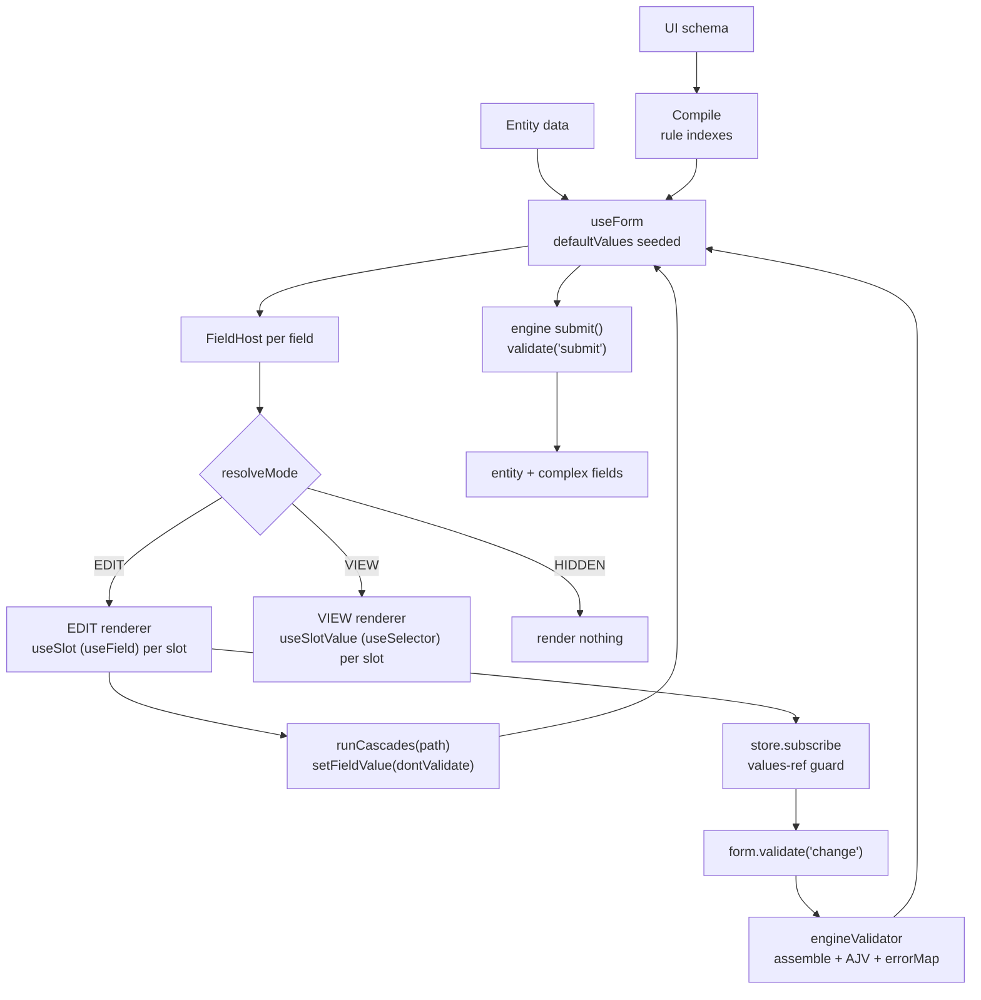

# Form Engine - TanStack Form Detailed Design

> The shared `engine/` contract below is superseded by
> [rhf-form-engine-design.md](rhf-form-engine-design.md) rev 2 (2026-11-07):
> mode order, validation fragmentation, cascade token, submit pipeline and
> repeat-group scope changed. Sync this note before implementing a TanStack
> spike.

**Design note**
Status: design defined, no implementation started
Scope: TanStack Form as the value and error layer under the generated form
Companion: [problem-form-engine.md](problem-form-engine.md),
[form-library-evaluation.md](form-library-evaluation.md),
[rhf-form-engine-design.md](rhf-form-engine-design.md) (counterpart)
Last updated: 2026-11-06
Revision: none

Facts are source-verified against `@tanstack/react-form` 1.33.5 (stable) and
2.0.0-alpha.3 (alpha), checked 2026-11-06. The design targets v1 stable; every
v2 difference is marked [v2]. Code sketches are TypeScript and illustrative.
None were executed.

---

## 1. Decision and boundaries

TanStack Form owns: values, dirty/touched flags, errors, field registration,
validation execution.

It does not own: the document, the registry, mode resolution, visibility, the
cascade engine, validation assembly, complex fields, submit orchestration.

Same split as the RHF counterpart. The engine is a set of plain functions over
`values`; only the `tsform/` folder imports the library, so the RHF and TanStack
versions differ in one folder and share the rest.

```text
document + entity data
        |
   engine (pure functions: mode, rules, schema assembly)
        |
   TanStack Form (values, errors, dirty, validation execution)
        |
   field renderers (VIEW / EDIT)
```

---

## 2. Module map

```text
src/patterns/form-engine-tsf/
  engine/                 identical to the RHF design; no library imports
    document.ts           parse and normalise the UI schema
    paths.ts              path <-> name normalisation, segment walk
    modes.ts              resolveMode(fieldId, values, ctx)
    visibility.ts         rule index, evaluateHidden(values, ctx)
    cascades.ts           rule index, runCascades(path, api)
    validation.ts         assembleSchema + mapAjvErrors
    submit.ts             orchestrate entity + complex fields
  tsform/
    FormHost.tsx          useForm, debounced validate subscription
    useSlot.ts            useField wrapper
    useSlotValue.ts       useSelector on a single path
    useFormEngine.ts      typed access to form + engine context
  registry/
    index.ts              field type -> entry
    fields/               Text, Date, RichText, InputWithNA, RepeatGroup
  fixture/
    documents.ts
```

The `engine/` modules are shared verbatim with the RHF version; the adapter
boundary is exactly where it was designed to be.

---

## 3. Runtime flow



One direction only: values flow through the TanStack store, everything else is
computed from them.

---

## 4. Form setup

```ts
const form = useForm<Record<string, unknown>>({
  defaultValues: seedValues(document, entity),   // every bound path seeded
  validators: {
    onChange: engineValidator,   // assembled AJV; the submit cause also runs onChange
  },
  // no onSubmit option, no handleSubmit: submit orchestration stays in the engine
})
```

- `defaultValues` is a plain sync object, read at mount; v1 has no function or
  promise updater. Seed every bound path from the entity data or the document
  `defaultValue` (`""`/`null`). TanStack tolerates `undefined` values
  (v1.26+, issue #1729), unlike RHF, but seeding still sets the dirty baseline
  and create-mode defaults. [v2: `defaultValues` is required, still sync; for
  async loads, pass a fallback shape then re-pass resolved values on the next
  render.]
- The library runs the form-level `onChange` validator synchronously on every
  `setFieldValue`/`handleChange`, user or programmatic, and has no debounce for
  sync validators (`onChangeAsyncDebounceMs` covers async only). So the engine
  suppresses per-write validation and owns the schedule:

```ts
useEffect(() => {
  let timer: ReturnType<typeof setTimeout> | undefined
  let lastValues = form.state.values
  const sub = form.store.subscribe((state) => {
    if (state.values === lastValues) return   // meta-only update
    lastValues = state.values
    clearTimeout(timer)
    timer = setTimeout(() => form.validate('change'), DEBOUNCE_MS)
  })
  return () => { clearTimeout(timer); sub.unsubscribe() }
}, [form])
```

- `form.store.subscribe` is a plain observer, no re-render and no selector; it
  fires on any store change. Guard on `state.values` identity: v1 rebuilds
  values immutably along the changed path only, so the ref changes exactly when
  a value changed. [v2: `form.atom.subscribe`.]
- Every engine write (cascade, complex-field setter, seeding) passes
  `{ dontValidate: true }` [v2: `{ causeValidation: false }`], so the debounce
  is the only edit-time validator. A write that forgets this runs AJV
  synchronously in the same handler; correct but wasteful. Treat as a review
  rule.
- When the effective-EDIT set changes, re-validate immediately: the engine
  diffs the signature and calls `form.validate('change')`, clearing the pending
  timer.
- Submit runs the same validator with no double registration: v1's submit cause
  executes onChange+onBlur+onSubmit validators, so `onChange` alone is enough.
  There is no `resolver` prop; the form-level validator is the resolver.
- The form instance is stable (`useState` internally) and `useForm` subscribes
  to nothing: passing the instance through context does not invalidate
  consumers, and the host never re-renders from store changes.

---

## 5. Paths are names

Same normaliser and the same rules as the RHF counterpart:

```ts
export const toName = (path: string) => path.replace(/\.(\d+)(?=\.|$)/g, '[$1]')
// properties.items.0.name -> properties.items[0].name
```

- TanStack accepts both notations, mixed: `properties.items[0].name` and
  `properties.items.0.name`; numeric segments become numbers.
- Normalise once, at document parse. Array indices are numeric segments; a
  property literally named `0` is not supported (accepted limitation).
- The stored entity keeps the original dotted form; conversion happens at the
  name boundary only.

---

## 6. Slot adapter

```ts
export function useSlot(path: string) {
  const { form } = useFormEngine()
  const field = form.useField({ name: toName(path) })
  return {
    value: field.state.value,
    onChange: change,
    onBlur: field.handleBlur,
    error: firstError(field.state.meta.errors),
    invalid: field.state.meta.errors.length > 0,
  }

  function change(next: unknown) {
    field.setValue(next, { dontValidate: true })   // validation is the engine's schedule
    engine.runCascades(path)
  }
}
```

- `useField` is the same machinery as `form.Field` (per-slice subscriptions);
  v1 docs discourage direct use, but multi-slot fields need the hook form. Each
  call subscribes to that field only. [v2: surface is `field.value`,
  `field.meta`, `field.errors` (issue objects).]
- `field.state.meta.errors` is a flat array (errorMap values flattened one
  level). `firstError` takes `message` when the value is an object, else the
  value itself.
- `handleChange`/`setValue` store exactly what you pass. There is no event
  unwrapping and no RHF-style `{ target }` misparse; the adapter contract is
  therefore that renderers pass the value (`e.target.value`), never the event.
  Passing the event stores the Event object; silent payload corruption that
  first-render binding checks cannot catch. Add a lint rule.
- Writes are synchronous: `form.state.values` is fresh on the next line, so
  `runCascades` reads the new value. React batches the source write and the
  cascade writes into one render.
- `shouldUnregister` has no analogue: values live in the store and survive
  unmount unconditionally (section 13).

VIEW variant:

```ts
export function useSlotValue(path: string) {
  const { form } = useFormEngine()
  const segments = useMemo(() => splitPath(path), [path])
  return useSelector(form.store, s => walkPath(s.values, segments))
}
```

- `useSelector` default compare is reference equality. v1 rebuilds values only
  along the changed path, so a selector returning a stored object/array ref
  fires only when that path or an ancestor changed. Never build a new
  object/array inside a selector: new identity each call means a re-render on
  every store change (issue #2090).
- [v2: `useSelector(form.atom, ...)`.]

---

## 7. Mode resolution

Identical to the RHF counterpart. Mode is a **pure function of values**, not
React state; the cascade engine calls it outside render.

```ts
type Mode = 'EDIT' | 'VIEW' | 'HIDDEN'

function resolveMode(fieldId: string, values: Values, ctx: ModeContext): Mode {
  if (ctx.formMode === 'VIEW') return 'VIEW'
  const grant = ctx.permissions[fieldId]
  if (!grant) return 'HIDDEN'
  if (isHidden(fieldId, values, ctx)) return 'HIDDEN'
  return grant === 'VIEW' ? 'VIEW' : 'EDIT'
}
```

`FieldHost` memoises on `(fieldId, values it depends on, formMode,
permissions)`; HIDDEN renders nothing; unknown field types fall back to the
fallback entry and record it. Demote-only invariant unchanged.

---

## 8. Visibility

Same inverted index at load: `Map<fieldId, Rule[]>`.

```ts
function useResolvedMode(fieldId: string) {
  const rules = visibilityIndex.get(fieldId) ?? []
  const deps = useMemo(() => rules.flatMap(r => r.dependsOn), [rules])
  const watched = deps.map(dep => {
    const segments = compiledSegments.get(dep)   // precomputed at compile time
    return useSelector(form.store, s => walkPath(s.values, segments))
  })
  return resolveMode(fieldId, watched, ctx)
}
```

- One `useSelector` per dependency path, not one selector over all deps: a
  combined selector returns a fresh array every call and re-renders on every
  store change.
- Same bound as the RHF per-dep `useWatch`: a field re-renders only when a value
  that can hide it changes.
- Rules re-evaluate on every data change, including cascade writes. Hiding never
  clears a value (unmount leaves the store untouched).

---

## 9. Validation

### 9.1 Assembly

Identical to RHF 9.1: `assembleSchema(doc, values, ctx)` filters to the
effective-EDIT set, places fragments at binding paths, expands RepeatGroup
templates per index, merges same-path fragments via `allOf`, and includes
cross-field rules only when every id in `dependsOn` is EDIT. AJV stays
sync-only.

### 9.2 Caching

Same signature (`document.version | sorted editable ids | array lengths`) and
the same LRU cap for the 2^n EDIT-set compile cache (review finding). The
signature check is O(1); the validator itself runs once per debounced cycle and
again at submit.

### 9.3 The validator (not a resolver)

```ts
const engineValidator = ({ value }: { value: Values }) => {
  const { schema, pathToField } = assembleSchema(doc, value, currentContext())
  const validate = getCompiled(schema)
  if (validate(value)) return undefined
  return { fields: toFieldErrors(validate.errors, pathToField) }
}
```

- v1 form-level validator returns `undefined` for valid (clears this
  validator's previous errors) or `{ fields: { name: error } }`, errors routed
  to field paths by key. `{ form: error }` for form-scoped errors. [v2:
  validators are an ordered array of `{ run, triggers }`;
  `run: ({ value, createErrorMap }) => createErrorMap({ fields })`; strings
  become `{ message }` issues.]
- No field-level validators are registered. All validation is form-level, one
  place, mirroring the single RHF resolver. Cross-field rules therefore need no
  `onChangeListenTo` [v2 `watchFields`]: they live in AJV.
- No async validators, no Standard Schema: no AJV standard-schema adapter
  exists, and a plain function validator is the supported integration path.

### 9.4 Error mapping

Same AJV pointer table as RHF 9.4, but the target is a flat map:

| AJV | Action |
|---|---|
| `instancePath: '/properties/items/0/name'` | key `properties.items[0].name` |
| `keyword: 'required'` | path + `params.missingProperty` |
| `keyword: 'additionalProperties'` | path + `params.additionalProperty` |
| `keyword: 'if'` | drop; `if` is a branch selector, not a user error |

errorMap keys are flat path strings, and the library routes them (v1 sets field
meta per path even for unmounted fields; [v2 walks the field tree and creates
internal instances for unmounted paths]). No nested-object building, no
`toNestErrors` equivalent, no `criteriaMode`: `meta.errors` already flattens all
causes, so the renderer shows the first error per field via `messageFor`.

### 9.5 Debounce

See section 4: outside the validator, `form.store.subscribe` + values-ref guard
+ `form.validate('change')`; immediate re-run when the EDIT set changes and at
submit. The library's own debounce options cover async validators only, which
this design has none of.

---

## 10. Cascades

Same index and `runCascades(sourcePath)` as RHF 10. Write path:

```ts
function applyEffect(effect, values) {
  const fieldId = fieldByPath(effect.target)
  if (!fieldId) return record('unbound target', effect)
  if (resolveMode(fieldId, values, ctx()) !== 'EDIT') return

  if (effect.kind === 'set') {
    form.setFieldValue(toName(effect.target), effect.value, { dontValidate: true })
    return
  }

  const controller = new AbortController()
  abortBySource.get(effect.target)?.abort()
  abortBySource.set(effect.target, controller)

  fetchSource(effect.source, { values, signal: controller.signal })
    .then(result => {
      const now = form.state.values
      if (resolveMode(fieldId, now, ctx()) !== 'EDIT') return   // re-check at landing
      form.setFieldValue(toName(effect.target), result, { dontValidate: true })
    })
    .catch(err => record('cascade failed', { effect, err }))
}
```

- `{ dontValidate: true }`: the debounced subscription validates the batch.
  Defaults still mark touched+dirty, so cascade targets count as dirty for the
  VIEW-toggle warning. v1 has one flag (`dontUpdateMeta`) covering both; keep
  the defaults. [v2: `{ causeValidation: false }`.]
- Multiple targets: wrap in `batch(() => ...)` from `@tanstack/store` [v2:
  re-exported]; one store flush, one React commit. Without it each call flushes
  separately but React 18 still commits once.
- Re-read `form.state.values` per effect; an earlier cascade in the run may have
  changed the picture (review finding).
- The three rules carry over unchanged: cascades do not chain (only
  `useSlot.change` calls `runCascades`; cascade writes call `setFieldValue`
  directly), visibility reacts to cascade writes, and the gate is re-checked at
  landing with current values.
- Async landing: capture the array item identity at fire (backend id, else
  index) and compare at landing (review finding).
- JSON Logic is a trust boundary: rules come from the backend document. Pin
  `json-logic-js >= 2.0.2` and harden `var` paths, or write a restricted
  evaluator (CVE-2021-4329; same warning as the RHF review).

---

## 11. Arrays and repeat groups

v1:

```tsx
<form.Field name={toName(def.binding.value)} mode="array">
  {(array) => (
    <>
      {array.state.value.map((item, i) => (
        <FieldHost key={item.id ?? i} def={def} index={i} item={item} />
      ))}
      <button onClick={() => array.pushValue(newItem(def))}>Add</button>
    </>
  )}
</form.Field>
```

- Mutation methods on the array FieldApi: `pushValue`, `insertValue`,
  `replaceValue`, `removeValue` (one index, no count), `swapValues`,
  `moveValue`, `clearValues`. All write the store synchronously;
  insert/remove/replace await validation afterwards.
- Nothing is injected into items: the payload is exactly the data. React keys
  are your job, backend item id when present, index otherwise. v1 officially
  recommends index keys (#1518; data-id keys had transient-undefined
  regressions, #2238); v2 docs recommend data ids.
- Flat scalar arrays (`string[]`) are supported; no object-item restriction,
  unlike RHF v7. No wrapper objects.
- Validation state follows the item, not the index: v1 shifts field meta on
  move/remove ([v2 moves the field-tree node itself]). Removed items' meta is
  deleted.
- Structural changes must go through the array methods, not a whole-array
  `setFieldValue`: v1's array Field subscribes to `meta._arrayVersion`, which
  only the methods bump; a plain replace may not re-render array subscribers.
  [v2 bumps `_arrayVersion` on same-length replaces; safe.]
- Nested arrays: path syntax parses generically, but v1's meta-shift uses a
  first-index-only regex; nested repeat groups are unverified in v1,
  structurally supported in v2's field tree. Spike before committing.
- Known v1 bugs with low exposure here: #2234 (async subfield validators stuck
  `isValidating` after `removeValue`; this design has no field-level async
  validators), #2131 (`removeValue` touches shifted siblings).
- [v2: `mode="array"` is removed; `form.ArrayField`, or path-based
  `form.pushFieldValue`/`moveFieldValue`/`removeFieldValue` etc.]

Open decision: the repeat-group contract (relative bindings, `itemKey`). The
proposal in RHF 11 is unchanged and applies verbatim. The RHF render-key notes
(`__rid`, `keyName`) do not apply here.

---

## 12. Submit

```ts
async function submit() {
  if (ctx().formMode === 'EDIT') {
    await form.validate('submit')        // submit cause runs onChange validators
    if (!form.state.isValid) return { ok: false, stage: 'validation' }
  }

  const values = form.state.values
  const entity = await saveEntity(values)
  if (!entity.ok) return { ok: false, stage: 'entity', entity }

  const settled = await Promise.allSettled(
    complexHandles.map(h => h.submit())
  )
  return { ok: true, entity, complex: settled }
}
```

- `handleSubmit` is not used: v1.30+ takes no handler, touches every mounted
  field, and cannot orchestrate complex fields after the entity save. The
  engine's submit reads state imperatively. [v2: `handleSubmit()` runs all
  validators and resolves to the error array; could replace
  `validate('submit')` + `isValid`. Re-evaluate at migration.]
- VIEW submit skips validation and sends current data, per the requirement.
- Entity first, complex fields second. Partial failure is reported, not rolled
  back; same proposal and open question as RHF 12.
- The payload keeps every stored value, including hidden and VIEW fields.
  Nothing to strip: the library injects nothing into values.
- This path marks nothing touched; errors were already shown by the debounced
  edit-time run. Accepted; noted.
- Double-submit guard: no `isSubmitting` is consumed anywhere; add an in-flight
  ref (open item).

---

## 13. Mode toggle and snapshot

```ts
function setFormMode(next: 'EDIT' | 'VIEW') {
  if (next === 'VIEW' && isDirtyNow()) {
    warnUnsavedChanges()
    form.reset(cloneSnapshot())               // strip unsaved edits
  }
  setFormModeState(next)
}

function isDirtyNow() {
  return form.state.isDirty || complexHandles.some(h => h.isDirty())
}
```

- `form.state` is an imperative snapshot getter; reading it in an event handler
  is always fresh. No RHF-style stale-formState trap.
- v1 `reset(values)` stores the passed object as the new `defaultValues` and
  resets values, errors, dirty and touched in one call. The snapshot is
  deep-cloned at capture (same review finding as the RHF counterpart).
- `isDirty` is an explicit flag set by default writes, not a value comparison;
  cascade writes mark targets dirty by default. Complex fields are consulted
  (review finding: the RHF draft ignored them).
- Unmount persistence: source-verified in both versions. Unmount never touches
  the values store, and remount restores the stored value. No `preserveValue`
  option exists; none is needed.
- Unmount on toggle drops focus and local component state; accepted, mode
  changes on user action only.

---

## 14. Complex fields

Same contract as RHF 14: `ComplexHandle { validate, submit, isDirty }`,
ref-backed registry, own state.

- Imperative reads: `form.state.values` / `form.getFieldValue(path)`.
- Reactive reads: narrow `useSelector` with stored-ref selectors only. Never a
  whole-form selector.
- Writes to form values go through the declared setter, so the cascade engine
  stays the only writer of record.

---

## 15. Re-render rules

| Rule | Reason |
|---|---|
| Host never subscribes: `useForm` holds the instance in `useState` and subscribes to nothing | the form root never re-renders from store changes; free win over RHF |
| `useSlot` per slot via `useField` | per-field subscriptions only |
| `useSelector` only with selectors returning stored refs or primitives | default compare is reference equality; object-building selectors re-render on every store change (#2090) |
| One `useSelector` per visibility dependency | a combined selector returns a fresh array every call |
| `form.store.subscribe` for side effects only, guarded by `state.values` ref | plain observer with no selector; fires on meta-only changes too |
| `React.memo` on `FieldHost`, compared by `def` identity and mode | document is immutable |
| Registry entries loaded once, module level | avoids identity churn |
| No new object literals in context values | invalidates every consumer |

Expected behaviour: typing in one field re-renders that field, plus any field
whose visibility or cascade rule depends on it. Nothing else, not even the host.
Caveat: v1 per-keystroke core work is O(mounted fields); each field's computed
store re-evaluates on any form change, though only changed fields re-render.
Irrelevant at documented form sizes; spike-check at scale.

---

## 16. Edge cases

Same table as RHF 16 with these deltas:

| Case | Behaviour |
|---|---|
| Path missing in data | seeded at load (`""`/`null`); `undefined` also tolerated by the library |
| Raw DOM event passed to `onChange` | stores the Event object; adapter contract requires the value; lint rule |
| Field hidden mid-typing | unmounts, value kept in store, focus lost |
| Async cascade lands after target hidden | discarded (engine gate) |
| Async cascade lands after array reorder | identity re-check at landing (backend id or index captured at fire) |
| Two fields bind the same path | both update; two FieldApi instances over one name; spike-check; validation merges via `allOf` |
| Whole-array replace via `setFieldValue` | may not re-render array subscribers in v1; use array methods |
| `setFieldValue(undefined)` | allowed (v1.26+); engine still normalises to `null` for JSON-safe payloads |
| Form flips to VIEW with a pending async cascade | discarded on landing |
| Submit in VIEW with validation errors present | submits anyway, per requirement |
| Unknown field type / path type mismatch | fallback / degraded entry, recorded, value untouched |

---

## 17. Testing

- `resolveMode`, `assembleSchema`, `runCascades`, `toFieldErrors` are pure and
  shared with the RHF design; test once with fixture documents, no React.
- `useSlot` and `FieldHost`: render one field with a real `useForm`, assert
  render counts via a counter component; assert the host does not re-render on
  typing.
- Validator: table-driven over fixtures, checking errorMap keys rather than
  message text; `undefined` return clears; the submit cause runs the onChange
  validator.
- Debounce: fake timers on the store subscription; EDIT-set change re-validates
  immediately.
- Arrays: payload shape across `pushValue`/`removeValue`/`moveValue`; flat
  `string[]` round-trip; data-id keys stable across moves; error meta follows
  the item.
- The spike checks from the evaluation note double as integration tests; check 6
  (real item id in values, render key separate) becomes "no key injection at
  all; assert payload identity".

---

## 18. Open items

1. **Repeat group contract** (as RHF 11); still open; the TanStack version
   needs no render-key machinery.
2. **Message text.** Same owner decision as RHF 18.2.
3. **Submit ordering and partial failure.** Same proposal and open question as
   RHF 18.3.
4. **Unbound properties on submit.** Same as RHF 18.4; seeding covers bound
   paths; unbound data seeded into `defaultValues` survives untouched. Decide
   echo vs drop.
5. **Path syntax for non-numeric array keys.** Same as RHF 18.5.
6. **v1 vs v2 target.** This design is v1; v2 alpha changes arrays
   (`ArrayField`), validators (ordered array + `createErrorMap`), selectors
   (`form.atom`) and the render-prop surface. Budget the migration either way;
   pin whichever is chosen.
7. **Submit path.** `validate('submit')` + `state.isValid` (chosen) vs
   `handleSubmit()`; spike-verify `isValid` reflects form-level errors
   immediately after the await.
8. **Double-submit guard.** Nothing prevents two engine submits today.
9. **Visibility deps over array paths** after move/remove; index identity
   shifts meaning (same open item as the RHF counterpart).
10. **Nested repeat groups**; unverified in v1 (first-index-only meta shift);
    spike before committing.

---

## 19. What this design deliberately avoids

- No schema renderer, no UI-schema library.
- No second store for form values: the TanStack store is the store; a copy would
  desync.
- No cascade chaining, no expression evaluator beyond JSON Logic and the effect
  vocabulary.
- No Standard Schema dependency: no AJV adapter exists; the plain function
  validator is the supported integration path.
- No field-level validators: one form-level validator mirrors the single RHF
  resolver; per-field rules stay in AJV fragments.
- No `onChangeListenTo`/`watchFields`: cross-field rules live in AJV; nothing
  else needs dependent-field validation triggers.
- No `handleSubmit`, no field-level `defaultValue`, no `FormProvider` (v1 has
  none; the form instance is stable and flows by props or context).

---

## Sources and caveats

- TanStack Form v1 docs (quick start, arrays, validation, reactivity, listeners)
  and v2 alpha docs + migration guide.
  https://tanstack.com/form/latest/docs/framework/react/guides/reactivity
  https://tanstack.com/form/alpha/docs/migrate-from-v1
- @tanstack/form-core 1.33.5 source (FormApi, FieldApi, ValidationLogic,
  metaHelper) and 2.0.0-alpha.3 source (FormApi.lib, fieldTree.lib,
  handleSubmit.lib). https://github.com/TanStack/form
- @tanstack/store / @tanstack/react-store 0.11.2 source (useSelector, batch,
  atom). https://github.com/TanStack/store
- Issues cited: #1518, #2238 (array keys), #2090 (selector equality), #1130
  (double render, fixed), #2234, #2131, #1709 (array validation), #1729
  (undefined values), #2018 (array re-render).

Caveats:

- Versions checked: @tanstack/react-form 1.33.5 and 2.0.0-alpha.3, 2026-11-06.
  v2 is alpha; APIs may shift before 2.0 stable.
- Nested array behaviour in v1 is source-inspected but untested (no library
  tests cover it).
- No benchmark was run; render claims describe subscription scope, not measured
  cost.
- The `validate('submit')` + `state.isValid` submit path is designed from
  source, not executed (open item 7).
