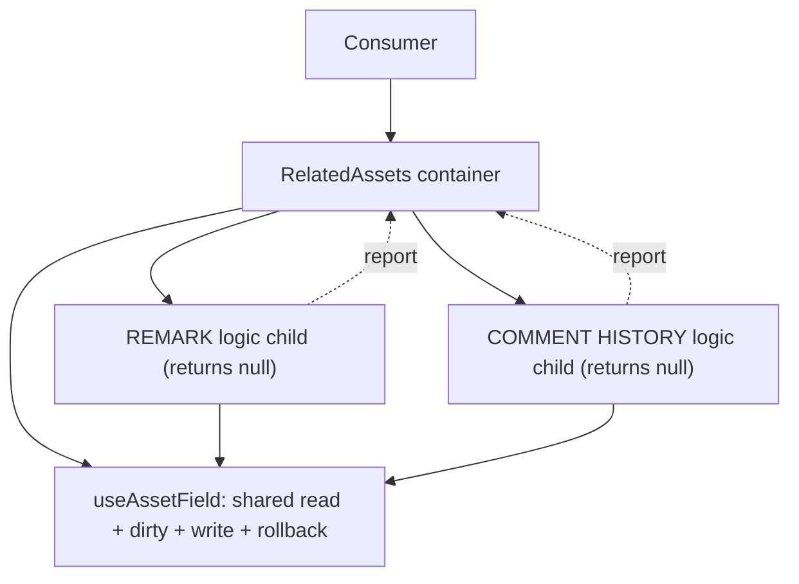
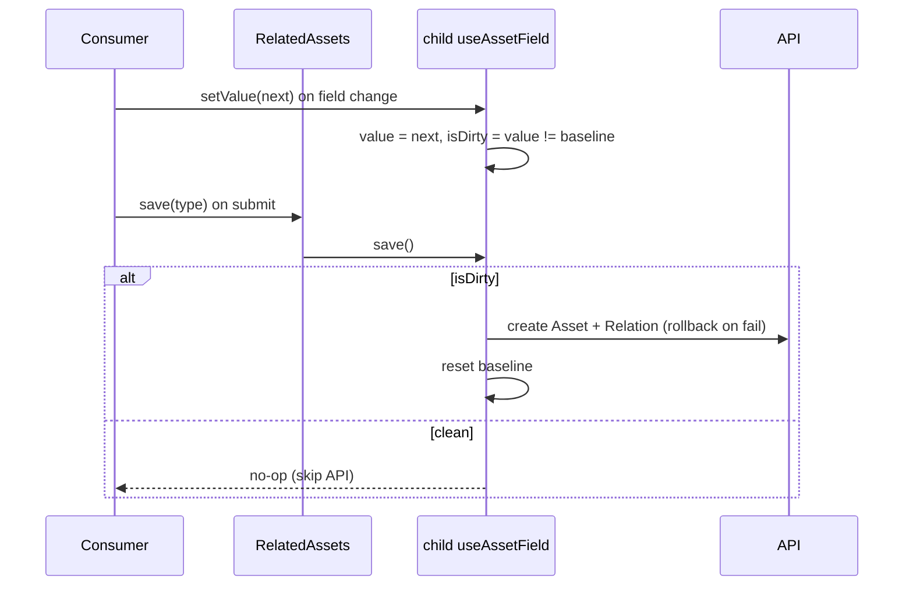

# Analysis — Option A: logic-only (headless) components

One container owns the shared core. One headless child per supporting asset type. Each
child is a hook-carrier: it runs that type's fetch + working/dirty/commit logic and
returns `null`, surfacing results to the container. The consumer declares which types
it wants; only those children run.

## Key concerns

| Tag | Concern |
|---|---|
| `[server]` | server state — baseline, cache, refetch, invalidation |
| `[dirty]` | working/dirty state — editable copy, isDirty, reset |
| `[commit]` | commit semantics — submit vs on-change, write-if-dirty |
| `[unique]` | per-type unique logic — relationType + shape |
| `[compose]` | composition — array of types -> map of results |
| `[deps]` | cross-asset dependency — License requires Attachment |
| `[OCP]` | extension — add a new type without editing the core |
| `[render]` | re-render granularity — one type updating does not re-render all |

## How it works

```jsx
function RemarkLogic({ subjectId, report }) {
  const ctrl = useAssetField('REMARK', subjectId)          // value, setValue, isDirty, save, reset
  useEffect(() => report('REMARK', ctrl), [ctrl])          // push result to container
  return null
}

function RelatedAssets({ subjectId, wanted, render }) {
  const [registry, setRegistry] = useState({})
  const report = (type, ctrl) => setRegistry((r) => ({ ...r, [type]: ctrl }))
  return (
    <>
      {wanted.includes('REMARK') && <RemarkLogic subjectId={subjectId} report={report} />}
      {wanted.includes('COMMENT_HISTORY') && <CommentLogic subjectId={subjectId} report={report} />}
      {render(registry)}   {/* consumer gets { REMARK: ctrl, COMMENT_HISTORY: ctrl } */}
    </>
  )
}
```

## Good

- `[dirty]` Hooks are the natural home for working/dirty state: `useState` holds the
  working copy, `useMemo` computes `isDirty`. Rules of hooks hold.
- `[render]` Per-type lazy run — a child not in `wanted` never mounts, so its fetch
  never fires (clean fit for the independent-mount / lazy preference).
- `[unique]` Per-type boundary — memoization and code-splitting per type are natural.
- `[server]` Shared core once — read + dirty compare + write + rollback in one hook.

## Bad

- `[compose]` Plumbing is the cost — a `null`-returning component cannot return a value,
  so results go through a `report` callback / render prop / context.
- `[deps]` Cross-asset coordination stays hard — a sibling child's result is not
  reachable directly; License needs Attachment forces lifting state to the container.
- `[dirty]` Dirty/commit lives per child unless lifted into the shared core — real risk
  of re-duplicating the logic being reused.
- `[OCP]` Bundle — every child is imported even when not rendered (unless lazy `import()`).
- `[commit]` Write flow is split — rollback in the container vs per-child create splits
  the two-phase logic.

## When it fits

Few, mostly-independent assets; a team already using render-prop / headless components;
when lazy per-type mount is the priority.

## When it fails

Cross-asset dependencies; when the null-return plumbing grows into a home-grown
registry — at which point C or F is the same thing, cleaner.

## Key risk

`[compose]` The "logic-only component returning null" is a hook-carrier in disguise. If
you end up writing a `report`/registry side channel to get the results out, you have
rebuilt C's provider by hand, less cleanly.

## Diagrams

### Structure



### Change flow — form submit (write if dirty)


