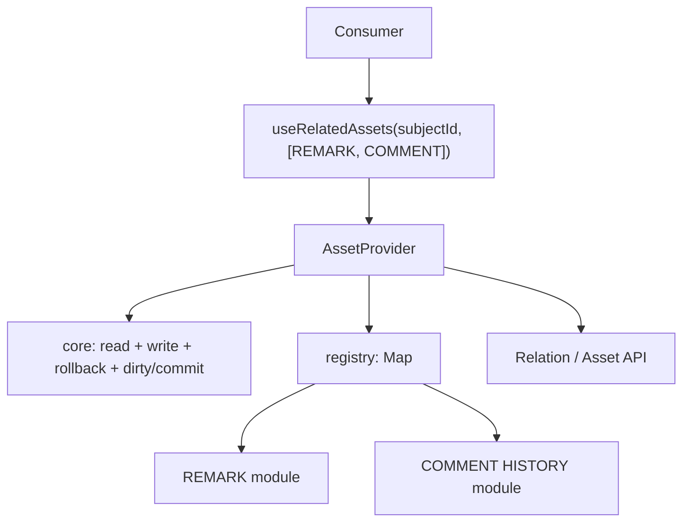
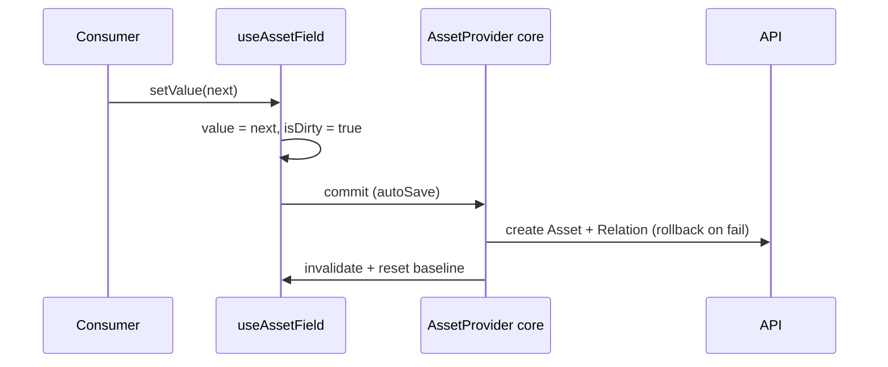

# Analysis — Option C: provider + registry (context-based)

A Context Provider holds the shared core — including the generic dirty/working/commit
layer — plus a registry of per-type modules. Consumers read a controller by name. This
is option F with Context as the state mechanism instead of RTK Query.

## Key concerns

| Tag | Concern |
|---|---|
| `[server]` | server state — baseline, cache, refetch, invalidation |
| `[dirty]` | working/dirty state — editable copy, isDirty, reset |
| `[commit]` | commit semantics — submit vs on-change, write-if-dirty |
| `[unique]` | per-type unique logic — relationType + shape |
| `[compose]` | composition — array of types -> map of results |
| `[deps]` | cross-asset dependency — License requires Attachment |
| `[OCP]` | extension — add a new type without editing the core |
| `[render]` | re-render granularity — one type updating does not re-render all |

## How it works

```jsx
const AssetContext = createContext(null)

function AssetProvider({ children }) {
  const registry = useMemo(buildRegistry, [])   // REMARK -> module
  const core = useAssetCore()                    // read + write + rollback + cache
  return <AssetContext.Provider value={{ core, registry }}>{children}</AssetContext.Provider>
}

// generic controller, driven by core.read + module.create
function useAssetField(name, subjectId, { autoSave } = {}) {
  const { core, registry } = useContext(AssetContext)
  const module = registry.get(name)
  return core.useController(name, subjectId, module, { autoSave })
  // { value, setValue, isDirty, save, reset, status, Component: module.Component }
}

function useRelatedAssets(subjectId, types, opts) {
  const map = {}
  for (const t of types) map[t] = useAssetField(t, subjectId, opts)
  return map
}
```

## Good

- `[compose]` Clean consumer API — `useRelatedAssets(subjectId, [REMARK, COMMENT])` -> a
  map of controllers with value / setValue / isDirty / save / reset.
- `[dirty]` Generic dirty/commit in the provider — working copy, compare, reset,
  write-if-dirty live once (the "management + dirty clearing" deliverable).
- `[unique]` Registry keeps per-type uniqueness — fetch / create / compare / validate / Component.
- `[deps]` Cross-asset deps declarable via `requires` resolved by the provider.

## Bad

- `[render]` Context re-render granularity — every consumer re-renders on any provider
  state change unless state is split per type (split contexts or an external store).
- `[unique]` Rules-of-hooks — the controller template is a fixed shape; unique hook logic
  per type cannot be called by key (module holds plain functions + optional Component).
- `[server]` Hand-rolled cache + invalidation + dependency resolution inside the provider
  — redundant now that RTK Query is mandated.
- `[commit]` Auto-save concurrency + rollback still yours to implement.

## Redux-strict note

`[server]` The project mandates RTK Query + Redux. C's hand-rolled provider cache is
redundant with RTK Query, and its "no dependency" advantage disappears. C's remaining
value is the registry pattern, which F already provides. Keep C only if you also refuse
RTK Query.

## When it fits

Consumer DX matters most; modest cross-asset deps; want hooks + registry, and you are
not using RTK Query.

## When it fails

Many types updating independently (`[render]`); deep/recursive deps needing real
graph/network optimization.

## Key risk

`[render]` + `[server]` Re-render granularity and the hand-rolled cache. If per-type
updates re-render the whole tree, C feels broken at 15+ types — and fixing it (external
store + selectors) turns C into F anyway.

## Diagrams

### Structure



### Change flow — standalone (write on change)


