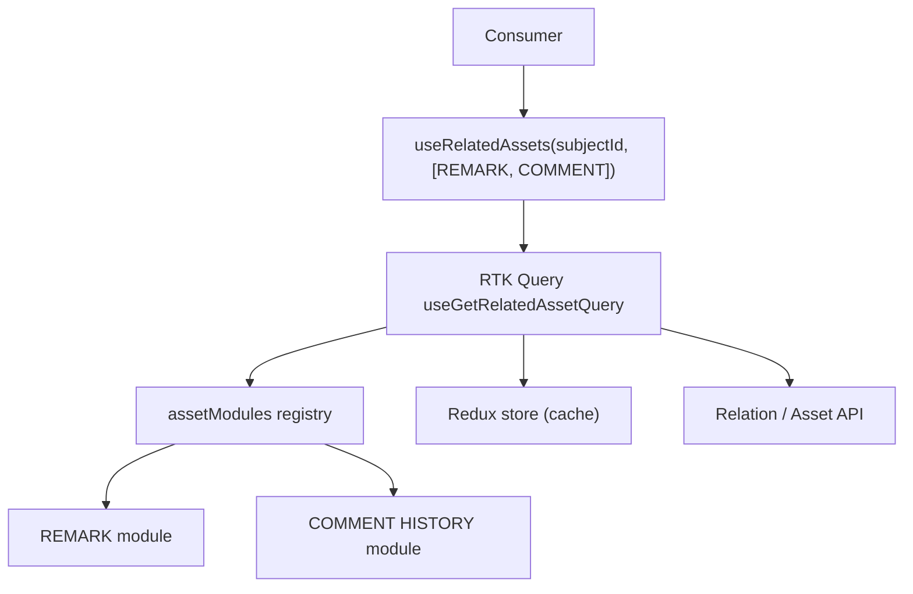
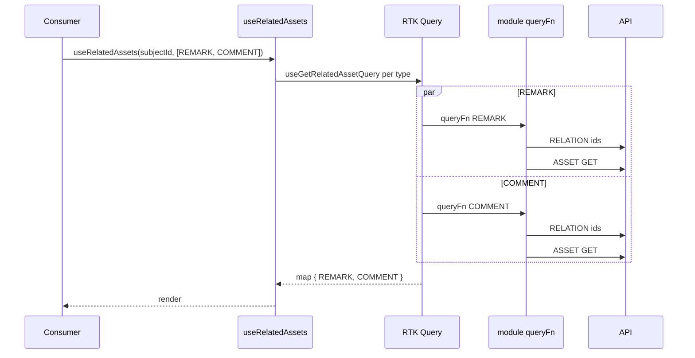

# Analysis — Option D: RTK Query + registry (the foundation)

RTK Query (already mandated) owns server state: fetch baseline, cache, dedup, refetch,
tag-based invalidation. A registry holds per-type modules. This is the server-state half
of F; on its own it does NOT satisfy the change/write requirement.

## Key concerns

| Tag | Concern |
|---|---|
| `[server]` | server state — baseline, cache, refetch, invalidation |
| `[dirty]` | working/dirty state — editable copy, isDirty, reset |
| `[commit]` | commit semantics — submit vs on-change, write-if-dirty |
| `[unique]` | per-type unique logic — relationType + shape |
| `[compose]` | composition — array of types -> map of results |
| `[deps]` | cross-asset dependency — License requires Attachment |
| `[OCP]` | extension — add a new type without editing the core |
| `[render]` | re-render granularity — one type updating does not re-render all |

## How it works

```js
// assetApi.js
import { createApi } from '@reduxjs/toolkit/query/react'

export const assetApi = createApi({
  reducerPath: 'assetApi',
  tagTypes: ['RelatedAsset'],
  endpoints: (build) => ({
    // two-phase read: relation ids -> asset GET (custom queryFn)
    getRelatedAsset: build.query({
      queryFn: async ({ subjectId, type }) => {
        const module = assetModules[type]
        const ids = await api.getRelations(subjectId, module.relationType)  // phase 1
        const data = await api.getAssets(type, ids)                          // phase 2, batched
        return { data }
      },
      providesTags: (_r, _e, { subjectId, type }) =>
        [{ type: 'RelatedAsset', id: `${subjectId}:${type}` }],
    }),
    // two-phase write + rollback
    createRelatedAsset: build.mutation({
      queryFn: async ({ subjectId, type, value }) => {
        const module = assetModules[type]
        const assetId = await api.createAsset(value)                          // phase 1
        try {
          await api.createRelation(subjectId, assetId, module.relationType)   // phase 2
        } catch (err) {
          await api.deleteAsset(assetId)                                      // rollback
          throw err
        }
        return { data: assetId }
      },
      invalidatesTags: (_r, _e, { subjectId, type }) =>
        [{ type: 'RelatedAsset', id: `${subjectId}:${type}` }],
    }),
  }),
})

export const { useGetRelatedAssetQuery, useCreateRelatedAssetMutation } = assetApi
```

Composition — array of types -> map of baselines:

```js
export function useRelatedAssets(subjectId, types) {
  const map = {}
  for (const t of types) {  // rules-of-hooks: `types` must be a stable array
    map[t] = useGetRelatedAssetQuery({ subjectId, type: t }, { skip: subjectId == null })
  }
  return map  // { REMARK: { data, isLoading, refetch }, ... } — baseline only, no dirty/commit
}
```

## Good

- `[server]` Solved by a tested library already in the project — cache, dedup, retries,
  refetch, tag invalidation, optimistic updates, Redux DevTools. Zero new deps.
- `[server]` Cache lives in the Redux store — inspectable, consistent with the team's stack.
- `[server]` Tag invalidation is a clean fit — create auto-refetches exactly the right
  baseline via `subjectId:type`.
- `[render]` Per-type granularity — one type updating re-renders only its subscribers.
- `[server]` Refetch control exposed (`refetch`, `invalidateTags`).
- `[deps]` Dependencies via `skip` (gate a query on another query's data).

## Bad (as a standalone answer)

- `[dirty]` No working/dirty/commit — the change flow (form field vs standalone,
  write-if-dirty) is not addressed. Pair with the controller layer to become F.
- `[compose]` Rules-of-hooks — no `useQueries` equivalent; the loop over `types` needs a
  stable array (or one hook call per known type with `skip`).
- `[unique]` Two-phase read lives in a custom `queryFn` — slightly more code than a plain
  `query`, unavoidable given relation -> asset is two calls.

## When it fits

As the foundation of F. Not a complete answer on its own.

## When it fails

Alone: adopting D thinking it is done leaves the dirty/change logic to be re-implemented
per consumer — the exact duplication being removed.

## Key risk

`[dirty]` Treating D as the finish line. It solves fetch/cache; the "management + dirty
clearing + change utility" requirement still needs the controller layer (F).

## Diagrams

### Structure



### Read flow (parallel per type)



Note: the change flow is missing here — see `analysis-option-f.md` for the `useAssetField`
controller that adds value / setValue / isDirty / save / reset on top of this baseline.
