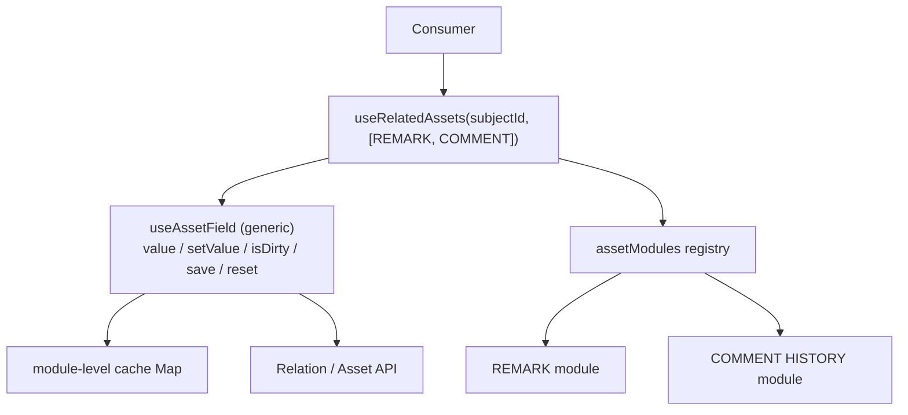

# Analysis — Option E: dep-free field controller + module cache

F without RTK Query: a generic `useAssetField` backed by a module-level cache +
subscription. Includes the dirty/working/commit layer. Kept only as "what you would
build if RTK Query were banned".

## Key concerns

| Tag | Concern |
|---|---|
| `[server]` | server state — baseline, cache, refetch, invalidation |
| `[dirty]` | working/dirty state — editable copy, isDirty, reset |
| `[commit]` | commit semantics — submit vs on-change, write-if-dirty |
| `[unique]` | per-type unique logic — relationType + shape |
| `[compose]` | composition — array of types -> map of results |
| `[deps]` | cross-asset dependency — License requires Attachment |
| `[OCP]` | extension — add a new type without editing the core |
| `[render]` | re-render granularity — one type updating does not re-render all |

## How it works

```jsx
// module-level cache + tiny subscription (mini RTK Query)
const cache = new Map()
const listeners = new Set()
const subscribe = (fn) => { listeners.add(fn); return () => listeners.delete(fn) }

async function readBaseline(subjectId, type) {
  const key = subjectId + ':' + type
  if (cache.has(key)) return cache.get(key)
  const data = await assetModules[type].fetch(subjectId)   // relation -> hydrate
  cache.set(key, data)
  listeners.forEach((l) => l())
  return data
}

// generic controller: working copy + dirty + change + commit
export function useAssetField(type, subjectId, { autoSave = false } = {}) {
  const [, force] = useReducer((x) => x + 1, 0)
  useEffect(() => subscribe(force), [])
  const baseline = cache.get(subjectId + ':' + type)
  const compare = assetModules[type].compare ?? ((a, b) => a === b)

  const [value, setValue] = useState(baseline)               // working copy, separate state
  const isDirty = useMemo(() => !compare(value, baseline), [value, baseline])
  useEffect(() => { setValue(baseline) }, [baseline])        // reset on load

  const save = () => (isDirty ? assetModules[type].create(subjectId, value) : undefined)
  const handleChange = (next) => {
    setValue(next)
    if (autoSave) assetModules[type].create(subjectId, next)  // standalone: write on change
  }
  return { value, setValue: handleChange, isDirty, save, reset: () => setValue(baseline) }
}
```

## Good

- `[dirty]` Full change flow — value / setValue / isDirty / save / reset, with both
  commit modes via `autoSave`.
- `[unique]` Registry keeps unique logic per type — plain functions, no rules-of-hooks trap.

## Bad

- `[server]` Re-implement cache AND the dirty lifecycle — invalidation, dedup,
  concurrency, reset-on-load, retries, every one a manual addition.
- `[render]` No structural sharing — a cache update re-renders every subscriber; the
  per-type re-render granularity RTK Query gives for free must be hand-built.
- `[commit]` Auto-save concurrency + rollback hand-rolled (ordering, debounce, revert).

## Redux-strict note

`[server]` The project mandates RTK Query + Redux. E exists to avoid a new dependency —
but the server-state library is already there, so hand-rolling a cache is pointless.
Keep E only as "what you would build if RTK Query were banned"; otherwise skip to F.

## When it fits

Only if RTK Query were banned, AND needs are modest (few types, infrequent updates, no
optimistic UI).

## When it fails

Real invalidation/refetch/optimistic needs; many types updating independently.

## Key risk

`[server]` + `[dirty]` You are re-implementing both RTK Query and the dirty lifecycle by
accident. On a Redux-strict project this option has no reason to exist — use F.

## Diagram


