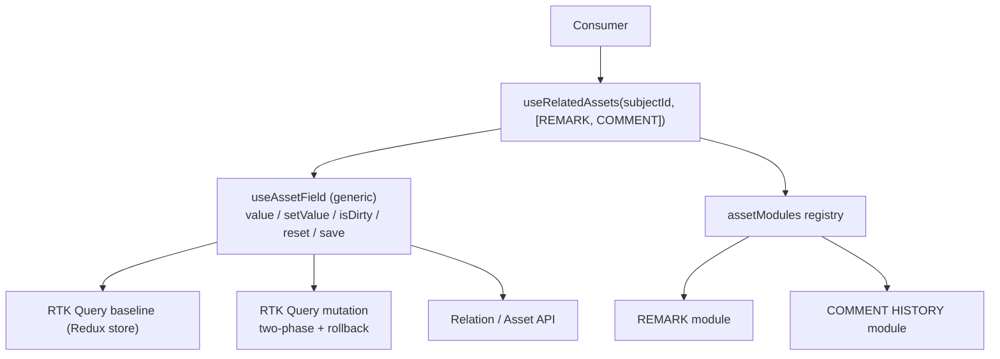
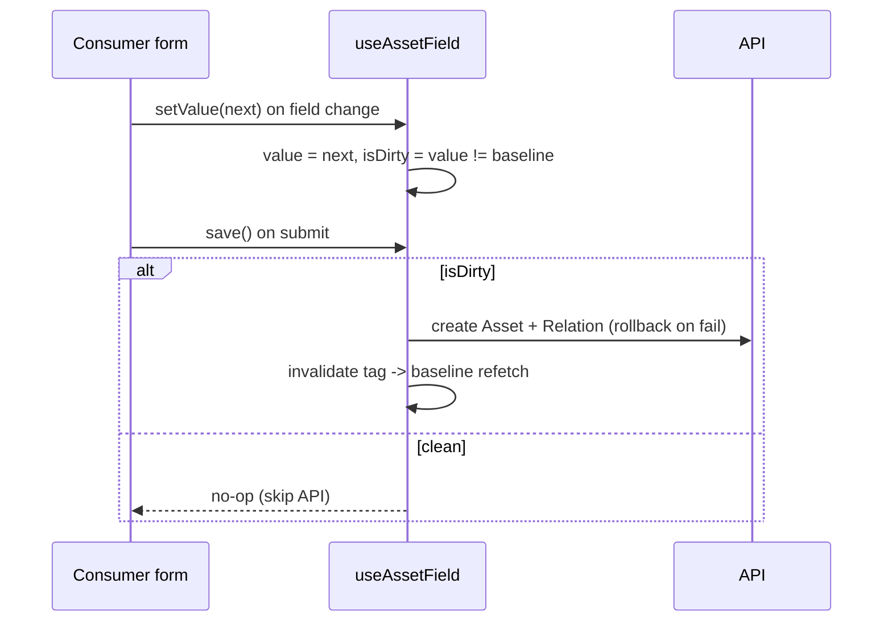
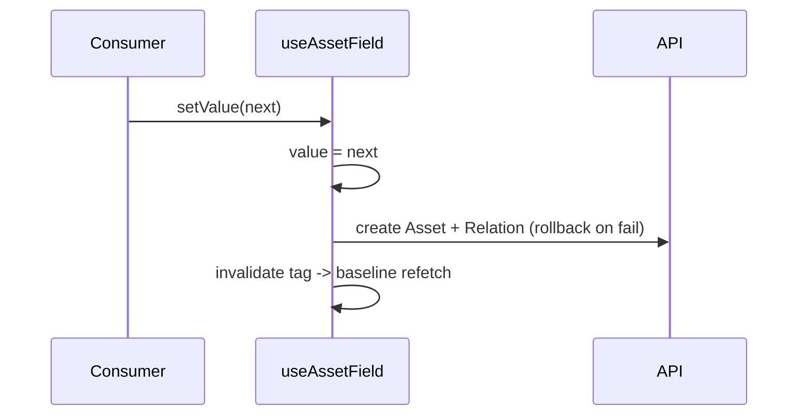

# Analysis — Option F: field controller + RTK Query + registry

The complete answer: D (RTK Query + registry) plus a generic **field controller** that
owns the working copy, dirty tracking, change handler and commit. Each supporting asset
becomes a server-backed field. RTK Query + Redux are already mandated, so this is zero
new dependencies.

## Key concerns

| Tag | Concern |
|---|---|
| `[server]` | server state — baseline, cache, refetch, invalidation |
| `[dirty]` | working/dirty state — editable copy, isDirty, reset |
| `[commit]` | commit semantics — submit vs on-change, write-if-dirty |
| `[unique]` | per-type unique logic — relationType + shape |
| `[compose]` | composition — array of types -> map of results |
| `[deps]` | cross-asset dependency — License requires Attachment |
| `[OCP]` | extension — add a new type without editing the core |
| `[render]` | re-render granularity — one type updating does not re-render all |

## The layers

1. `[server]` RTK Query — baseline, cache, tag invalidation (lives in Redux store)
2. `[dirty]` + `[commit]` `useAssetField` — working copy, isDirty, save, reset
3. `[unique]` registry module — relationType, compare, validate, Component
4. `[compose]` `useRelatedAssets(subjectId, types)` — map of controllers

## How it works

```jsx
import { useGetRelatedAssetQuery, useCreateRelatedAssetMutation } from './assetApi'

// per-type module: only what actually differs (fetch/create live in the API endpoints)
export const assetModules = {
  REMARK: {
    relationType: 'hasRemark',
    compare: (a, b) => a === b,            // optional per-type equality
    validate: (v) => v.trim() !== '',      // optional per-type validation
    Component: RemarkField,                // optional UI
  },
  COMMENT_HISTORY: { relationType: 'hasCommentHistory', Component },
}

// generic controller: working copy + dirty + change + commit
export function useAssetField(type, subjectId, { autoSave = false } = {}) {
  const module = assetModules[type]
  const compare = module.compare ?? ((a, b) => a === b)

  const { data: baseline, refetch } = useGetRelatedAssetQuery(
    { subjectId, type },
    { skip: subjectId == null },
  )
  const [create] = useCreateRelatedAssetMutation()

  const [value, setValue] = useState(null)      // working copy, local session state
  const isDirty = useMemo(() => !compare(value, baseline), [value, baseline])

  useEffect(() => { setValue(baseline) }, [baseline])   // reset on load

  const handleChange = (next) => {
    setValue(next)
    if (autoSave) create({ subjectId, type, value: next })   // standalone: write on change
  }

  const save = () => (isDirty ? create({ subjectId, type, value }) : undefined)  // form: write if dirty

  return { value, setValue: handleChange, isDirty, save, reset: () => setValue(baseline), refetch }
}

// composition: array -> map of controllers (types array must be stable)
export function useRelatedAssets(subjectId, types, opts) {
  const map = {}
  for (const t of types) map[t] = useAssetField(t, subjectId, opts)
  return map
}
```

## The two commit modes

- `[commit]` **Form field (on-submit).** `value` lives in the field's own state. The
  form calls `save()` on submit; `save` no-ops when clean, writes when dirty.
- `[commit]` **Standalone (on-change).** `autoSave: true` -> `handleChange` writes immediately.

## Good

- `[dirty]` "Management + dirty clearing + change utility" is the deliverable — one
  controller gives value, setValue, isDirty, reset, save for every type.
- `[server]` Zero new dependencies — RTK Query + Redux are already the mandated stack.
- `[server]` Tag invalidation does the write->read loop — `createRelatedAsset` invalidates
  the `subjectId:type` tag, so the baseline auto-refetches after save.
- `[server]` Baseline lives in the Redux store (DevTools, inspectable); working copy stays local.
- `[dirty]` Dirty logic lives once — compare-on-baseline, reset-on-load, write-only-if-dirty
  are shared, not duplicated per type.
- `[unique]` Per-type uniqueness stays small — relationType / compare / validate /
  Component; fetch/create live in the API endpoints.
- `[compose]` One hook — array -> map of controllers.
- `[deps]` Dependencies via `skip` — gate a type on a sibling's value/`isDirty`.

## Bad

- `[dirty]` Working-copy placement is an open decision — local `useState` (transient) vs
  a Redux slice (survives remount, shared). Decide before building.
- `[render]` Rules-of-hooks — the loop over `types` must have a stable length; otherwise
  one hook call per known type with `skip`.
- `[dirty]` Two sources of truth (by design) — Redux baseline vs local working copy IS
  the dirty model; reset-on-load and invalidate-after-save are where drift bugs live.
- `[commit]` Auto-save needs concurrency care — ordering, debounce, cancel in-flight
  commit; optimistic update + revert is more complex than submit mode.
- `[OCP]` Controller shape is a single value — list / read-only / compound types force a
  core change (see OCP analysis below).

## When it fits

The recommended answer given the change/write requirement, on an RTK Query + Redux stack.

## When it fails

An existing form library already owns dirty tracking -> fold the controller into it
instead of building a parallel one.

## Key risk

`[dirty]` The working-copy lifecycle. Getting reset-on-load and invalidate-after-save
wrong produces stale reads or silently dropped edits — the exact bugs "dirty clearing"
is meant to prevent. The Redux-vs-local decision is the one thing to settle first.

## Diagrams

### Structure



### Change flow — form submit (write if dirty)



### Change flow — standalone (write on change)



## OCP analysis — new asset types

OCP = open for extension (add a type), closed for modification (don't edit the core).

**Closed correctly** `[server]` fetch/cache/rollback/composition in the core — adding a
fitting type = one module entry.

**Closed wrongly** `[OCP]` `useAssetField` hard-codes a single-value shape
`{ value, setValue, isDirty, save, reset }`. New types will break it:

- cardinality 1..n — Comment History / Attachments / Remarks are lists, not a value.
- read-only types — no `setValue`/`save` at all.
- 1..1 (License) — object equality needs structural compare, not `===`.
- compound types — License + Attachment is two fields, not one.

Every one forces a change to `useAssetField` — the core — which is the OCP failure mode.

**Fix** `[OCP]` shrink the generic contract to `[server]` (baseline + commit) and move
value-shape into the module:

```jsx
// core: truly generic
function useAssetBaseline(type, subjectId) {
  const module = registry.get(type)
  const { data: baseline, refetch } = useGetRelatedAssetQuery({ subjectId, type }, { skip: subjectId == null })
  const [create] = useCreateRelatedAssetMutation()
  return { baseline, refetch, create }
}

// module owns its own shape (extension point)
const REMARK = {
  relationType: 'hasRemark',
  useController(baseline, create) {
    const [items, setItems] = useState(baseline.data ?? [])      // 1..n shape
    const isDirty = !equal(items, baseline.data)
    return {
      items,
      add: (x) => setItems([...items, x]),
      remove: (x) => setItems(items.filter((i) => i !== x)),
      save: () => isDirty && create({ subjectId, type: 'REMARK', value: items }),
      isDirty,
    }
  },
}

function useRelatedAssets(subjectId, types) {
  const map = {}
  for (const t of types) {
    const { baseline, create } = useAssetBaseline(t, subjectId)
    map[t] = registry.get(t).useController(baseline, create)    // shape is the module's call
  }
  return map
}
```

Also `[OCP]`:

- **Registration** — per-file module + `registerAsset()` (or Vite `import.meta.glob`), not
  one central edited map (a chokepoint at 25 types).
- **Commit trigger** — make it a per-module decision, not a core `autoSave` enum; expect
  on-blur, on-navigate-away, debounce to appear.

Now a new list/read-only/compound type is pure extension, and `useAssetBaseline` /
`useRelatedAssets` stay closed.
