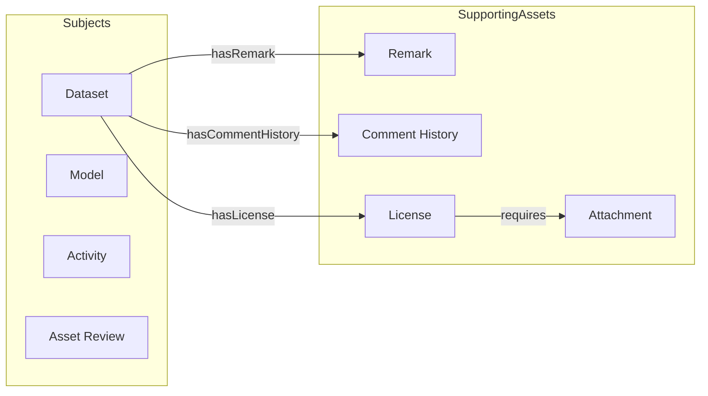
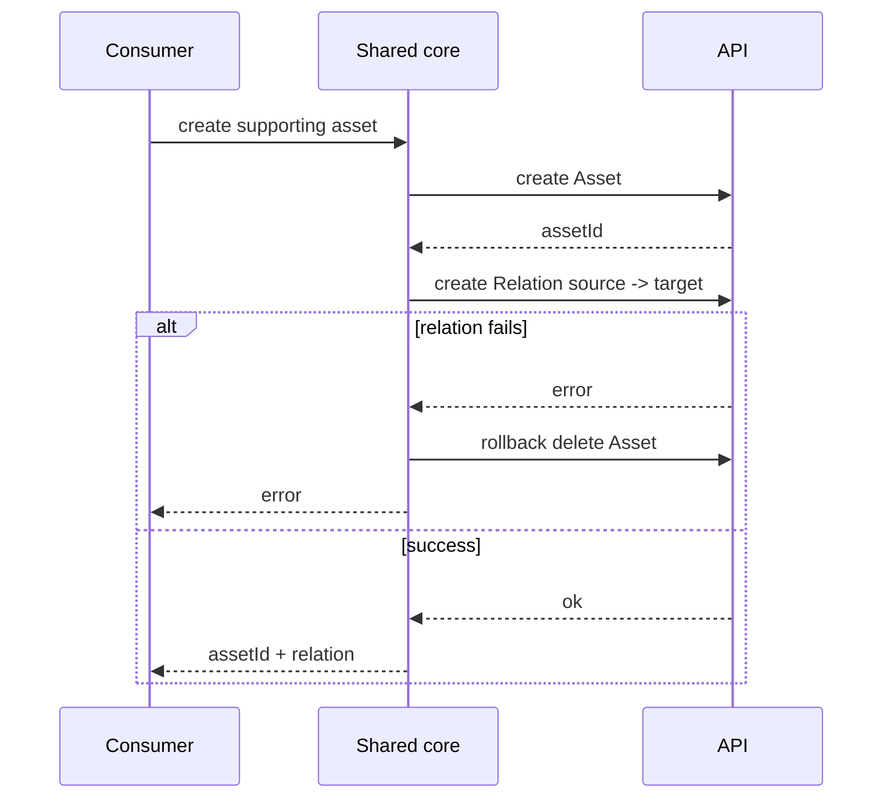
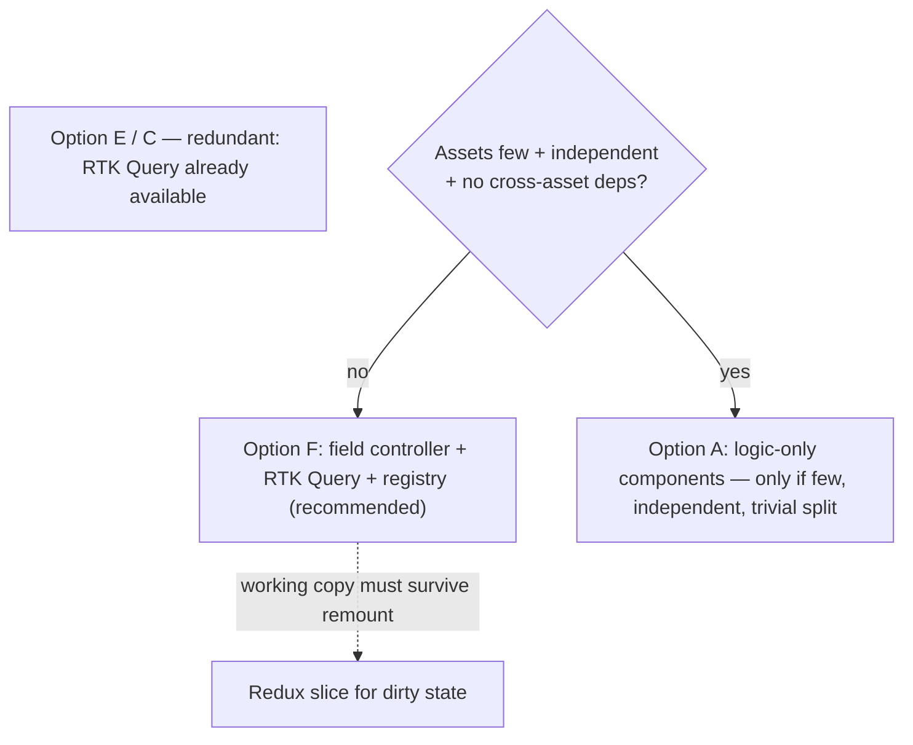

# Comparison — related-asset fetching

Stack note: the project mandates **RTK Query + Redux**. Server state = RTK Query (cache
lives in the Redux store). TanStack Query is not in the picture. So options that
hand-roll a cache (C) or skip a server-state lib (E) are now redundant, not "dependency-free".

| Dimension | A: logic-only comps | C: provider + registry | D: RTK Query + registry (foundation) | E: dep-free controller | F: field controller (rec.) |
|---|---|---|---|---|---|
| Consumer API | render headless children | useRelatedAssets -> map | useRelatedAssets -> map | useRelatedAssets -> map | useRelatedAssets -> map of controllers |
| Server state | reimplemented in hook | reimplemented in provider | RTK Query (Redux store) | module cache | RTK Query (Redux store) |
| Working / dirty / commit | per-child hooks | generic in provider | missing (needs layer) | generic controller | generic useAssetField |
| Unique logic | child components (hooks) | module + Component | module | module (fetch/create/compare) | module (relationType/compare/validate) |
| Cross-asset deps | weakest (lift state) | middle (requires) | middle (skip) | middle (requires) | middle (skip on sibling value/isDirty) |
| Commit modes | manual per child | manual | manual | autoSave flag | autoSave flag (submit / on-change) |
| New dependencies | none | none | none (already there) | none | none (already there) |
| Hook-friendliness | best | middle | best | best | best (stable-array caveat) |
| Up-front cost | low | medium | low | medium | medium |
| Risk to watch | null-return plumbing + coordination | re-render granularity | rules-of-hooks loop | mini-cache + dirty footguns | working-copy reset + Redux-vs-local |

## Decision drivers

1. **RTK Query + Redux are mandated.** So F is the natural answer: RTK Query for the
   baseline, a generic controller for dirty/commit, a registry for per-type uniqueness.
2. **Dirty/change flow present?** (It is.) This pushes the dirty/working/commit layer
   into the shared core — F's whole point.
3. **Where does the working copy live?** Local `useState` (transient, recommended) vs a
   Redux slice (if it must survive remount or be shared). Settle before building.
4. **Cross-asset deps common?** Rare -> A. Common/deep -> F.

## Recommended answer

**F — field controller + RTK Query + registry.** Zero new dependencies (RTK Query +
Redux already mandated), the dirty/working/commit layer lives once in the shared core,
and per-type uniqueness stays a small registry module.

Choose A only if assets are few, independent, and the form/standalone split is trivial.
D is the foundation of F, not a full answer. C and E are redundant given RTK Query is
already available.

## Suggested next step

Prototype `useAssetField` on RTK Query for one form-field type (Remark) and one
standalone type (Comment History): prove reset-on-load, isDirty, tag invalidation, and
both commit modes. Settle the Redux-vs-local working-copy decision in that prototype.

## Diagrams

### Domain model

### Shared write + rollback (all options reuse this)

### Decision tree

