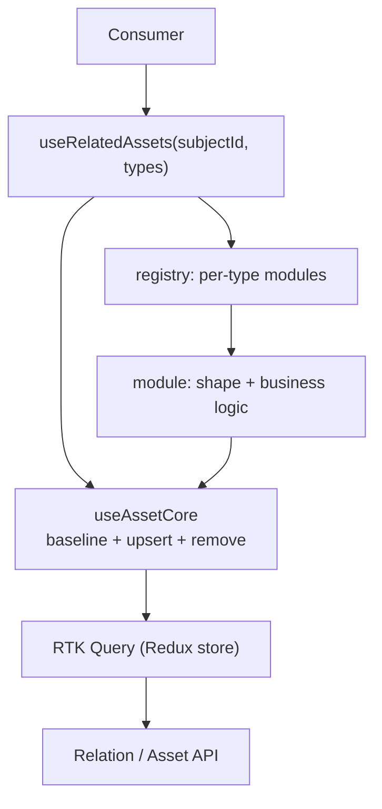

# Option F — design (for humans)

## The problem in one line

Every screen shows and edits "supporting assets" (Remark, Comment History, License...)
attached to a subject (Dataset, Model, Activity, Review). Fetching and saving each one
repeats the same dance: read relation ids -> hydrate assets; and the same save: upsert
the asset -> ensure the relation. Today that logic is copy-pasted into `useRemark`,
`useCommentHistory`, ... and every consumer has to call them all.

## The big idea

Treat each supporting asset as a **server-backed field**. Fetching, caching, and saving
live ONCE in a shared core. What makes Remark different from Comment History — its shape
(one value vs a list) — lives in a small **module** per type.
The consumer declares which types it wants and gets a controller for each:

```
useRelatedAssets(subjectId, ['REMARK', 'LICENSE'])
// { REMARK: { items, add, remove, save, isDirty },
//   LICENSE: { value, setValue, save, isDirty } }
```

## The three layers



1. **RTK Query** — the server state. Fetch, cache, refetch, tag invalidation. Already
   mandated in the project; we do not rebuild it.
2. **The core** (`useAssetCore`) — one thin hook per type that hands each module
   `baseline`, `upsert`, `remove`. Never changes when a new type arrives.
3. **The module** — one per type. Declares its relation name, its shape, and its
   `useController` (working copy + dirty + save). This is the only thing that changes
   when a new asset arrives.

## Why these choices

- **RTK Query for the baseline** — already mandated; zero new dependencies; tags do the
  write->refetch loop automatically.
- **The module owns the shape** — because assets are 1..1 (License) or 1..n (Comment
  History). A single "value" shape would be wrong for lists, so each module picks
  `single`, `many`, or `readonly`.
- **Upsert, not create** — editing an existing asset must update it and ensure the
  relation, not duplicate it.
- **Working copy in local state** — it is transient form state; a Redux slice is only an
  escape hatch, not the default.
- **Per-file registration** — new type = new file + register; nobody edits a shared map.

## What you get vs what you give up

**Get:** one place for the fetch/save logic; a consumer that declares types instead of
calling N hooks; new types are pure additions.

**Give up:** the `many` shape needs a diff-based save (added/removed/changed); dependencies
(License needs Attachment) need careful ordering; and reset-on-load vs in-flight edits is
the one subtle bug to watch.

## The three shapes in one glance (no enum — the return shape is the shape)

| Shape | Cardinality | Controller |
|---|---|---|
| single | 1..1 | `{ value, setValue, isDirty, save, reset }` |
| many | 1..n | `{ items, add, update, remove, isDirty, save }` |
| readonly | display only | `{ data, refetch, isLoading, error }` |

## Still open (settle during prototype)

1. Working-state placement — local `useState` (default) vs Redux slice.
2. Whether `requires` gating is needed at fetch time, or only at save time.

## Migration

Keep `useRemark` as a one-line wrapper over the new core during migration; swap
consumers screen by screen, no big-bang rewrite.
